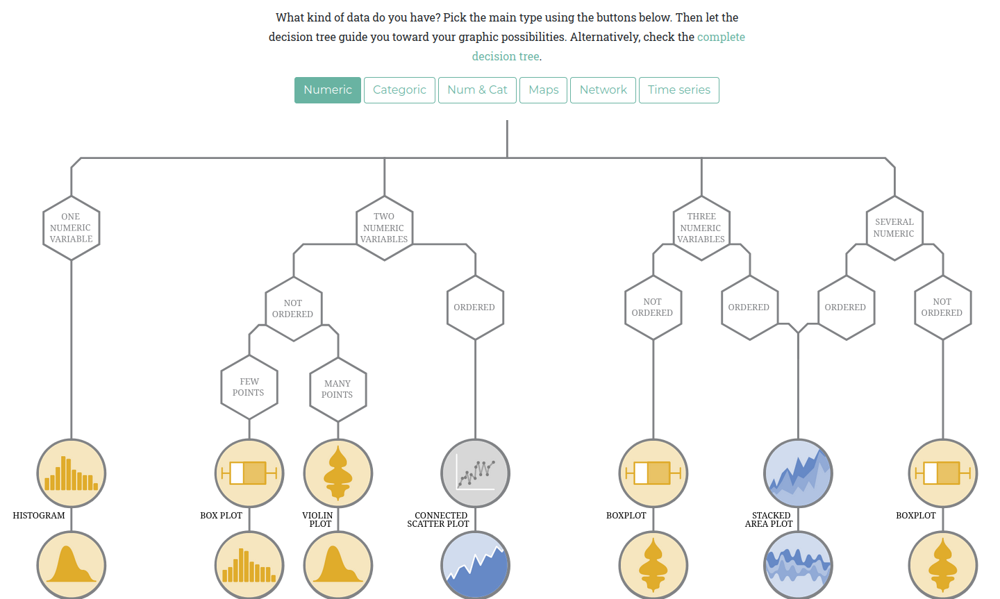

```{r setup, include=FALSE}
library(tidyverse)
library(stringi)
library(ggthemes)
library(kableExtra)
library(knitr)
library(ggdist)
library(patchwork)
options("kableExtra.html.bsTable" = T)
knitr::opts_chunk$set(echo = TRUE,
                      comment= NA,
                      warning = FALSE,
                      message = FALSE)


theme_set(
  theme_gray(base_size = 17) +
    theme(plot.background = element_rect(fill = "transparent", colour = NA)))


d_spellname <- read_csv("data/spellname.csv")


d_spellname <- summarise(d_spellname, 
                      rt = mean(rt),
                      dur = mean(dur),
                      .by = c(ppt_id, name_familiarised, ppt_vocab, modality)) %>% 
    mutate(across(name_familiarised, ~case_when(. ~ "familiar name",
                                              !. ~ "unfamiliar name")),
         group = str_c("Modality: ", modality, "; ", name_familiarised)) 
```


## General outline for weeks 2 -- 5

- ~~Week 2: Principles of data visualisation~~
- ~~Week 3: Grammar of graphics; aesthetics and attributes~~
- Week 4: Major visualisation tools
- Week 5: Customising visualisations (scales, themes, and labels)

## Checking up on the formative assessment

- Identify a data set for formative assessment.
- Work on visualisation for your data set.


## Objectives for today

- Appreciate the wide range of different visualisation tools 
- Understand and explain what "geometries" are.
- Differentiate three major visualisation tools, when to use them, and how to create them in `ggplot2`.
- Explain why barplots are problematic for certain data types.
- Use data wrangling to adjust data to your visualisation goals.

Download exercises from Week 4 folder on NOW and move them into your R-project directory.


<!-- include plotly in slides -->
<!-- explain geometries in more details -->


## Warm-up

From the top of your head, what types of data visualisations have you seen in journal articles / news / social media etc.?


## The list goes on forever {.smaller}

**Basic Charts**

- Bar Chart: compares quantities across categories.  
- Column Chart: vertical version of a bar chart.  
- Line Chart: shows trends over time.  
- Pie Chart: shows proportions of a whole.  
- Donut Chart: like a pie chart but with a blank center.  
- Area Chart: like a line chart but filled below the line.  

**Statistical Visualisations**

- Histogram: shows distribution of numerical data.  
- Box Plot (Box-and-Whisker Plot): displays data spread and outliers.  
- Violin Plot: combines box plot and density plot.  
- Scatter Plot: shows relationships between two variables.  
- Bubble Chart: scatter plot with a third variable represented by bubble size.  

**Multivariate Visualisations**

- Heatmap: uses color to represent values in a matrix.  
- Pair Plot: shows scatter plots for all variable combinations.  
- Parallel Coordinates Plot: compares many variables across observations.  
- Radar Chart (Spider Chart): compares multiple variables on axes from a central point.  

**Geospatial Visualisations**

- Choropleth Map: uses color to show data across geographic regions.  
- Dot Map: uses dots to show data density.  
- Heat Map (Geospatial): shows intensity of data over a map.  
- Flow Map: shows movement between locations.  

**Hierarchical & Network Visualisations**

- Tree Map: nested rectangles showing hierarchical data.  
- Sunburst Chart: radial version of a tree map.  
- Dendrogram: tree diagram showing hierarchical clustering.  
- Network Graph: shows relationships between entities (nodes and edges).  
- Sankey Diagram: shows flow and proportions between stages.  

**Temporal Visualisations**

- Gantt Chart: shows project timelines.  
- Timeline: displays events in chronological order.  
- Calendar Heatmap: shows data across days/weeks/months.  

**Specialised Visualisations**

- Word Cloud: visualises text data by word frequency.  
- Contour Plot: shows 3D surface on 2D plane.  
- Streamgraph: variation of stacked area chart for time series.  
- Ternary Plot: shows proportions of three variables that sum to a constant.

## Here with some more system

Decision tree from [data-to-viz.com/](https://www.data-to-viz.com/)

```{r echo = F}

```


# Major visualisation tools


## Geometries

- choice depends on visualisation goals, number and type of variables (and your subject domain)
- what kind of visual element you want to draw?
- a geometry (or geom) is the type of plot layer that tells *R* how to represent the data visually.

Think of it like this:

- you have data (e.g., heights of children, test scores, etc.).
- you want to show it visually.
- the **geom** decides *how* it appears: as points, lines, bars, boxes, etc.
- **geoms** are your drawing toolkit


## Geometries

- Geometries (`geom_`) control visual encoding of aesthetics layer
- ~50 geometries: `geom_` are part of `ggplot2` (below)
- more `geoms` in other packages such as `ggdist`, `ggbeeswarm`, and `ggridges`
- many can be combined


```{r echo = F}
env <- asNamespace("ggplot2")
all_geoms <- ls(envir = env, pattern = "^geom_+")
geoms <- tolower(gsub("geom_", "", all_geoms))
#which(!(geoms %in% c("annotationmap", "col", "sf", "spoke")))

print(geoms, quote = F)
```


## Common geometries and their uses

| Geometry         | Function       | What it shows                                      |
|------------------|----------------|----------------------------------------------------|
| `geom_point()`   | Scatter plot   | Relationship between two variables                 |
| `geom_line()`    | Line plot      | Trends over time or ordered categories             |
| `geom_bar()`     | Bar chart      | Counts or values for categories                    |
| `geom_histogram()`| Histogram     | Distribution of a single variable                  |
| `geom_boxplot()` | Boxplot        | Summary of distribution (median, quartiles, outliers) |
| `geom_text()`    | Text labels    | Add labels to points or bars                       |

## Same data, different geometries

```{r echo = F, fig.width=10, fig.height=4.5}
plot <- ggplot(d_spellname, aes(x = dur)) +
  theme(plot.subtitle = element_text(size = 11),
        axis.text = element_text(size = 8),
        axis.title = element_text(size = 9))

plot_a <- plot + geom_histogram() + labs(subtitle = "Histogram")
plot_b <- plot + geom_density() + labs(subtitle = "Density plot")
plot_c <- plot + geom_freqpoly() + labs(subtitle = "Frequency polygon")
plot_d <- plot + geom_blur_dots() + labs(subtitle = "Blurry dot plot")
plot_e <- plot + stat_halfeye() + labs(subtitle = "Half-eye plot")

plot_a + plot_b + plot_c + plot_d + plot_e + plot_spacer() +
  plot_annotation(tag_levels = "A")
```


## Major visualisation types

- univariate distributions
- bivariate distributions 
- group comparisons


## Univariate distribution

<div style="float: left; width: 40%;">

- function: distribution of values
- variable type: continuous or discrete
- examples: histograms, density plots, bar plots, rug

</div>

<div style="float: right; width: 50%;">

```{r echo=F, out.width="100%"}
ggplot(d_spellname, aes(x = rt)) +
  geom_histogram() 
```

```{r eval=F, out.width="100%"}
ggplot(d_spellname, aes(x = rt)) +
  geom_histogram() 
```

</div>

## Univariate distribution

Complete RMarkdown document **1_univariate_viz.Rmd**

## Bivariate distribution

<div style="float: left; width: 30%;">

- function: relationship between two variables
- variable type: typically continuous
- examples: scatter plot, time series

</div>

<div style="float: right; width: 65%;">


```{r  out.width="100%", echo = FALSE, results=FALSE}
ggplot(data = d_spellname, mapping = aes(x = dur, y = rt)) +
  geom_point() +
  stat_smooth(method = "lm") 
```
</div>


## Bivariate distribution

<div style="float: left; width: 30%;">

- function: relationship between two variables
- variable type: typically continuous
- examples: scatter plot, time series

</div>

<div style="float: right; width: 65%;">


```{r  out.width="100%", echo = FALSE, results=FALSE}

years <- 1949:1960

AirPassengers %>% 
  as.data.frame() %>% 
  mutate(year = rep(years, each = 12),
         month = rep(month(1:12, label = T), length(years)),
         time = str_c(month, year, sep = " ")) %>% 
#time = as.Date(time, format = "%m %Y" ))# %>% 
  ggplot(aes(x = year, y = x, colour = month)) +
    geom_point() +
    stat_smooth() +
    labs(y = "number of airline passengers",
         caption = "Box, G. E. P., Jenkins, G. M. and Reinsel, G. C. (1976) Time Series Analysis, \nForecasting and Control. Third Edition. Holden-Day. Series G.") +
  theme(plot.caption = element_text(size = 8))
    


```
</div>

## Bivariate distribution

<div style="float: left; width: 30%;">

- function: relationship between two variables
- variable type: typically continuous
- examples: scatter plot, time series

</div>

<div style="float: right; width: 65%;">


```{r  out.width="100%", echo = FALSE, results=FALSE}
ggplot(data = d_spellname, mapping = aes(x = dur, y = rt)) +
  geom_point() +
  stat_smooth(method = "lm") 
```
</div>


## Bivariate distribution

<div style="float: left; width: 30%;">

- function: relationship between two variables
- variable type: typically continuous
- examples: scatter plot, time series

</div>

<div style="float: right; width: 65%;">


```{r echo=F, results=F}
p <- ggplot(data = d_spellname, mapping = aes(x = dur, y = rt)) +
  geom_point() +
  stat_smooth(method = "lm") 
```


```{r  out.width="100%", echo = FALSE, results=FALSE}
ggExtra::ggMarginal(p)
```
</div>


## Bivariate distribution

<div style="float: left; width: 30%;">

- function: relationship between two variables
- variable type: typically continuous
- examples: scatter plot, time series

</div>

<div style="float: right; width: 65%;">


```{r  out.width="100%", echo = FALSE, results=FALSE}
ggplot(data = d_spellname, mapping = aes(x = dur, y = rt)) +
  geom_density_2d()
```
</div>


## Bivariate distribution

<div style="float: left; width: 30%;">

- function: relationship between two variables
- variable type: typically continuous
- examples: scatter plot, time series

</div>

<div style="float: right; width: 65%;">


```{r  out.width="100%", echo = FALSE, results=FALSE}
ggplot(data = d_spellname, mapping = aes(x = dur, y = rt)) +
 geom_density_2d_filled()
```
</div>


## Bivariate distribution

<div style="float: left; width: 30%;">

- function: relationship between two variables
- variable type: typically continuous
- examples: scatter plot, time series

</div>

<div style="float: right; width: 65%;">


```{r  out.width="100%", echo = FALSE, results=FALSE}
read_csv("data/spellname.csv") %>% 
  select(resp, nsyl, nchar, nphon, cat, semcat, name_div) %>% 
  drop_na() %>% 
  count(nchar, nphon) %>% 
  ggplot(aes(x = nchar, y = nphon, fill = n)) +
  geom_tile(colour = "grey90") 
```
</div>


## Bivariate distributions: interactivity {.columns-2}

Any `ggplot2` object can easily be transformed into an interactive visualisation using the `plotly` package.

```{r fig.width=4, eval = F}
# Load plotly package
library(plotly)

# Create ggplot plot and save in `plot`
plot <- ggplot(d_spellname, aes(x = dur, y = rt)) +
  geom_point()

# Create an interactive version of `plot` using `ggplotly`
ggplotly(plot)
```


```{r fig.width=5, echo = F}
# Load plotly package
library(plotly)

# Create ggplot plot and save in `plot`
plot <- ggplot(d_spellname, aes(x = dur, y = rt)) +
  geom_point()

# Create an interactive version of `plot` using `ggplotly`
ggplotly(plot)
```


## Bivariate distribution

Complete RMarkdown document **2_bivariate_viz.Rmd**


## Groups comparison

- function: distribution of values for two or more groups (often closely tied to statistical descriptions)
- variable type: continuous 
- examples: (jitter) dots, box plot, violin plot, beeswarm plots, barplot (pie chart), dynamite plots


## Dynamite plot and its pitfalls

<div style="float: left; width: 40%;">

What problems can you think of? 

What's possibly problematic with this visualisation?

</div>

<div style="float: right; width: 55%;">


```{r  out.width="100%", echo = FALSE, results=FALSE}
ggplot(data = d_spellname, aes(y = rt, x = modality)) +
  stat_summary(fun.y = mean, geom = "bar") +
  stat_summary(fun.data = mean_sdl, 
               fun.args = list(mult = 1), 
               geom = "errorbar", width = .35) +
  labs(y = "Reaction time (in msecs)", x = "Response modality") 
```

</div>


## Dynamite plot and its pitfalls

<div style="float: left; width: 40%;">

Visualisation suggests $\dots$

- normal distribution
- same number of observations in each group
- presence of data where there are none?
- absence of data above the errorbars 

Now watch what happens to the y-axis when we use dots.

</div>

<div style="float: right; width: 55%;">


```{r  out.width="100%", echo = FALSE, results=FALSE}
ggplot(data = d_spellname, aes(y = rt, x = modality)) +
  stat_summary(fun.y = mean, geom = "bar") +
  stat_summary(fun.data = mean_sdl, 
               fun.args = list(mult = 1), 
               geom = "errorbar", width = .35) +
  labs(y = "Reaction time (in msecs)", x = "Response modality") 
```

</div>


## Dynamite plots: bars

```{r  out.width="65%", echo = FALSE, results=FALSE}
ggplot(data = d_spellname, aes(y = rt, x = modality)) +
  stat_summary(fun.y = mean, geom = "bar") +
  stat_summary(fun.data = mean_sdl, 
               fun.args = list(mult = 1), 
               geom = "errorbar", width = .35) +
  labs(y = "Reaction time (in msecs)", x = "Response modality") 
```

## Alternative geometries: points

```{r  out.width="65%", echo = FALSE, results=FALSE}
ggplot(data = d_spellname, aes(y = rt, x = modality)) +
  geom_point(size = .5) +
  labs(y = "Reaction time (in msecs)", x = "Response modality") 
```


## Alternative geometries: jittered points


```{r  out.width="65%", echo = FALSE, results=FALSE}
ggplot(data = d_spellname, aes(y = rt, x = modality)) +
  geom_jitter(width = .1, size = .5) +
  labs(y = "Reaction time (in msecs)", x = "Response modality") 
```


## Alternative geometries: points and errorbars


```{r  out.width="65%", echo = FALSE, results=FALSE}
ggplot(data = d_spellname, aes(y = rt, x = modality)) +
  geom_jitter(width = 0.1, size = .5, alpha = .25) + 
  stat_summary(fun.y = mean, 
               geom = "point",
               col = "darkred",
               size = 3) +
  stat_summary(fun.data = mean_sdl, 
               fun.args = list(mult = 1), 
               geom = "errorbar", 
               col = "darkred",
               width = .15) +
  labs(y = "Reaction time (in msecs)", x = "Response modality") 
```


## Alternative geometries: box-and-whiskers plot


```{r  out.width="65%", echo = FALSE, results=FALSE}
ggplot(data = d_spellname, aes(y = rt, x = modality)) +
  geom_boxplot(width = .25) +
  labs(y = "Reaction time (in msecs)", x = "Response modality") 
```

## Alternative geometries: box-and-whiskers plot


```{r  out.width="65%", echo = FALSE, results=FALSE}
ggplot(data = d_spellname, aes(y = rt, x = modality)) +
  geom_jitter(width = .1, size = .5) +
  geom_boxplot(width = .25, outlier.shape = NA, alpha = .35) +
  labs(y = "Reaction time (in msecs)", x = "Response modality") 
```


## Alternative geometries: box-and-whiskers plot

```{r fig.cap="See @tukey1977exploratory", echo = F}
include_graphics("gfx/boxplot.png")
```


## Raincloud plots {.columns-2 .smaller}

```{r fig.width=5}
library(ggdist)

ggplot(d_spellname, aes(x = modality, y = rt)) +
  # half violin (the "cloud")
  stat_halfeye(
    adjust = 0.45,        # smoothness
    justification = -0.2, # shift left/right
    .width = 0,           # no interval bars
    point_colour = NA) +
  # boxplot
  geom_boxplot(
    width = 0.15,
    outlier.shape = NA,
    alpha = 0.5) +
  # jittered points (the "rain")
  geom_jitter(
    width = 0.1,
    alpha = 0.5,
    size = 1) +
  coord_flip() # horizontal orientation 
```


## Group comparisons

Complete RMarkdown document **3_group_comparisons.Rmd**


## Crash course in data wrangling {.smaller}

- Data come in various formats.
- For some visualisations, the format of the data needs to be changed.

You've already seen these:

```{r eval = F}
# Count number of identical observations 
count(data, group)

# Calculate descriptive statistics
summarise(data, mean = mean(rt))

# Remove rows with missing data (i.e. NA) 
drop_na()
```

These wrangling tasks can be managed in `ggplot` and `tidyverse`, more specifically `dplyr`.  

## Crash course in data wrangling {.smaller}

- `dplyr` has many useful functions for data wrangling.
- Knowing the following functions will give you a lot of flexibility.

```{r eval = F}
# Transforms dataframes into a long format
pivot_longer(data, cols)

# Transforms dataframes into a wide format
pivot_wider(data, names_from, values_from)

# Selects and removes variables
select(data, var1, var2)

# Retains and removes observations
filter(data, condition)

# Creates new variables
mutate(data, new_var = old_var)
```


Complete RMarkdown document **4_data_wrangling.Rmd**


## Homework

- Complete RMarkdown document **4_data_wrangling.Rmd**
- Bring in data and anything you've already done for the formative assessment.
- Complete recommended reading

## Recommended Reading

For support with this week's material, use:

- @andrews2021doing, Chapter 4: data visualisation in R. [Online chapter](https://www.mjandrews.org/book/ddsr/assets/chapter_04_visualization.pdf)
- @andrews2021doing, Chapter 3: data wrangling in R. [Online chapter](https://github.com/mark-andrews/ddsr/releases/download/v22.7.31/chapter_03_wrangling.pdf)
- @wickham2016r, data visualisation and transformation chapters as optional extra support. [Data visualisation](https://r4ds.had.co.nz/data-visualisation.html); [data transformation](https://r4ds.had.co.nz/transform.html)


## References

<style>
slides > slide { overflow: scroll; }
slides > slide:not(.nobackground):after {
  content: '';
}
</style>

