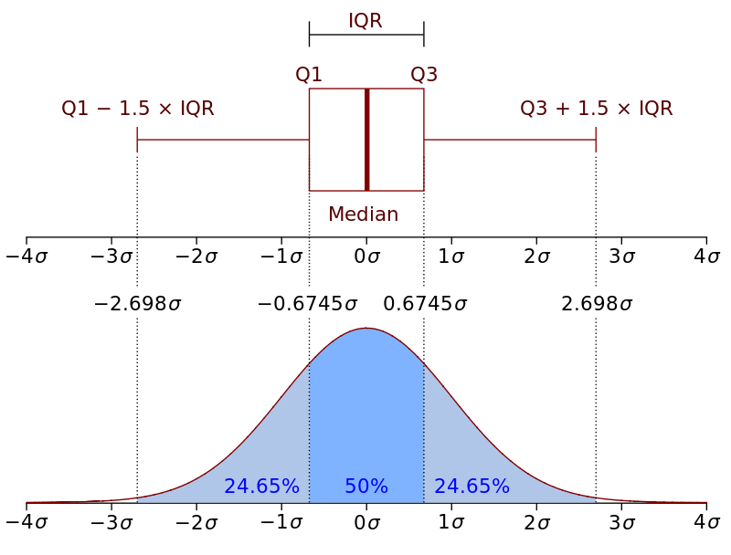

```{r setup, include=FALSE}
library(tidyverse)
library(stringi)
library(ggthemes)
library(kableExtra)
library(knitr)
library(ggdist)
library(patchwork)
options("kableExtra.html.bsTable" = T)
knitr::opts_chunk$set(echo = TRUE,
                      comment= NA,
                      warning = FALSE,
                      message = FALSE)


theme_set(
  theme_gray(base_size = 17) +
    theme(plot.background = element_rect(fill = "transparent", colour = NA)))


d_spellname <- read_csv("data/spellname.csv")


d_spellname <- summarise(d_spellname, 
                      rt = mean(rt),
                      dur = mean(dur),
                      .by = c(ppt_id, name_familiarised, ppt_vocab, modality)) %>% 
    mutate(across(name_familiarised, ~case_when(. ~ "familiar name",
                                              !. ~ "unfamiliar name")),
         group = str_c("Modality: ", modality, "; ", name_familiarised)) 
```


## Get The Week 4 Exercise Files

From the **Week 4 section on NOW**, download:

`psyc40940-week-04-major-visualisation-tools.zip`

1. Unzip the download and move the extracted `week-04-major-visualisation-tools` folder into your **existing module RStudio Project folder**.
2. Keep the `.Rmd` files, `data` folder, and supporting files together. Do not work inside the zip file.
3. Have `01_choosing_plot_types.Rmd` ready in RStudio for the first practical.


## From Grammar To Plot Choice

- ~~Week 2: Principles of data visualisation~~
- ~~Week 3: Grammar of graphics; aesthetics and attributes~~
- Week 4: Major visualisation tools
- Week 5: Customising visualisations (scales, themes, and labels)

## What You Should Take Away

By the end of the session, you should be able to:

- choose a geometry based on the question and variable types
- compare options for distributions, relationships, and group comparisons
- recognise when a summary plot hides important variation
- use simple data wrangling when it makes a clearer plot possible

## Before thinking about code, look at the plot first.

<div style="float: left; width: 38%;">


- What is this plot trying to compare?
- Which group seems faster or slower?
- What makes the comparison easy?
- What makes the comparison difficult?
- What would you try instead?

</div>

<div style="float: right; width: 58%;">

```{r echo = FALSE, out.width="100%", fig.height=5}
ggplot(d_spellname, aes(x = rt, fill = modality)) +
  geom_histogram(alpha = 0.55,
                 position = "identity",
                 bins = 30,
                 colour = "white") +
  labs(x = "Reaction time (in msecs)",
       y = "Number of participants",
       fill = "Response modality") +
  theme(legend.position = "top")
```

</div>


## Start With Question And Variable Type

Start with the question and the variables involved.

| Question | Typical variable types | Useful starting point |
|---|---|---|
| What values occur? | one continuous variable | histogram, density plot |
| Are two measures related? | two continuous variables | scatterplot |
| Do groups differ? | categorical group + continuous outcome | jitter/boxplot/violin |
| How many observations are in each group? | one categorical variable | bar plot |

<p class="take-home">Plot type follows the question and variable types, not the other way round.</p>


## Variable Type Is A Plot Choice Shortcut

Identify whether each variable is continuous or categorical.

| Variable combination | What it supports | Examples |
|---|---|---|
| one continuous variable | distribution of values | histogram, density plot |
| one categorical variable | counts or proportions | bar chart |
| continuous + continuous | relationship | scatterplot, density contours |
| categorical + continuous | group comparison | jitter, boxplot, violin, raincloud |
| categorical + categorical | counts across groups | grouped bar chart, heatmap |

<p class="take-home">The geom should match the structure of the variables you want to compare.</p>


## The Main Question For Every Plot

For each visualisation today, ask three things:

- What question does this plot answer?
- What does this plot reveal clearly?
- What does this plot hide or make difficult to compare?

<p class="take-home">A plot type is a design decision: it makes some comparisons easier and others harder.</p>


## Week 2 Principles, Week 4 Decisions

We used principles as a checklist for judging plots [@hartwig1979exploratory; @tufte1983visual; @cleveland1984graphical]. This week we use the same checklist to choose plot types.

| Week 2 principle | Week 4 plot-choice question |
|---|---|
| Show the data and variation | Do we need raw points, distributions, or uncertainty? |
| Make comparisons easy | Which plot makes the target comparison quickest to see? |
| Avoid misleading summaries | What does this plot hide, average away, or imply? |
| Label enough for interpretation | Are variables, groups, and units clear? |

<p class="take-home">Choosing a plot type is how we put the Week 2 principles into practice.</p>


<!-- include plotly in slides -->
<!-- explain geometries in more details -->


## What Plot Types Do You Know?

What types of data visualisations have you seen in journal articles, news, reports, dashboards, or social media?

You do not need to know the correct name. Describe or sketch the idea: what does it look like, and what does it seem to show?


## A Snapshot Of The Visualisation Landscape {.smaller}

There are many named chart types. We will not read or memorise this list. Use it as a quick reminder that visualisation tools vary with the question, the variables, and the data structure.

<div style="float: left; width: 32%;">

**Amounts and proportions**

- bar chart
- column chart
- stacked bar chart
- pie chart
- donut chart
- waffle chart

**Distributions**

- histogram
- density plot
- frequency polygon
- box plot
- violin plot
- raincloud plot

</div>

<div style="float: left; width: 32%; margin-left: 2%;">

**Relationships**

- scatterplot
- bubble chart
- line chart
- contour plot
- heatmap
- pair plot

**Change over time**

- time-series line chart
- area chart
- streamgraph
- timeline
- calendar heatmap
- Gantt chart

</div>

<div style="float: right; width: 32%;">

**Places, networks, and structures**

- choropleth map
- dot map
- flow map
- treemap
- sunburst chart
- dendrogram
- network graph
- Sankey diagram
- parallel coordinates
- radar chart
- word cloud
- ternary plot

</div>

<p style="clear: both;" class="take-home">The name matters less than the comparison: What are we trying to see?</p>


## A Decision Tree For Plot Choice [data-to-viz.com/](https://www.data-to-viz.com/)

```{r echo = F}
include_graphics("gfx/dataviz.png")
```


# Choosing Visualisation Tools


## Geoms Are Drawing Tools

- choice depends on visualisation goals, number and type of variables (and your subject domain)
- what kind of visual element you want to draw?
- a geometry (or geom) is the type of plot layer that tells *R* how to represent the data visually.

Think of it like this:

- you have data (e.g., heights of children, test scores, etc.).
- you want to show it visually.
- the **geom** decides *how* it appears: as points, lines, bars, boxes, etc.
- **geoms** are your drawing toolkit


## `ggplot2` Has Many Geoms

- Geometries (`geom_`) control visual encoding of aesthetics layer
- ~50 geometries: `geom_` are part of `ggplot2` (below)
- more `geoms` in other packages such as `ggdist`, `ggbeeswarm`, and `ggridges`
- many can be combined


```{r echo = F}
env <- asNamespace("ggplot2")
all_geoms <- ls(envir = env, pattern = "^geom_+")
geoms <- tolower(gsub("geom_", "", all_geoms))
#which(!(geoms %in% c("annotationmap", "col", "sf", "spoke")))

print(geoms, quote = F)
```


## Common Geoms And What They Show

Use geometries as tools for comparison, not as a menu of effects.

| Geometry         | Function       | What it shows                                      |
|------------------|----------------|----------------------------------------------------|
| `geom_point()`   | Scatter plot   | Relationship between two variables                 |
| `geom_line()`    | Line plot      | Trends over time or ordered categories             |
| `geom_bar()`     | Bar chart      | Counts or values for categories                    |
| `geom_histogram()`| Histogram     | Distribution of a single variable                  |
| `geom_boxplot()` | Boxplot        | Summary of distribution (median, quartiles, outliers) |
| `geom_text()`    | Text labels    | Add labels to points or bars                       |

## Same Data, Different Views

```{r echo = F, fig.width=10, fig.height=4.5}
plot <- ggplot(d_spellname, aes(x = dur)) +
  theme(plot.subtitle = element_text(size = 11),
        axis.text = element_text(size = 8),
        axis.title = element_text(size = 9))

plot_a <- plot + geom_histogram() + labs(subtitle = "Histogram")
plot_b <- plot + geom_density() + labs(subtitle = "Density plot")
plot_c <- plot + geom_freqpoly() + labs(subtitle = "Frequency polygon")
plot_d <- plot + geom_blur_dots() + labs(subtitle = "Blurry dot plot")
plot_e <- plot + stat_halfeye() + labs(subtitle = "Half-eye plot")

plot_a + plot_b + plot_c + plot_d + plot_e + plot_spacer() +
  plot_annotation(tag_levels = "A")
```


## Three Plotting Problems We Will Practise

- Univariate distributions
- Bivariate distributions 
- Group comparisons


## Show One Variable: Histograms {.smaller}

A histogram answers: what values occur, and how often? It reveals distribution shape, but the answer depends on binning.

<div style="float: left; width: 43%;">

```{r ex_hist_code, eval=FALSE}
ggplot(data = d_spellname,
       mapping = aes(x = rt)) +
  geom_histogram(bins = 30)
```

</div>

<div style="float: right; width: 52%;">

```{r ex_hist_plot, ref.label="ex_hist_code", echo=FALSE, out.width="100%", fig.height=3.8}
```

</div>


## Exercise 1: Choosing Plot Types

Open **01_choosing_plot_types.Rmd**.

Complete now:

- Load packages and data
- Question 1: distribution of age
- Choose between histogram and scatterplot for the age question
- Question 2: distribution of reaction times

Stop before Question 3.

## Scatterplots: Points And Trends {.smaller}

A scatterplot answers: do two continuous variables vary together? It reveals individual observations, but dense regions can overplot.

Both variables are shown by position on shared axes, supporting accurate comparisons of values [@cleveland1984graphical].

A trend line summarises the overall direction, but can hide local variation. Keep the individual points visible.

<div style="float: left; width: 43%;">

```{r ex_scatter_code, eval=FALSE}
ggplot(data = d_spellname,
       mapping = aes(x = dur,
                     y = rt)) +
  geom_point() +
  stat_smooth(method = "lm")
```

</div>

<div style="float: right; width: 52%;">

```{r ex_scatter_plot, ref.label="ex_scatter_code", echo=FALSE, out.width="100%", fig.height=3.8}
```

</div>


## Add Marginal Distributions {.smaller}

Marginal distributions answer two questions at once: how are the variables related, and how is each variable distributed?

<div style="float: left; width: 43%;">

```{r ex_marginal_code, eval=FALSE}
p <- ggplot(data = d_spellname,
       mapping = aes(x = dur,
                     y = rt)) +
  geom_point() +
  stat_smooth(method = "lm")

ggExtra::ggMarginal(p)
```

</div>

<div style="float: right; width: 52%;">

```{r ex_marginal_plot, ref.label="ex_marginal_code", echo=FALSE, out.width="100%", fig.height=3.8}
```

</div>


## Two-Dimensional Density Lines {.smaller}

Density lines answer: where are observations concentrated? They reveal clusters, but individual points disappear.

<div style="float: left; width: 43%;">

```{r ex_density_code, eval=FALSE}
ggplot(data = d_spellname,
       mapping = aes(x = dur,
                     y = rt)) +
  geom_density_2d()
```

</div>

<div style="float: right; width: 52%;">

```{r ex_density_plot, ref.label="ex_density_code", echo=FALSE, out.width="100%", fig.height=3.8}
```

</div>


## Filled Density Regions {.smaller}

Filled density regions answer the same question with colour. They reveal broad structure, but exact values become less visible.

<div style="float: left; width: 43%;">

```{r ex_filled_density_code, eval=FALSE}
ggplot(data = d_spellname,
       mapping = aes(x = dur,
                     y = rt)) +
  geom_density_2d_filled()
```

</div>

<div style="float: right; width: 52%;">

```{r ex_filled_density_plot, ref.label="ex_filled_density_code", echo=FALSE, out.width="100%", fig.height=3.8}
```

</div>


## Heatmaps Show Counts Across Two Variables {.smaller}

A heatmap answers: which combinations occur most often? It reveals counts across two dimensions, but not individual observations.

```{r echo = FALSE}
data_char <- read_csv("data/spellname.csv") %>%
  select(resp, nsyl, nchar, nphon, cat, semcat, name_div) %>%
  drop_na() %>%
  count(nchar, nphon)
```

<div style="float: left; width: 43%;">

```{r ex_heatmap_code, eval=FALSE}
ggplot(data = data_char,
       mapping = aes(x = nchar,
                     y = nphon,
                     fill = n)) +
  geom_tile(colour = "grey90")
```

</div>

<div style="float: right; width: 52%;">

```{r ex_heatmap_plot, ref.label="ex_heatmap_code", echo=FALSE, out.width="100%", fig.height=3.8}
```

</div>


## Optional Preview: Interactive Scatterplots {.smaller}

We will return to interactivity in the Shiny part of the module.

<div style="float: left; width: 43%;">

```{r ex_plotly_code, eval=FALSE}
library(plotly)

plot <- ggplot(data = d_spellname,
       mapping = aes(x = dur,
                     y = rt)) +
  geom_point()

ggplotly(plot)
```

</div>

<div style="float: right; width: 52%;">

```{r ex_plotly_plot, ref.label="ex_plotly_code", echo=FALSE, out.width="100%", fig.height=3.8}
```

</div>


## Ordered Data: Time Trends {.smaller}

A time plot answers: how does a value change across an ordered sequence? It reveals trends, cycles, and departures from the pattern.

```{r echo = FALSE}
passenger_data <- data.frame(
  passengers = as.numeric(AirPassengers),
  year = rep(1949:1960, each = 12),
  month = factor(rep(month.abb, times = 12), levels = month.abb)
)
```

<div style="float: left; width: 43%;">

```{r ex_time_code, eval=FALSE}
ggplot(data = passenger_data,
       mapping = aes(x = year,
                     y = passengers,
                     colour = month)) +
  geom_point() +
  stat_smooth()
```

</div>

<div style="float: right; width: 52%;">

```{r echo = FALSE, out.width="100%", fig.height=3.8}
ggplot(data = passenger_data,
       mapping = aes(x = year,
                     y = passengers,
                     colour = month)) +
  geom_point() +
  stat_smooth() +
  scale_x_continuous(breaks = 1949:1960)
```

</div>


## Same Data, Different Questions

Each plot changes the question we can answer. This is the Week 2 point again: plots reveal structure that summaries can leave out [@anscombe1973graphs; @matejka2017same].

| Plot choice | Strongest question | Main trade-off |
|---|---|---|
| Scatterplot | Do two variables vary together? | Can overplot dense data |
| Trend line | What is the overall pattern? | Hides individual variation |
| Marginal distributions | What is the relationship and each variable's spread? | More visually complex |
| Density or heatmap | Where are observations concentrated? | Individual observations disappear |

<p class="take-home">Choose the plot that makes the important comparison easiest to see.</p>


## Continue Exercise 1: Relationships

Return to **01_choosing_plot_types.Rmd**.

Complete now:

- Question 3: relationship between two reaction-time measures
- Choose between scatterplot and separate histograms for the relationship question
- Question 4: whether the relationship differs by group

If you finish early, complete the Principle check.


## Compare Groups Without Hiding The Data

- Compare a continuous outcome across categorical groups.
- Put groups in distinct positions on a common outcome scale; colour, shape, or facets can also distinguish groups.
- Add a group mapping only when it helps answer the question. Extra aesthetics can make comparison harder.

We will compare raw points, boxplots, and distribution plots to see what each reveals or hides.


## What Does This Plot Hide?

<div style="float: left; width: 40%;">

Look at the plot first, before thinking about code. Bar plots with error bars can make summaries feel more complete than they are [@correll2014error].

- What does this visualisation suggest?
- What information is missing?
- Can we see spread, outliers, or sample size?
- What would you add or change?

</div>

<div style="float: right; width: 55%;">


```{r  out.width="100%", echo = FALSE, results=FALSE}
ggplot(data = d_spellname, aes(y = rt, x = modality)) +
  stat_summary(fun.y = mean, geom = "bar") +
  stat_summary(fun.data = mean_sdl, 
               fun.args = list(mult = 1), 
               geom = "errorbar", width = .35) +
  labs(y = "Reaction time (in msecs)", x = "Response modality") 
```

</div>


## Why Dynamite Plots Can Mislead

<div style="float: left; width: 40%;">

Visualisation suggests $\dots$

- normal distribution
- same number of observations in each group
- presence of data where there are none?
- absence of data above the errorbars 

Now watch what happens to the y-axis when we use dots.

</div>

<div style="float: right; width: 55%;">


```{r  out.width="100%", echo = FALSE, results=FALSE}
ggplot(data = d_spellname, aes(y = rt, x = modality)) +
  stat_summary(fun.y = mean, geom = "bar") +
  stat_summary(fun.data = mean_sdl, 
               fun.args = list(mult = 1), 
               geom = "errorbar", width = .35) +
  labs(y = "Reaction time (in msecs)", x = "Response modality") 
```

</div>


## Summary Bars Hide Raw Variation

```{r  out.width="65%", echo = FALSE, results=FALSE}
ggplot(data = d_spellname, aes(y = rt, x = modality)) +
  stat_summary(fun.y = mean, geom = "bar") +
  stat_summary(fun.data = mean_sdl, 
               fun.args = list(mult = 1), 
               geom = "errorbar", width = .35) +
  labs(y = "Reaction time (in msecs)", x = "Response modality") 
```

## Raw Points Reveal Variation

```{r  out.width="65%", echo = FALSE, results=FALSE}
ggplot(data = d_spellname, aes(y = rt, x = modality)) +
  geom_point(size = .5) +
  labs(y = "Reaction time (in msecs)", x = "Response modality") 
```


## Jitter Reduces Overplotting


```{r  out.width="65%", echo = FALSE, results=FALSE}
ggplot(data = d_spellname, aes(y = rt, x = modality)) +
  geom_jitter(width = .1, size = .5) +
  labs(y = "Reaction time (in msecs)", x = "Response modality") 
```


## Combine Raw Data With Summary Estimates

The larger red point highlights the mean. Its size adds emphasis; it does not represent another measured quantity.

```{r out.width="65%", fig.width=7, fig.height=4.2, echo=FALSE, results=FALSE}
ggplot(data = d_spellname, aes(y = rt, x = modality)) +
  geom_jitter(width = 0.1, size = .5, alpha = .25) + 
  stat_summary(fun.y = mean, 
               geom = "point",
               col = "darkred",
               size = 3) +
  stat_summary(fun.data = mean_sdl, 
               fun.args = list(mult = 1), 
               geom = "errorbar", 
               col = "darkred",
               width = .15) +
  labs(y = "Reaction time (in msecs)", x = "Response modality") 
```


## Boxplots Summarise Distributions


```{r  out.width="65%", echo = FALSE, results=FALSE}
ggplot(data = d_spellname, aes(y = rt, x = modality)) +
  geom_boxplot(width = .25) +
  labs(y = "Reaction time (in msecs)", x = "Response modality") 
```

## Boxplots Work Better With Raw Points


```{r  out.width="65%", echo = FALSE, results=FALSE}
ggplot(data = d_spellname, aes(y = rt, x = modality)) +
  geom_jitter(width = .1, size = .5) +
  geom_boxplot(width = .25, outlier.shape = NA, alpha = .35) +
  labs(y = "Reaction time (in msecs)", x = "Response modality") 
```


## Reading A Boxplot {.smaller}

Boxplots were introduced as part of exploratory data analysis [@tukey1977exploratory]. They compress a distribution into a small set of robust summaries.

<div style="float: left; width: 44%;">

```{r fig.cap="See @tukey1977exploratory", echo = FALSE, out.width="100%"}

```

</div>

<div style="float: right; width: 50%;">

Read the parts as:

- **middle line:** median
- **box:** middle 50% of the data
- **lower edge:** first quartile, Q1
- **upper edge:** third quartile, Q3
- **box height:** interquartile range, IQR
- **whiskers:** values within 1.5 IQR from the box
- **points beyond whiskers:** possible outliers

<p class="take-home">A boxplot is compact, but it hides individual observations unless we add raw points.</p>

</div>


## Raincloud Plots: Distribution And Raw Data {.columns-2 .smaller}

```{r fig.width=4.5, fig.height=5}
library(ggdist)

ggplot(d_spellname, 
       aes(x = modality, y = rt)) +
  # half violin (the "cloud")
  stat_halfeye(
    adjust = 0.45,        # smoothness
    justification = -0.2, # horiz. shift 
    .width = 0,           # no interv bars
    point_colour = NA) +
  # boxplot
  geom_boxplot(
    width = 0.15,
    outlier.shape = NA,
    alpha = 0.5) +
  # jittered points (the "rain")
  geom_jitter(
    width = 0.1,
    alpha = 0.5,
    size = 1) +
  coord_flip() # horizontal orientation 
```


## Exercise 2: Group Comparisons

Open **02_group_comparisons_and_raw_data.Rmd**.

Complete the file and use the ranking task near the end to decide which plot is most honest for the question.


## Homework/Reference: Data Wrangling For Visualisation {.smaller}

This is homework/reference material.

- Data come in various formats.
- For some visualisations, the format of the data needs to be changed.

You've already seen these:

```{r eval = F}
# Count number of identical observations 
count(data, group)

# Calculate descriptive statistics
summarise(data, mean = mean(rt))

# Remove rows with missing data (i.e. NA) 
drop_na()
```

These wrangling tasks can be managed in `ggplot` and `tidyverse`, more specifically `dplyr`.  

## Wrangling Tools To Recognise {.smaller}

- `dplyr` and `tidyr` have useful functions for preparing data for plots.
- You do not need to master data wrangling in this module, but these tools are useful to recognise.

```{r eval = F}
# Transforms dataframes into a long format
pivot_longer(data, cols)

# Transforms dataframes into a wide format
pivot_wider(data, names_from, values_from)

# Selects and removes variables
select(data, var1, var2)

# Retains and removes observations
filter(data, condition)

# Creates new variables
mutate(data, new_var = old_var)
```


Data wrangling is homework/reference: **03_data_wrangling_for_visualisation_homework.Rmd**. Focus on how reshaping data makes it match what the geom needs.


## Homework

- Data wrangling is homework/reference: **03_data_wrangling_for_visualisation_homework.Rmd**. Focus on how reshaping data makes it match what the geom needs.
- Bring in data and anything you've already done for the formative assessment.
- Complete recommended reading

## Recommended Reading

For support with this week's material, use:

- @andrews2021doing, Chapter 4: data visualisation in R. [Online chapter](https://www.mjandrews.org/book/ddsr/assets/chapter_04_visualization.pdf)
- @andrews2021doing, Chapter 3: data wrangling in R. [Online chapter](https://github.com/mark-andrews/ddsr/releases/download/v22.7.31/chapter_03_wrangling.pdf)
- @wickham2016r, data visualisation and transformation chapters as optional extra support. [Data visualisation](https://r4ds.had.co.nz/data-visualisation.html); [data transformation](https://r4ds.had.co.nz/transform.html)


## References

<style>
slides > slide { overflow: scroll; }
slides > slide:not(.nobackground):after {
  content: '';
}
</style>

