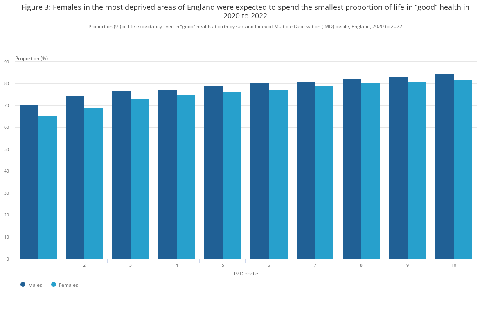

```{r setup, include=FALSE}
library(tidyverse)
library(stringi)
library(ggthemes)
library(kableExtra)
library(knitr)
library(patchwork)
options("kableExtra.html.bsTable" = T)
knitr::opts_chunk$set(echo = TRUE,
                      comment= NA,
                      warning = FALSE,
                      message = FALSE)

theme_set(
  theme_gray(base_size = 17) +
    theme(plot.background = element_rect(fill = "transparent", colour = NA)))

```


## Your Feedback Helps Shape The Module

Please take a few minutes to complete the **Student Voice section on NOW**.

- Tell us what supports your learning and what could work better.
- Your feedback helps us decide what to change and what to keep for future cohorts.
- More responses give us a better picture of the whole class experience, not just a few voices.
- Even without detailed comments, your response counts.

**Your feedback is anonymous, valued, and used:** we read and consider every comment and act on feedback to improve teaching and learning.

## Weeks 2 To 5 Build One Workflow

- ~~Week 2: Principles of data visualisation~~
- ~~Week 3: Grammar of graphics; aesthetics and attributes~~
- ~~Week 4: Major visualisation tools~~
- Week 5: Customising visualisations (scales, themes, and labels)


```{r echo = F}
d_spellname <- read_csv("data/spellname.csv")
```


```{r echo = F}
d_spellname <- summarise(d_spellname, 
                      rt = mean(rt),
                      dur = mean(dur),
                      .by = c(ppt_id, name_familiarised, ppt_vocab, modality)) 
```


## Customising visualisations

By the end of this session, you should be able to:

1. Improve `ggplot2` visualisations using labels, legends, colour, and simple themes.
2. Choose aesthetics and scales that fit the variable type and comparison.
3. Decide which customisation improves clarity, and which is only decoration.
4. Start a formative assessment RMarkdown using either the provided dataset or your own dataset.

Download the Week 5 files from NOW. Unzip the folder, then move the unzipped Week 5 folder into your existing RStudio Project folder.


## Today: Practical Scope

The session has two practical blocks.

<style>
.schedule-table th, .schedule-table td { padding: 0.45em 0.65em; vertical-align: top; border-bottom: 1px solid #ddd; }
.schedule-table th:first-child, .schedule-table td:first-child { text-align: center; font-weight: 700; }
.schedule-table th { background: #f7f7f7; }
</style>

<table class="schedule-table" style="width: 100%; table-layout: fixed; font-size: 0.9em;">
  <colgroup>
    <col style="width: 12%;">
    <col style="width: 44%;">
    <col style="width: 44%;">
  </colgroup>
  <thead>
    <tr>
      <th>Block</th>
      <th>Main work</th>
      <th>Files</th>
    </tr>
  </thead>
  <tbody>
    <tr>
      <td>1</td>
      <td>Make plots easier to understand with labels, legends, colour, and aesthetics.</td>
      <td><code>01_labels_and_legends.Rmd</code><br><code>02_colours_and_aesthetics.Rmd</code> selected parts</td>
    </tr>
    <tr>
      <td>2</td>
      <td>Start a formative assessment figure and decide what the plot should show.</td>
      <td><code>04_formative_practice_provided_data.Rmd</code><br>or <code>05_formative_planning_own_data.Rmd</code></td>
    </tr>
  </tbody>
</table>

`03_themes.Rmd` is optional/homework/reference material for after the session.

<p class="take-home">The priority today is not to try every customisation option. It is to make better decisions about which changes help the viewer.</p>


## Discussion: What Helps You Read This Chart? {.smaller}



<p class="question compact-question">What do you notice first? Which labels or colours would you change?</p>

<p class="source-note">Source: <a href="https://www.ons.gov.uk/peoplepopulationandcommunity/healthandsocialcare/healthinequalities/bulletins/healthylifeexpectancybynationalareadeprivationenglandandwales/between2013to2015and2020to2022">Office for National Statistics, Figure 3 (2025)</a>. Decile 1 = most deprived areas; 10 = least deprived.</p>

<!-- Allow 4 minutes. Ask about the message title, group colours, legend location,
     ordered deciles, units, and grid lines. Would direct labels help? Does the
     percentage tell the same story as years in good health? Avoid a right/wrong reveal. -->


## Every Element Should Help Readers Understand The Data

Revisiting Week 2: Tufte's principles [@Tufte2001VisualDisplay].

- **Data-ink ratio**: make the data marks more prominent than the supporting marks.
- **Chartjunk**: remove decoration that does not help the comparison.
- **Small multiples**: use consistent scales and layouts so groups can be compared fairly.
- **Narrative graphics**: use text, annotations, and labels to guide interpretation.

<p class="take-home">Plot don't have to be minimal. But, every customisation should earn its place.</p>


## Tufte Ideas Become `ggplot2` Decisions {.overview-slide}

In `ggplot2`, these principles become specific choices we can make and justify.

| Tufte principle | `ggplot2` decision |
|---|---|
| increase data-ink | use quiet themes, lighter grids, and visible data marks |
| reduce chartjunk | avoid decorative palettes, heavy backgrounds, and unnecessary legends |
| support comparison with small multiples | use facets, consistent scales, and aligned axes |
| guide interpretation | write meaningful titles, axis labels, legend labels, and captions |
| avoid distortion | choose sensible scales, transparency, jittering, or grouping aesthetics |

The grammar of graphics helps because each layer can be changed deliberately: data, mapping, geom, scale, coordinate system, facet, and theme.


## Customisation Serves The Comparison {.overview-slide}

Customisation should help the viewer answer the question.

| Customisation | Helps the viewer... | Ask yourself... |
|---|---|---|
| labels | know what the variables, units, and groups mean | could this plot stand alone in a report? |
| legends and facets | understand which observations belong to which group | are the group names meaningful? |
| colour and aesthetics | compare categories, ordered values, or continuous values | does the aesthetic fit the variable type? |
| scales | read values fairly and accurately | could the scale mislead the comparison? |
| themes | remove unnecessary distraction | did this remove clutter or add decoration? |
| figure size and scaling | read the figure at its final size | are text, points, and proportions still clear? |

<p class="take-home">Scaling down shrinks text and points too. Check relative sizes in the knitted report.</p>


## Labels Make Plots Stand Alone

<div class="plot-properties">

- `title`
- `subtitle`
- `caption`
- `tag`
- `x`
- `y`
- `colour`, `shape`, `linetype`, `fill`


</div>

<div class="code-plot">

```{r echo=TRUE, fig.width=5.4, fig.height=4.4, out.width="100%"}
ggplot(d_spellname, 
       aes(y = rt,
           x = dur,
           colour = modality)) +
  geom_point() + 
  labs()
```

</div>

## Titles Could Name The Comparison

<div class="plot-properties">

- `title`
- `subtitle`
- `caption`
- `tag`
- `x`
- `y`
- `colour`, `shape`, `linetype`, `fill`


</div>

<div class="code-plot">

```{r echo=TRUE, fig.width=5.4, fig.height=4.4, out.width="100%"}
ggplot(d_spellname, 
       aes(y = rt,
           x = dur,
           colour = modality)) +
  geom_point() + 
  labs(
    title = "Reaction time and duration")
```

</div>

## Subtitles Add Context

<div class="plot-properties">

- `title`
- `subtitle`
- `caption`
- `tag`
- `x`
- `y`
- `colour`, `shape`, `linetype`, `fill`


</div>

<div class="code-plot">

```{r echo=TRUE, fig.width=5.4, fig.height=4.4, out.width="100%"}
ggplot(d_spellname, 
       aes(y = rt,
           x = dur,
           colour = modality)) +
  geom_point() + 
  labs(
    title = "Reaction time and duration",
    subtitle = "Participant-level averages")
```

</div>

## Captions Tell Readers Where Data Came From

<div class="plot-properties">

- `title`
- `subtitle`
- `caption`
- `tag`
- `x`
- `y`
- `colour`, `shape`, `linetype`, `fill`


</div>

<div class="code-plot">

```{r echo=TRUE, fig.width=5.4, fig.height=4.4, out.width="100%"}
ggplot(d_spellname, aes(y = rt,
    x = dur,
    colour = modality)) +
  geom_point() + 
  labs(caption = "Data: picture naming norms")
```

</div>

## Tags Can Label Panels

<div class="plot-properties">

- `title`
- `subtitle`
- `caption`
- `tag`
- `x`
- `y`
- `colour`, `shape`, `linetype`, `fill`


</div>

<div class="code-plot">

```{r echo=TRUE, fig.width=5.4, fig.height=4.4, out.width="100%"}
ggplot(d_spellname, aes(y = rt,
    x = dur,
    colour = modality)) +
  geom_point() + 
  labs(tag = "A")
```

</div>

## Axis Labels Need Units

<div class="plot-properties">

- `title`
- `subtitle`
- `caption`
- `tag`
- `x`
- `y`
- `colour`, `shape`, `linetype`, `fill`


</div>

<div class="code-plot">

```{r echo=TRUE, fig.width=5.4, fig.height=4.4, out.width="100%"}
ggplot(d_spellname, aes(y = rt,
    x = dur,
    colour = modality)) +
  geom_point() + 
  labs(x = "Production duration (ms)",
       y = "Reaction time (ms)")
```

</div>

## Legend Titles Name The Grouping

<div class="plot-properties">

- `title`
- `subtitle`
- `caption`
- `tag`
- `x`
- `y`
- `colour`, `shape`, `linetype`, `fill`


</div>

<div class="code-plot">

```{r echo=TRUE, fig.width=5.4, fig.height=4.4, out.width="100%"}
ggplot(d_spellname, aes(y = rt,
    x = dur,
    colour = modality)) +
  geom_point() + 
  labs(colour = "Response mode")
```

</div>

## Exercise 1: Changing Text (about 12 minutes)

Open `01_labels_and_legends.Rmd`.

Write axis labels, improve legend titles and group labels, and label combined colour/shape legends.

Keep one labelled figure and one sentence explaining your choice.

Further label examples are marked optional; you are welcome to continue.


## Variable Type Also Guides Aesthetics {.smaller}

In Week 4, variable type helped us choose geoms. Today, it helps us choose aesthetics and scales.

| Variable type | Good aesthetic choices | Be careful with |
|---|---|---|
| categorical groups | colour, fill, shape, linetype, facets | too many colours or shapes |
| ordered categories | ordered colour, position, facets | unordered palettes |
| continuous values | position, colour gradient, size | size can be hard to compare |

A **binary variable** has two categories; it does not need a separate set of aesthetics.

A **redundant legend** repeats information already clear elsewhere: for example, a boxplot's x-axis names each group, and its fill legend repeats those same groups. Colour and shape together can still help accessibility.

<p class="take-home">Next we focus on colour: distinguishing categories versus showing ordered or continuous values.</p>


## Colour: Hue Versus Brightness {.smaller}

```{r colour-plot-text-size, include=FALSE}
theme_before_colour <- theme_set(
  theme_gray(base_size = 12) +
    theme(
      plot.background = element_rect(fill = "transparent", colour = NA)))
```

```{r colour-property-examples, echo=FALSE, fig.width=11, fig.height=3.2, out.width="100%"}
colour_strip <- function(labels, colours, title) {
  ggplot(tibble(position = seq_along(labels), label = labels,
                swatch = colours), aes(x = position, y = 1)) +
    geom_tile(aes(fill = swatch), width = .9, height = .6) +
    geom_text(aes(y = .4, label = label), size = 3.5) +
    scale_fill_identity() +
    scale_y_continuous(limits = c(.2, 1.4)) +
    labs(title = title) +
    theme_void(base_size = 12) +
    theme(plot.title = element_text(size = 12, face = "bold"),
          plot.margin = margin(8, 12, 4, 12))
}
categories <- c("Speech", "Writing", "Gesture")
ordered_values <- c("Low", "2", "3", "4", "High")
p_hue <- colour_strip(categories,
  c("#0072B2", "#D55E00", "#009E73"),
  "Works: distinct hues separate categories")
p_rank <- colour_strip(categories,
  c("#DEEBF7", "#9ECAE1", "#3182BD"),
  "Risk: lightness suggests a category ranking")
p_lightness <- colour_strip(ordered_values,
  c("#EFF3FF", "#BDD7E7", "#6BAED6", "#3182BD", "#08519C"),
  "Works: light-to-dark shows increasing values")
p_unordered <- colour_strip(ordered_values,
  c("#009E73", "#CC79A7", "#0072B2", "#E69F00", "#D55E00"),
  "Harder: unrelated hues do not show the order")
(p_hue | p_rank) / (p_lightness | p_unordered)
```

For values either side of a meaningful midpoint, use a diverging palette with a neutral centre.

<p class="take-home">Use different hues for different kinds of things. Use light-to-dark progressions for more/less.</p>


## Colour Scales Control The Palette {.smaller}

<div class="plot-properties">

- `scale_colour_discrete`
- `scale_colour_continuous`
- `scale_colour_manual`
- or any other aesthetic instead of `colour`


</div>

<div class="code-plot">

```{r echo=TRUE, fig.width=5.4, fig.height=3.4, out.width="100%"}
ggplot(d_spellname, 
       aes(y = rt,
           x = dur,
           colour = modality)) +
  geom_point() +  
  scale_colour_discrete()
```

</div>

## Continuous Colour Shows More And Less {.smaller}

<div class="plot-properties">

- The colour bar shows a progression, not separate categories.
- `scale_colour_viridis_c()`: `c` means continuous; `d` means discrete.

</div>

```{r continuous-colour-data, include=FALSE}
d_colour_age <- read_csv("data/blomkvist.csv")
```

<div class="code-plot">

```{r continuous-colour-plot, echo=TRUE, fig.width=5.4, fig.height=3.4, out.width="100%"}
ggplot(d_colour_age,
    aes(x = rt_hand_d,
        y = rt_hand_nd,
        colour = age)) +
  geom_point() +
  scale_colour_viridis_c()
```

</div>

## Reverse The Scale {.smaller}

<div class="plot-properties">

`direction = -1` reverses the palette.

</div>

<div class="code-plot">

```{r reversed-continuous-colour, echo=TRUE, fig.width=5.4, fig.height=3.4, out.width="100%"}
ggplot(d_colour_age,
    aes(x = rt_hand_d,
        y = rt_hand_nd,
        colour = age)) +
  geom_point() +
  scale_colour_viridis_c(
    direction = -1)
```

</div>

## Existing Palette Functions Are The Easiest Start

<div class="plot-properties">

- Use a palette function first
- `ggthemes::scale_colour_colorblind()`
- Then customise manually only when needed


</div>

<div class="code-plot">

```{r echo=TRUE, fig.width=5.4, fig.height=3.4, out.width="100%"}
ggplot(d_spellname, 
       aes(y = rt,
           x = dur,
           colour = modality)) +
  geom_point() +  
  scale_colour_colorblind()
```

</div>

## Manual Colours Should Support Comparison

<div class="plot-properties">

- Change colour values manually
- Colour names: [link](http://sape.inf.usi.ch/quick-reference/ggplot2/colour)
- `ggthemes`


</div>

<div class="code-plot">

```{r echo=TRUE, fig.width=5.4, fig.height=3.4, out.width="100%"}
ggplot(d_spellname, 
       aes(y = rt,
           x = dur,
           colour = modality)) +
  geom_point() +  
  scale_colour_manual(
    values = c("#0072B2", "#D55E00"))
```

</div>

## Store Palette Values When You Need Manual Control

<div style="float: left; width: 35%;">
- Start from a tested palette
- Store hex codes if you need to reuse them
- `scales::show_col()` previews colours

</div>

<div style="float: right; width: 60%;">

```{r }
# RGB codes of "colorblind" function
mycolours <- c("#000000", "#E69F00",
               "#56B4E9", "#009E73",
               "#F0E442", "#0072B2",
               "#D55E00", "#CC79A7")
```

</div>

---

```{r fig.width=10, fig.height=4}
# RGB codes of "colorblind" function
scales::show_col(colorblind_pal()(8))
```


## Legend Labels Should Be Human-Readable

<div class="plot-properties">

- Replace data codes with readable group names
- `labels` changes the legend wording
- `values` controls the corresponding colours


</div>

<div class="code-plot">

```{r echo=TRUE, fig.width=5.4, fig.height=3.4, out.width="100%"}
ggplot(d_spellname, 
       aes(y = rt,
           x = dur,
           colour = modality)) +
  geom_point() +  
  scale_colour_manual(
    labels = c("Spoken output",
               "Written output"),
    values = mycolours[1:2])
```

</div>

## Discussion: Hue, Brightness, Shape, Or Facets? {.smaller}

Each version shows the same relationship. Which would you use, and what trade-off does it make?

```{r colour-encoding-discussion, echo=FALSE, fig.width=11, fig.height=4.6, out.width="100%"}
p_colour <- ggplot(d_spellname,
                   aes(x = dur, y = rt, colour = modality)) +
  geom_point() +
  scale_colour_colorblind(
    labels = c("Spoken", "Written")) +
  labs(title = "Different hues",
       x = "Duration (ms)",
       y = "Reaction time (ms)",
       colour = "Mode") +
  theme_minimal(base_size = 10)

p_brightness <- ggplot(d_spellname,
                       aes(x = dur, y = rt, colour = modality)) +
  geom_point() +
  scale_colour_manual(
    values = c(speech = "#BDBDBD", writing = "#333333"),
    labels = c(speech = "Spoken", writing = "Written")) +
  labs(title = "Different brightness",
       x = "Duration (ms)",
       y = "Reaction time (ms)",
       colour = "Mode") +
  theme_minimal(base_size = 10)

p_colour_shape <- ggplot(d_spellname,
                         aes(x = dur, y = rt,
       colour = modality, shape = modality)) +
  geom_point() +
  scale_colour_colorblind(
    labels = c("Spoken", "Written")) +
  scale_shape_discrete(
    labels = c("Spoken", "Written")) +
  labs(title = "Colour + shape",
       x = "Duration (ms)",
       y = "Reaction time (ms)",
       colour = "Mode",
       shape = "Mode") +
  theme_minimal(base_size = 10)

p_facets <- ggplot(d_spellname, aes(x = dur, y = rt)) +
  geom_point() +
  facet_grid(~modality,
             labeller = labeller(
               modality = c(speech = "Spoken",
      writing = "Written"))) +
  labs(title = "Facets",
       x = "Duration (ms)",
       y = "Reaction time (ms)") +
  theme_minimal(base_size = 10)

((p_colour | p_brightness) / (p_colour_shape | p_facets)) &
  theme(legend.position = "bottom")
```

<p class="question compact-question">Does brightness imply an order or make one group more prominent? When do shape or facets help?</p>


## Exercise 2: Colour And Aesthetic Decisions (about 12 minutes)

```{r restore-plot-text-size, include=FALSE}
theme_set(theme_before_colour)
```

Open `02_colours_and_aesthetics.Rmd`.

Choose a palette and compare overlapping age distributions.

Record which version you would use and what the viewer can compare more easily.

Further colour examples are marked optional; you are welcome to continue.


```{r built-in-theme-base, include=FALSE}
plot_theme_comparison <- ggplot(d_spellname, aes(x = dur, y = rt)) +
  geom_point() +
  facet_grid(~modality)
```

## `theme_grey()`: Reference Structure For Exploration {.smaller}

The next four plots keep data, mappings, geoms, and scales fixed. Only the theme changes.

<div class="code-plot">
<div>

**Useful context:** exploratory work, when readers need to locate values and compare panels.

**Why it helps:** white grids provide references; the grey panel separates the data region from the margins.

**Check the knitted report:** are the points and lines easy to see against the background?

Add it with `plot + theme_grey()`.

</div>

```{r theme-grey-context, echo=FALSE, fig.width=5.4, fig.height=3.6, out.width="100%"}
plot_theme_comparison + theme_grey(base_size = 12)
```

</div>

## `theme_bw()`: Clear References On White {.smaller}

<div class="code-plot">
<div>

**Useful context:** reports or projection, where a white background and clear reference structure can help.

**Why it helps:** grids support value readings; borders clearly separate panels.

**Trade-off:** borders and grids add non-data ink and can compete with dense data.

Add it with `plot + theme_bw()`.

</div>

```{r theme-bw-context, echo=FALSE, fig.width=5.4, fig.height=3.6, out.width="100%"}
plot_theme_comparison + theme_bw(base_size = 12)
```

</div>

## `theme_classic()`: Emphasise The Overall Pattern {.smaller}

<div class="code-plot">
<div>

**Useful context:** showing an overall trend or distribution when precise value readings matter less.

**Why it helps:** removing grids reduces competing marks and emphasises the data.

**Trade-off:** without grids, reading values far from the axes is harder.

Add it with `plot + theme_classic()`.

</div>

```{r theme-classic-context, echo=FALSE, fig.width=5.4, fig.height=3.6, out.width="100%"}
plot_theme_comparison + theme_classic(base_size = 12)
```

</div>

## `theme_minimal()`: Keep Grids Without Heavy Framing {.smaller}

<div class="code-plot">
<div>

**Useful context:** uncluttered reports or multi-panel figures that still need grid references.

**Why it helps:** removes backgrounds and borders while retaining useful guides for reading values.

**Trade-off:** weaker panel boundaries may make separate panels less distinct.

Add it with `plot + theme_minimal()`.

</div>

```{r theme-minimal-context, echo=FALSE, fig.width=5.4, fig.height=3.6, out.width="100%"}
plot_theme_comparison + theme_minimal(base_size = 12)
```

</div>

<p class="source-note">Theme features: <a href="https://ggplot2.tidyverse.org/reference/ggtheme.html">ggplot2 documentation</a>. Choose a theme that helps readers compare the data and remains clear in your knitted report. The simplest-looking theme is not always the clearest.</p>


## Optional/Homework: Themes

`03_themes.Rmd` is optional/homework/reference material.

In your own time, use it to compare themes and practise changing individual elements. Worked examples are in the separate [Supplementary Materials: Customising Visualisations](week-05-supplementary-customising-visualisations.html) slide set. Detailed theme customisation is not part of today's main practical work.


## Useful Resources For Data Visualisation

- Choosing the right visualisation: [data-to-viz.com](https://www.data-to-viz.com/)
- Rick Scavetta's course: [datacamp.com](https://learn.datacamp.com/skill-tracks/data-visualization-with-r)
- `ggplot2` [CheatSheet](https://rstudio.com/wp-content/uploads/2015/03/ggplot2-cheatsheet.pdf)
- Most important functions: [ggplot2.tidyverse.org](https://ggplot2.tidyverse.org/reference/)

```{r echo=F, eval = F}
#- need a data set for practicing: [vincentarelbundock.github.io](https://vincentarelbundock.github.io/Rdatasets/datasets.html)

```

## Recommended Reading

For support with this week's material, use:

- @andrews2021doing, Chapter 4: data visualisation in R. [Online chapter](https://www.mjandrews.org/book/ddsr/assets/chapter_04_visualization.pdf)
- The `ggplot2` online book sections on scales, labels, themes, and saving plots as optional extra support. [Online book](https://ggplot2-book.org/)


## Start The Formative Figure {.smaller}

Use one of the two templates in the Week 5 files:

- `04_formative_practice_provided_data.Rmd` if you want to practise with the provided Blomkvist dataset.
- `05_formative_planning_own_data.Rmd` if you already have a candidate dataset.

Start by deciding what your first figure should help the viewer compare.

Use the next **25 minutes** to:

- Choose one question and draft one figure.
- Give the document a title about your data or question.
- Give the figure section a heading about the comparison.
- Add a caption and explain one design choice in 2-3 sentences.

You can run chunks while developing the figure.

## Formative Assessment: The Full Brief {.smaller}

Select a behavioural dataset, such as reaction times, survey responses, or decision-making data.

- Create 3-4 visualisations using different techniques (e.g., boxplot, scatterplot, density plot).
- Include brief commentary on:
  - What each visualisation highlights about the data?
  - Why each visualisation was chosen?
  - How each visualisation adheres to principles of effective visualisation (e.g., Tufte's guidelines)?
  - What each visualisation may obscure about the data.
- **Deadline:** Friday 30 October 2026, before 2 pm
- **Length:** max 1,000 words

**Feedback focus:**

- Clarity and effectiveness of visualisations.
- Code quality and reproducibility.
- Interpretation and communication of behavioural insights.

## Submit Files Needed To Reproduce Your Work {.overview-slide .submission-files}

Submit **one ZIP archive**, keeping the project folder structure intact.

| Include | What it provides |
|---|---|
| R Markdown (`.Rmd`) | your code and commentary |
| Rendered report (`.html`) | your finished figures and text |
| RStudio project (`.Rproj`) | the project starting point |
| Data files used by the code | the inputs needed to recreate the figures |
| Supporting files | e.g., `references.bib`, `apa.csl`, images, helper scripts |
| GenAI Usage Declaration Form | the required declaration |

Check: unzip into a new folder, open the project, restart R, and knit the report. Use relative paths, not paths to your own computer. Keep the submission anonymous.


## Explain The Choice In Your Own Figure {.overview-slide}

Choose one or two decisions in your figure. Explain how they help answer your question and what the figure still hides.

| Decision | Options you could compare |
|---|---|
| Showing variation | raw points, a summary, or both |
| Distinguishing groups | colour, colour and shape, or separate facets |
| Showing overlap | opaque fill, transparent fill, or outlines |
| Making text useful | variable names or descriptive labels with units; a question or finding as the title |
| Keeping useful structure | keep, lighten, or remove grid lines; choose a starting theme |

**Example:** "I used transparent fills so the overlapping age distributions remain visible, but the curves do not show how many participants are in each group."


## Before Week 6: Install Shiny {.smaller}

Next week we will start building interactive apps in R. Install Shiny **before the session** so we can spend class time working with the apps.

Run this once in RStudio; skip it if Shiny is already installed:

```{r install-shiny-before-week6, eval=FALSE}
install.packages("shiny")
```

Then check that the package loads:

```{r check-shiny-before-week6, eval=FALSE}
library(shiny)
```

If this runs without an error, you are ready. Let me know before the session if installation does not work.

## References

