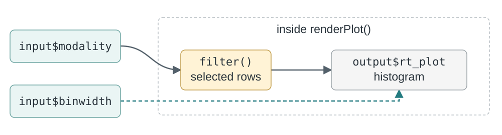
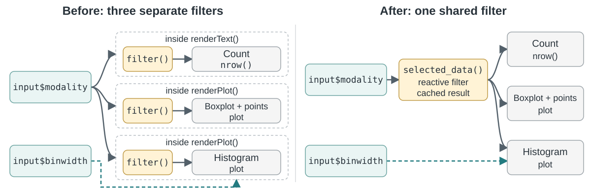
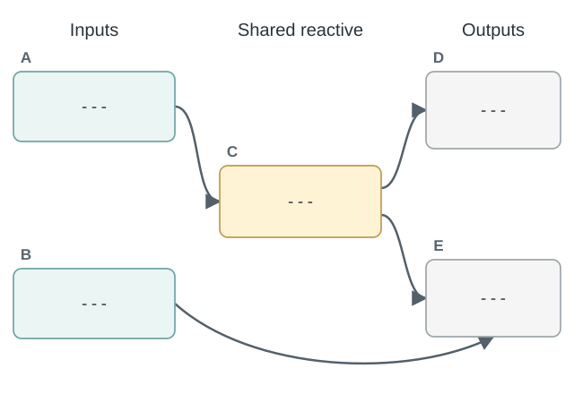
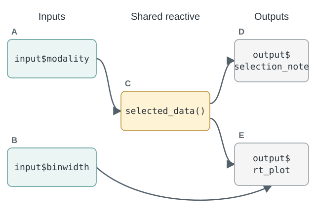
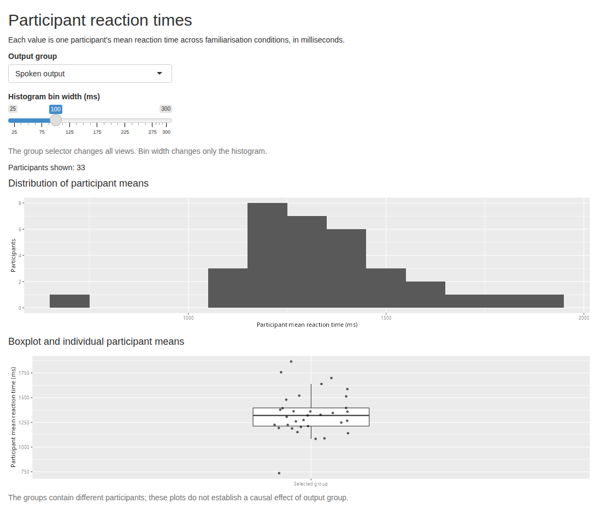
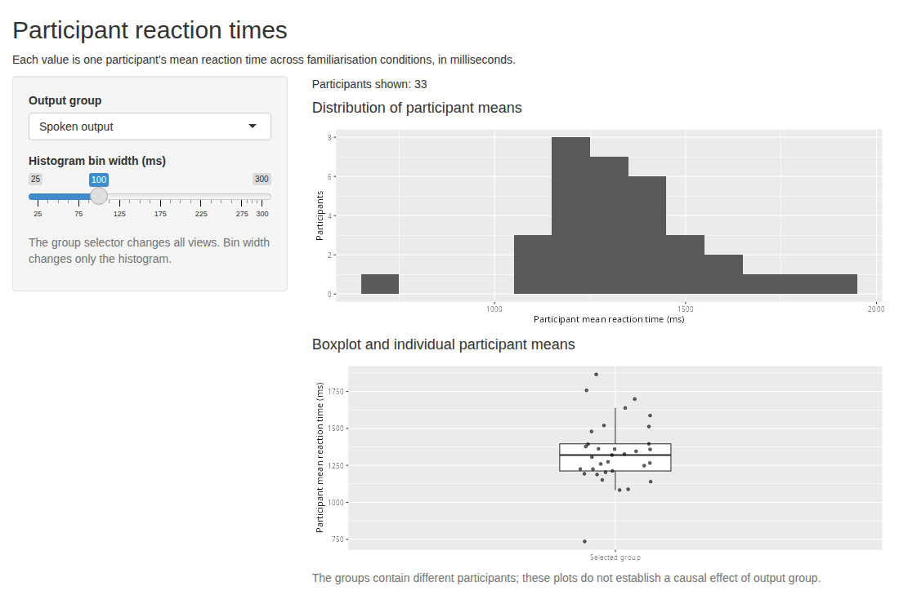

```{r setup, include=FALSE}
library(tidyverse)
library(patchwork)
knitr::opts_chunk$set(echo = TRUE, comment = NA,
                      warning = FALSE, message = FALSE)
d_participants <- read_csv("data/participant_reaction_times.csv",
                           show_col_types = FALSE)
d_spoken <- filter(d_participants, modality == "speech")
theme_set(theme_grey(base_size = 12))
```


## Recall Task: Connect The UI And Server {.smaller}

<div class="connection-columns">
<div>

**UI: input controls and output locations**

The controls let users supply values. `plotOutput()` creates a named **placeholder** for the server to fill; @Wickham2021MasteringShiny, [section 2.3](https://mastering-shiny.org/basic-ui.html#outputs).

```{r recap-week6-ui, eval=FALSE}
selectInput("modality", "Output group",
  choices = c("Spoken output" = "speech",
              "Written output" = "writing"))
sliderInput("binwidth", "Bin width (ms)",
  min = 25, max = 300, value = 100)
plotOutput("rt_plot")
```

</div>
<div>

**Server: read inputs and calculate outputs**

`input$` reads control values; `output$` defines displayed results using render functions. Dependent outputs update when inputs change.

```{r recap-week6-server, eval=FALSE}
output$rt_plot <- renderPlot({
  selected_data <- filter(
    d_participants,
    modality == input$modality
  )
  ggplot(selected_data, aes(x = mean_rt)) +
    geom_histogram(
      binwidth = input$binwidth)
})
```

</div>
</div>

**Your task:** match the two controls and plot location to their server counterparts. Identify the matching names. Predict each control's effect.


## Distinguish The Data Column From The Input {.smaller}

The data column in `d_participants` and control `input$modality` share a name. `filter()` explicitly connects the column to the selected value.

```{r data-column-versus-input, eval=FALSE}
filter(d_participants, modality == input$modality)
```

Inside `filter()`, `modality` is the data column; `input$modality` is the chosen value. If it is `"speech"`, the comparison keeps the 33 spoken-output participants.

<div class="connection-columns">
<div>

```{r data-preview, echo=FALSE, results='asis'}
d_participants |>
  group_by(modality) |>
  slice_head(n = 2) |>
  ungroup() |>
  mutate(mean_rt = round(mean_rt, 1)) |>
  knitr::kable()
```

</div>
<div>

**`ppt_id`:** participant code.

**`modality`:** categorical data column containing `"speech"` or `"writing"`.

**`mean_rt`:** numeric participant mean reaction time.

</div>
</div>


## Recall: Trace The Histogram Dependencies {.smaller}

A **reactivity graph** shows dependencies: follow arrows to predict what an input change affects.



- **Group changes:** select different rows and redraw the histogram.
- **Bin width changes:** redraw the histogram. The same rows are selected, but its filter runs again.

@Wickham2021MasteringShiny, [section 3.3.3](https://mastering-shiny.org/basic-reactivity.html#the-reactive-graph).

## Today: Keep Several Views Consistent 

By the end of this session, you should be able to:

- Share one filtering step across several outputs using `reactive()`.
- Obtain the current result from a reactive expression you created.
- Explain which controls affect which outputs.
- Organise the same app using a sidebar and clear explanations.

**What we will build:** a complementary plot of individual values, and a participant count, all using one group selection.

## Download The Apps And Session Guide {.smaller}

Unzip the **whole Week 7 folder** from NOW into your existing module project.

```text
Your existing module project/
  week-07-reactivity-layouts/
    intro_app.R
    comparison_app.R
    starter_app.R
    layout_app.R
    session-guide.html
    data/
      participant_reaction_times.csv
```

Keep the scripts and `data/` together. 

Open **`session-guide.html`** in a web browser; keep it beside your app script in RStudio. 

## Open The Session Guide In Your Browser {.smaller}

Read **`session-guide.html`** in your browser. Use its contents menu to find each stage; edit and run the named app scripts in RStudio.

| Guide section | Activity |
|---|---|
| Inspect the familiar histogram | Recall the group selector and width slider |
| Add two views of the same selection | Inspect extra outputs and repeated filtering |
| One shared filter supplies the outputs | Trace the shared filter into the outputs |
| Exercise 1: connect shared data to the outputs | Complete and test shared-data connections |
| Exercise 2: give the same app a sidebar | Complete and test the sidebar layout |

**Where to complete code:** read instructions in the **session guide**; complete the exercises in the named **app `.R` script**. Edit it, save, then click **Run App**.


## Start With The Familiar Histogram 

Run **`intro_app.R`**. This is the completed Week 6 app: one histogram, a group selector and a bin-width slider.

- Select spoken output and set bin width to 100 ms.
- Change group: which part of the data selection changes?
- Keep the group fixed and change bin width: what changes about the histogram?

Point to `input$modality` and `input$binwidth` in the server. Both already make the plot update automatically.

## Add Two Views Of The Same Selection {.smaller}

Stop `intro_app.R` and run **`comparison_app.R`**. It adds a boxplot/points and count for the same **33 spoken-output participants**.

```{r compare-views, echo=FALSE, fig.width=11, fig.height=3.3, out.width="100%"}
p_hist <- ggplot(d_spoken, aes(mean_rt)) +
  geom_histogram(binwidth = 100) +
  labs(x = "Participant mean reaction time (ms)", y = "Participants")
p_values <- ggplot(d_spoken, aes(x = "Selected group", y = mean_rt)) +
  geom_boxplot(width = 0.25, outlier.shape = NA) +
  geom_point(position = position_jitter(width = 0.08, height = 0, seed = 7),
             alpha = 0.6) +
  labs(x = NULL, y = "Participant mean reaction time (ms)")
p_hist | p_values
```

- **Histogram:** reveals distribution shape through bin counts; bin width affects its appearance.
- **Boxplot:** highlights the median and the spread of the middle 50% of values.
- **Points:** reveal individual values, clusters, and extremes that a summary can conceal.

## Three Outputs Repeat The Same Preparation {.smaller}

In **`comparison_app.R`**, the same filtering step appears inside **each** render block:

```{r duplicated-filter, eval=FALSE}
selected_data <- filter(d_participants, modality == input$modality)
```

| Render block | What it does with the selected rows |
|---|---|
| `renderText()` | counts the participants |
| First `renderPlot()` | draws a histogram |
| Second `renderPlot()` | draws a boxplot with individual points |

**Predict and test:** changing group updates the count and both plots; changing only bin width leaves the count and boxplot unchanged. How many times does each action run the filter?

**The app works:** each output filters separately. Changing bin width reruns the histogram's whole render block, including its filter. 

## Compare The Graphs Before And After Sharing {.smaller}

Arrows show **dependencies**: follow them to predict changes.



- **Change group:** three filters before; one shared filter after (all outputs visible).
- **Bin width:** before, rerun the filter and plot; after, reuse cached rows.

@Wickham2021MasteringShiny, [section 3.3.3: The reactive graph](https://mastering-shiny.org/basic-reactivity.html#the-reactive-graph).

## One Shared Filter Supplies The Outputs {.smaller .shared-example}

<div class="connection-columns shared-example-columns">
<div>

```{r shared-data-example, eval=FALSE}
server <- function(input, output) {
  # 1. Prepare the selected rows once.
  selected_data <- reactive({
    filter(d_participants,
           modality == input$modality)
  })

  # 2. Draw the histogram from those rows.
  output$rt_plot <- renderPlot({
    ggplot(selected_data(),
           aes(x = mean_rt)) +
      geom_histogram(
        binwidth = input$binwidth)
  })

  # 3. Count the same rows.
  output$selection_note <- renderText({
    paste("Participants shown:",
          nrow(selected_data()))
  })
}
```

</div>
<div>

**1. One shared preparation**

`reactive()` creates a **function**, not a data frame. `selected_data` names that function; `selected_data()` calls it and returns the current data frame. Hence the parentheses; @Wickham2021MasteringShiny, [section 1.6](https://mastering-shiny.org/basic-app.html#reducing-duplication-with-reactive-expressions).

**2. A plot uses the result**

The result is cached until group changes. The histogram also reads `input$binwidth`.

**3. The count uses the same result**

`nrow()` counts participants; `paste()` joins the label and count. Neither reads bin width. 

**Predict:** if `input$modality` stays fixed and bin width changes, which outputs should update?

</div>
</div>

## Share The Work And Change The Code Once {.smaller .shared-example}

<!-- Presenter: allow 30–60 seconds for this recap. Summarise the benefits and leave the code available during Exercise 1. -->

<div class="connection-columns shared-example-columns">
<div>

```{r shared-data-benefits, ref.label='shared-data-example', eval=FALSE}
```

</div>
<div>

**Change the rule in one place**

Edit the filter inside `reactive()`, rather than in three output blocks. All outputs use the same rule.

**Calculate once and share the result**

When group changes, filtering runs once when needed. The histogram, boxplot, and count reuse the selected rows.

**Keep results when other inputs change**

Changing only bin width redraws the histogram using the cached rows. It does not rerun the filter.

@Wickham2021MasteringShiny, [section 1.6](https://mastering-shiny.org/basic-app.html#reducing-duplication-with-reactive-expressions).

Keep this example open during Exercise 1.
</div>
</div>

## Exercise 1: Connect The Shared Data 

Open `starter_app.R`; follow Exercise 1 in the session guide (**about 20–25 minutes**).

Complete **six blanks**:

- One function name to create the reactive expression.
- Three calls obtaining the selected data: two plots and one count.
- Two matching output names in the UI.

Complete all blanks, then predict and test each control change. Use the annotated shared-filter example when needed.

**After code edits:** save, stop, and run again. **When testing controls:** keep the app running.

## Label The Reactivity Graph {.smaller .graph-label-slide}

This smaller app has a group selector (`modality`), a width slider (`binwidth`), a histogram and a participant count.

<div class="connection-columns graph-label-columns">
<div>

**Inside the server function**

```{r graph-label-task, eval=FALSE}
selected_data <- reactive({
  filter(d_participants,
    modality == input$modality)
})
output$rt_plot <- renderPlot({
  ggplot(selected_data(), aes(mean_rt)) +
    geom_histogram(
      binwidth = input$binwidth)
})
output$selection_note <- renderText({
  nrow(selected_data())
})
```

</div>
<div>

**Your task: label boxes A–E (3 minutes)**



</div>
</div>

**Predict:** which output stays unchanged when only bin width changes?

## Check The Names And Predict A Change {.smaller .graph-label-slide}

<div class="connection-columns graph-label-columns">
<div>

**Inside the server function**

```{r graph-label-answer, eval=FALSE}
selected_data <- reactive({
  filter(d_participants,
    modality == input$modality)
})
output$rt_plot <- renderPlot({
  ggplot(selected_data(), aes(mean_rt)) +
    geom_histogram(
      binwidth = input$binwidth)
})
output$selection_note <- renderText({
  nrow(selected_data())
})
```

</div>
<div>

**Completed dependencies**




</div>
</div>

**Group:** updates shared rows and both outputs. **Bin width:** redraws only the histogram, using cached rows.

Check participant counts in your app. Then take the **break**; we resume with layouts.

## Which Layout Is Clearer? {.smaller}

Both versions contain the same data, controls, and outputs.

<div class="layout-comparison">
<div><strong>A: One long column</strong></div>
<div><strong>B: Controls beside the outputs</strong></div>
</div>

Where do you look for controls? Which arrangement helps you compare the plots and see what is selected?

## Move UI Elements And Keep Their Connections {.smaller}

<div class="connection-columns">
<div>

**UI structure; existing elements omitted here**

```{r sidebar-structure, eval=FALSE}
ui <- fluidPage(
  titlePanel("Participant reaction times"),
  p("Participant means, in milliseconds."),
  sidebarLayout(
    sidebarPanel(
      # Existing controls and help text.
    ),
    mainPanel(
      # Existing count, headings and plots.
    )
  )
)
```

</div>
<div>

**Outer wrapper:** `sidebarLayout()` holds both areas.

**Controls:** `sidebarPanel()` holds the selector, slider and their `helpText("...")`.

**Outputs:** `mainPanel()` holds the count, headings and plots.

Keep input and output names unchanged when moving them. The server can stay the same.

Use `p("...")` to introduce the data and units; explain each control beside it. Write your own wording in the supplied blanks.

**Predict:** what will change when a plot moves to the main area? What will stay the same?

</div>
</div>

## Exercise 2: Give The Same App A Sidebar {.smaller}

Open `layout_app.R`; follow Exercise 2 in the session guide (**about 20–25 minutes**).

Complete **five blanks**:

- Three layout function names: the wrapper, control area, and output area.
- One sentence identifying the data and units.
- One sentence explaining which outputs each control changes.

The completed server is supplied. 

Choose which plot should come first. Move its heading with its plot location; keep the output names and server unchanged. Predict the result, then test both controls.

## Compare The Design And Test The Behaviour {.smaller}

Compare your layout and help text with a neighbour's:

- Which plot do you want a reader to inspect first, and why?
- Does the help text explain what changes and what stays fixed?
- Are units and the participant count easy to find?

Revise one sentence or one placement if needed.

Then repeat the control tests: group changes update all views; bin-width changes update only the histogram.

**Together: check:** which changes were only in the UI? Why could the server stay the same?

## After Completing Your App: Compare And Explain

Now open `worked_example_app.R` to compare with your own finished app.

Trace the group selector through `selected_data()` to the count and both plots. Explain why bin width affects only the histogram.

Compare the layout and wording. Keep your own version and use the reference to check your reasoning.

## What We Have Added This Week {.smaller}

- One shared preparation step with `reactive()`.
- Two complementary plots of the same selected participants.
- A count that identifies the selected sample.
- Controls and explanations organised beside the outputs.

Automatic updates still work. No update or reset buttons are needed.

Next week: organise plots into tabs, choose controls, and explain empty selections. Session 9 introduces Plotly before adapting the ideas to another dataset.

## After Class: Read About Shared Reactive Data 

**Everyone:** @Wickham2021MasteringShiny, [section 1.6](https://mastering-shiny.org/basic-app.html#reducing-duplication-with-reactive-expressions).

Where is the shared preparation in the example, and which outputs use it? No written response is required.

**Optional reference:** [Chapter 6, section 6.2](https://mastering-shiny.org/action-layout.html#single-page-layouts), for sidebar layouts.

Keep your working app. Continue exploring possible summative datasets; it is fine not to have chosen one yet. No transfer to your own data is required this week.

## Independent Practice: Choose One Optional Exercise {.smaller}

Use the **remaining time** to work independently on **one of two optional exercises**. Choose the one you would most like to explore:

- **Compare both groups:** use `optional_groups_app.R` to select one or both groups, compare them in the boxplot, and pool them in the histogram. Follow **Optional: show both groups** in the guide.
- **Add a summary table:** complete five blanks in `extension_app.R` to connect and explain a participant count, median and interquartile range. Follow **Optional: add a summary table** in the guide.

The exercises are independent: neither requires completing the other. Read the instructions, make the changes in your app script, and test the controls.

If you finish one, you are welcome to try the other or continue after class.

## Optional: Compare Both Groups In One View {.smaller}

Use **Optional: show both groups** in the guide and `optional_groups_app.R`. Complete its **four blanks**, save, then click **Run App**.

- Use `checkboxGroupInput()` so users can tick one or both groups.
- Filter with `modality %in% input$modality`: keep rows matching **any** selected group. `==` was for one selected value.
- Map the boxplot's x axis to `modality` to show separate groups and points.
- Keep the histogram as `aes(x = mean_rt)`: it pools both groups.
- Write help text explaining the difference between the two views.

**Check:** counts should be **33**, **39**, and **72**. Bin width changes only the histogram.

What might a pooled histogram conceal that the separate boxplots reveal? The guide explains the choices vector and `%in%`.

## Optional: Add A Summary Table {.smaller}

Open **`extension_app.R`** and follow **Optional: add a summary table** in the session guide. The core app is complete; fill its **five blanks**:

- Explain the summary in `p("---")`.
- Use `tableOutput()` for the named UI location.
- Match the server output name and use `renderTable()`.
- Give `summarise()` the current result of your shared reactive expression.

The supplied calculations report participant count, median and IQR in milliseconds. Complete all blanks, save and use **Run App**.

**Test:** group changes update the table; bin width does not. Check the count against **33 / 39** and the summaries against the boxplot.

The guide explains each function and test. Tabs are a core part of Session 8.


## References
