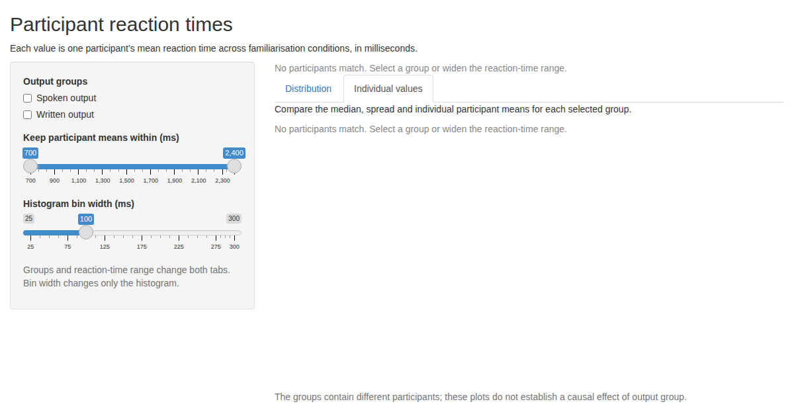
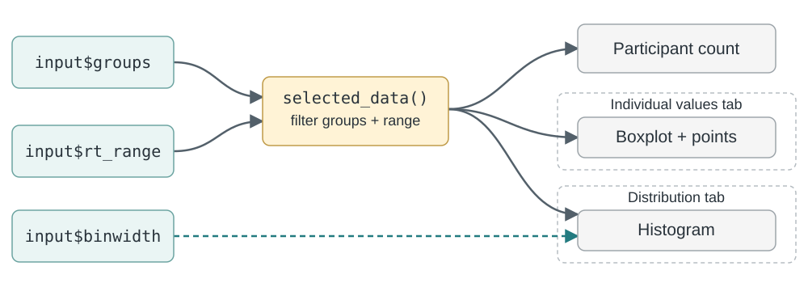

## Recall: Trace The Week 7 Connections {.smaller}

Open your completed Week 7 `layout_app.R` and choose **Run App**.


**Trace each input:** which outputs change? Find `selected_data()` in your code and explain the parentheses.

## Today: Make Exploration Easy To Navigate

- Organise two plots into tabs while keeping their connections.
- Choose controls for one group, several groups, or a numeric range.
- Extend one shared filter and explain when no data match.
- Test every view and help the reader recover from an empty selection.

**First block:** tabs and group choices. **Second block:** range filtering, then feedback, with a working app at each checkpoint.

## Download, Unzip, And Knit The Guide {.smaller}

Unzip **`psyc40940-week-08-tabs-controls.zip`** into your existing module project. Keep scripts beside `data/` inside `week-08-tabs-controls/`.

Open **`01_tabs_and_reliable_controls.Rmd`** and **Knit** it. Read the HTML guide; edit the named app scripts and use **Run App** to test them.

| Guide section | Activity |
|---|---|
| Exercise 1: build two tabs | Complete five blanks in `starter_app.R` |
| Exercise 2A: filter groups and a range | Complete four active blanks in `controls_app.R` |
| Exercise 2B: explain an empty selection | Enable the check and complete its two blanks in the same script |

Complete the blanks for the **current checkpoint** before running. The guide explains which code remains commented until later.

## Discussion: When Would Tabs Help? {.smaller}


What becomes easier when each plot has its own tab? What becomes harder to compare?

Which controls and context should stay visible when the reader changes tabs?

## Tabs Change Location, Not Dependencies {.smaller}


The connections are unchanged. Keep controls and the count outside the tabs, and preserve the output names.

**Predict:** if the reader changes group while viewing one tab, what should they see when they open the other?

## Put Familiar Plot Locations Inside Tabs {.smaller}

<div class="connection-columns">
<div>

```{r tabs-structure, eval=FALSE}
mainPanel(
  textOutput("selection_note"),
  tabsetPanel(
    tabPanel("Distribution",
      p("Explain this view."),
      plotOutput("rt_plot")
    ),
    tabPanel("Individual values",
      p("Explain this view."),
      plotOutput("values_plot")
    )
  )
)
```

</div>
<div>

**One outer wrapper:** `tabsetPanel()` holds all tabs.

**One wrapper per view:** `tabPanel()` gives a tab its visible name and contents.

The selector and slider remain in the existing `sidebarPanel()`. The count stays above the tabs.

Keep `"rt_plot"` and `"values_plot"` matched to their existing server outputs. The server and plotting code stay the same for this exercise.

</div>
</div>

## Exercise 1: Build And Explain Two Tabs {.smaller}

Follow **Exercise 1: build two tabs** in the guide and open `starter_app.R` (**about 20 minutes**).

- Complete **three function names**: one tab container and two individual tabs.
- Complete **two explanations** telling the reader what each view contributes.
- Save and run. Switch tabs, change group, then change only bin width.
- Choose which view should come first and explain the reason.

The server is already complete. You are changing navigation and explanation around familiar plots.

## Check The Connections After Moving The Plots {.smaller}

| Test | Expected result |
|---|---|
| Select writing, then open each tab | Both views show the same 39 participants |
| Change bin width | Only the histogram changes |
| Switch tabs | Controls keep their values; count stays visible |

**Explain:** why could the server stay the same? When would showing both plots together be preferable?

A control's position does not limit its effect: its server dependencies determine which outputs use it.

## Choose One Or Several Groups {.smaller}

```{r checkbox-example, eval=FALSE}
checkboxGroupInput(
  "groups", "Output groups",
  choices = c("Spoken output" = "speech",
              "Written output" = "writing"),
  selected = c("speech", "writing")
)
```

`choices` lists the available values; `selected` ticks both initially. `input$groups` holds the current selection, which may contain one, two, or no values.

Use `modality %in% input$groups` to keep rows matching **any** selected group. `==` compares values element by element and was suitable for the earlier single choice.

Here `"groups"` names the control; `modality` remains the data column. This is core content today, even if you tried Week 7's optional exercise.

**Break:** we will use these group choices with a range filter after the break.

## Discussion: Help The Reader Recover {.smaller}



**No participants match. Select a group or widen the reaction-time range.**

What happened? What should the reader try next? What would a blank plot fail to explain?

## A Range Slider Selects Observations {.smaller}

```{r range-example, eval=FALSE}
sliderInput("rt_range", "Keep participant means within (ms)",
            min = 700, max = 2400,
            value = c(700, 2400), step = 50)
```

The two handles supply a vector. `[1]` selects its lower value; `[2]` selects its upper value.

```{r range-filter, eval=FALSE}
selected <- filter(
  d_participants,
  modality %in% input$groups,
  mean_rt >= input$rt_range[1],
  mean_rt <= input$rt_range[2]
)
```

Each condition must hold for a row to remain. **Range** changes which observations are included; **bin width** changes how the included observations are summarised.

## Two Filters Feed The Shared Preparation {.smaller}



The group and range inputs change the selected rows. The count and both plots use the same result from `selected_data()`.

**Trace it:** which input changes the histogram without changing the count or boxplot?

## Exercise 2A: Get Filtering Working First {.smaller}

Open `controls_app.R` and follow **Exercise 2A: filter groups and a range** (**about 12 minutes**).

Complete **four active blanks**: checkbox function, group input name, and two range indexes. Leave the commented validation block for the next checkpoint.

- Test both groups (**72**), speech (**33**), and writing (**39**) with the full range.
- Narrow the range and check the count and both tabs.
- Change bin width: the count and boxplot should stay fixed.

Then clear both groups or use the range **2350–2400**. Observe the result and restore a valid selection. We will now improve the feedback.

## Check Rows Before Returning Shared Data {.smaller}

<div class="connection-columns shared-example-columns">
<div>

```{r shared-validation, eval=FALSE}
selected_data <- reactive({
  req(input$rt_range)
  selected <- filter(
    d_participants,
    modality %in% input$groups,
    mean_rt >= input$rt_range[1],
    mean_rt <= input$rt_range[2]
  )
  validate(need(
    nrow(selected) > 0,
    "Choose a group or widen the range."
  ))
  selected
})
```

</div>
<div>

**Wait for the supplied input:** `req()` stops silently until the range is available. It is already supplied in the app.

**Check the filtered rows:** `need()` tests whether any rows remain; `validate()` passes the message to outputs when the check fails.

**Return valid data:** `selected` is the last expression. Every dependent output uses that data frame or receives the feedback.

Unchecking all groups needs a visible explanation, so we check the rows instead of silently stopping on `req(input$groups)`.

</div>
</div>

## Exercise 2B: Explain Empty Results {.smaller}

Continue in **the same `controls_app.R`** and follow **Exercise 2B: explain an empty selection** (**about 13 minutes**).

- Enable the four commented lines from `validate(need(` to `))`.
- Complete its **two blanks**: the filtered data-frame name and your own recovery message.
- Save, stop and rerun. Test no groups, an empty range, then a valid selection.

Tell the reader **what happened and what to change**. Check the count and each tab: they all depend on the shared preparation.

The guide explains how to uncomment the lines and lists the expected results.

## Test Recovery As Well As A Valid Selection {.smaller}

| Action | Expected result |
|---|---|
| Uncheck both groups | Recovery message in the count and each plot location |
| Both groups; range 2350–2400 | Recovery message |
| Restore range 700–2400 | Count 72; both plots return |
| Change only bin width | Histogram changes; count and boxplot stay fixed |
| Switch tabs | Selected controls persist |

**Explain:** why is the check inside the shared reactive expression? Where would you change the message?

Reducing the range selects observations; it does not establish that excluded values were errors.

## Build A Dashboard Around A Reading Task

- Keep controls and sample information easy to find.
- Use tab names and app text to explain what each view contributes.
- Choose views that help answer a question; compare them together when necessary.
- Test valid selections, empty selections and recovery.

The assessment permits **at most three tabs** and requires **at least two interactive plots**. Two purposeful tabs can be sufficient. Shiny-reactive plots qualify; Week 9 adds Plotly hover and zoom.

## After Class: Read About Tabs And Feedback {.smaller}

Read @Wickham2021MasteringShiny:

- [Section 6.3.1: tabsets](https://mastering-shiny.org/action-layout.html#tabsets).
- [Section 8.1.4: validating outputs](https://mastering-shiny.org/action-feedback.html#validate-output).

Connect the examples to your app. No written response is required.

Keep your working app and continue exploring a suitable dataset. Week 9 provides time to adapt the pattern to your own data or a supplied practice dataset.

## Optional: Choose A Further Comparison {.smaller}

If your core app works, choose either task in the guide for remaining time or independent practice:

- **Compare pooled and faceted histograms:** uncomment the supplied `facet_wrap()` line. Which view helps you describe the overall distribution, and which helps compare groups? Update the app explanation to match.
- **Add a summary tab:** use the supplied `tableOutput()` and `renderTable()` example in `extension_app.R`. Check the count and median for each selected group.

These tasks are independent. The guide also lists other control options for reference.

## Optional Reference: Other Ways To Supply Values {.smaller}

| Control | Value supplied | Useful when |
|---|---|---|
| `selectInput()` | One selected value by default | A compact list of choices |
| `radioButtons()` | One selected value | A few alternatives should all stay visible |
| `checkboxGroupInput()` | Several selected values | Readers may include several groups |
| `numericInput()` | One number | Readers need to type an exact value |
| `checkboxInput()` | `TRUE` or `FALSE` | A single option is on or off |

Choose a control for the value your calculation needs. The same input can guide filtering or a plotting choice, as our bin-width slider already does.

These are reference options for later project work; no additional functions are required today.

## After Completing Your App: Compare And Explain {.smaller}

Now use `worked_example_app.R` to compare with your own version.

Compare both tabs, the shared controls, and all empty-selection tests. Explain how the shared preparation supplies valid data or feedback to each output.

Keep your own work. Use the reference to check your reasoning and app explanations.

## References
