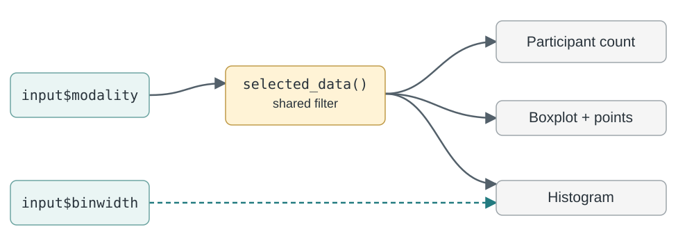
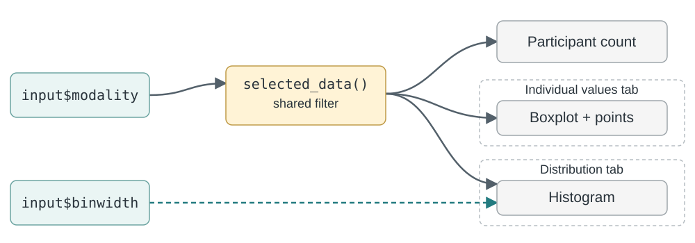
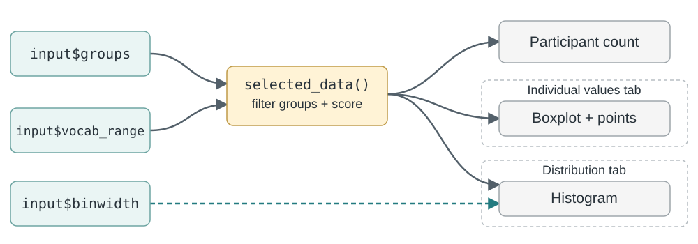
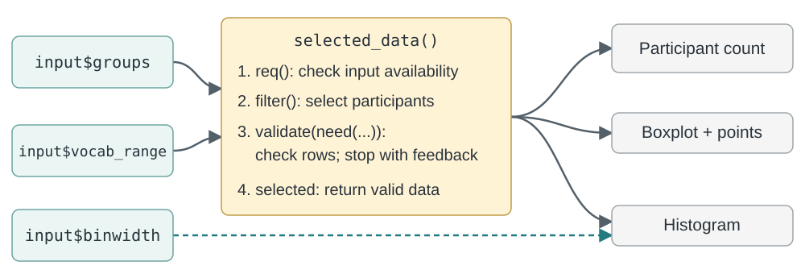
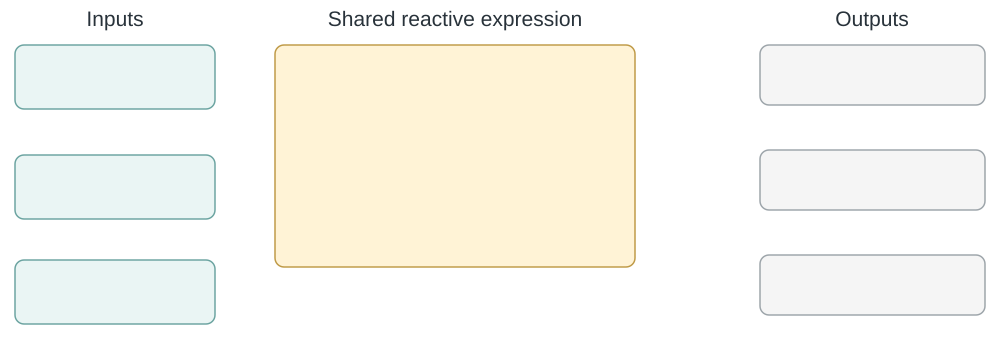
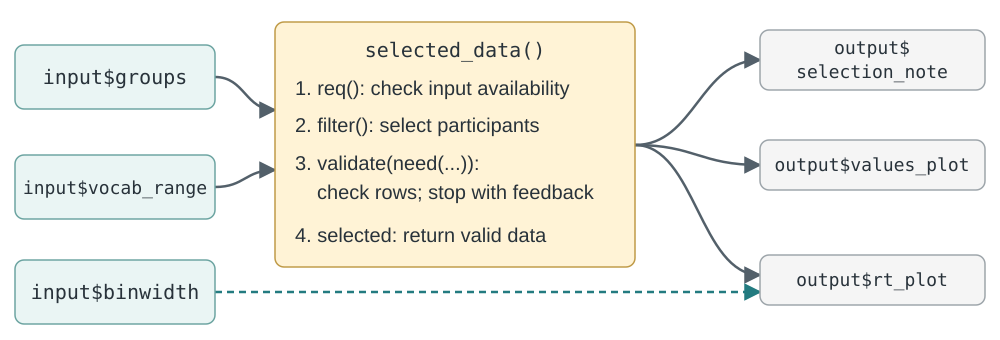
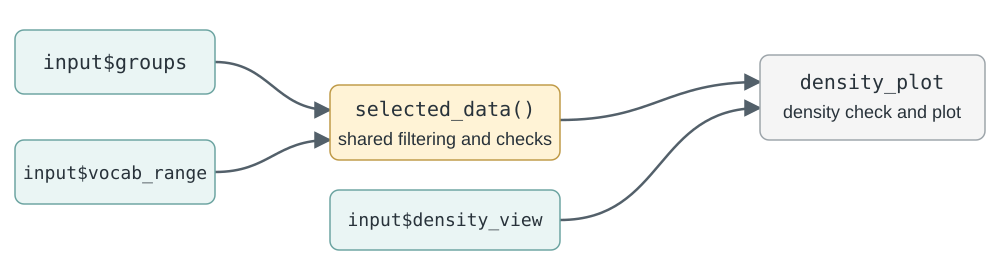

## Where to work

Download `psyc40940-week-08-tabs-controls.zip` from NOW and unzip the whole folder into your existing module RStudio project. Keep the scripts beside `data/` inside `week-08-tabs-controls/`.

Open `session-guide.html` in a web browser. Keep it beside the named app script;
use the contents menu to find the stage shown on the slides. You do not need to
knit or edit the guide. Read instructions here, make changes in the R scripts
in RStudio, and use Run App to test them.

The slides introduce an example before you modify it. You do not need to type along or build an app from scratch. Complete the active blanks for the current checkpoint before running. In Exercise 2, two later blanks are deliberately inside a commented block and remain untouched until checkpoint B.

| File | Purpose |
|---|---|
| `intro_app.R` | familiar working Week 7 sidebar app |
| `starter_app.R` | Exercise 1: organise views into tabs with shared controls |
| `controls_app.R` | Exercise 2A: combine group and range filters; Exercise 2B: explain empty results and help users recover |
| `extension_app.R` | optional worked example adding a third summary tab |
| `optional_density_app.R` | optional choice of colour or facets to compare the same groups |

After source edits, save, stop the running app and use Run App again. Keep it running while testing its controls. Only one example needs to be running at a time.

The apps load `shiny` and `tidyverse`, as in previous weeks; no new packages are
needed. If Shiny is missing, run `install.packages("shiny")` once in the RStudio
Console before running an app.

## Reference for the Week 7 recap

The opening task uses your completed Week 7 `layout_app.R`, before the Week 8 download instructions. Trace which outputs depend on each input. Why did we put the filter in a shared `reactive()` expression instead of repeating it inside each output?

The shared expression keeps the filtering rule in one place and lets several outputs reuse its cached result. Changing a filtering input makes that result out of date; it is recalculated when needed. Changing only histogram bin width redraws the histogram without rerunning the shared filter. This avoids repeated work and makes the filtering rule easier to maintain consistently across views.

Changing group affects the shared data, participant count and both plots. Changing only bin width leaves the shared data and the other outputs unchanged. Arrows show dependencies, not a fixed execution order. These notes support the recap; they are not a separate exercise.

## See how two tabs organise the app

Open `intro_app.R` and choose Run App. It reproduces the Week 7 sidebar app's UI, reaction-time observations, plots and shared-data server. The CSV now also includes `vocabulary_score` for the later filtering task; the opening apps do not use that extra column. The supplied CSV still contains 72 participant means, 33 speech and 39 writing. Each value is a mean across familiarisation conditions, in milliseconds, not an individual trial.

Compare the one-page app with the tab example on the slides. Tabs give a view more space but hide the other view, which can make direct comparisons harder. Keep shared controls and the participant count outside the tabs so the reader can always see the current selection.

[Wickham, section 6.3](https://mastering-shiny.org/action-layout.html#multi-page-layouts), introduces tabs as a way to divide an app that has become too complex for one page into pieces, with one piece visible at a time. His example separates tasks such as importing data and viewing results.

The slides introduce the two-tab example and explain its advantages:

- Each view has more room for its plot, labels and explanation.
- The tabs separate reading tasks: Distribution shows the overall shape; Individual values compares group summaries and observations.
- Shared group controls and the participant count remain visible, so readers know which sample both views describe.
- The trade-off is that readers must switch views and remember the hidden plot. If the question requires direct visual comparison, showing the plots together may work better.

These are design choices for our example, not a requirement to give every plot a separate tab.

A control's location alone does not determine its scope. Outputs depend on the inputs their server code reads. Moving an output location into a tab preserves its connection when you keep its name unchanged. Open each tab to check the current selection; a hidden plot may wait until it is displayed before rendering.

## Exercise 1: build two tabs

Your turn, about 20 minutes: open `starter_app.R`. The server and plotting code are unchanged from the familiar Week 7 app. Complete all five `---` blanks before running:

The goal is to give readers two clearly explained views while preserving the existing controls and server connections.

1. Replace the outer wrapper with the function that holds a set of tabs, using the slide example.
2. Replace each inner wrapper with the function that creates one named tab.
3. Complete the two `p("---")` strings with your own short explanations of what a reader can learn from the histogram and the boxplot with points. Keep the quotation marks.

Hint: the two tab functions

Use `tabsetPanel` for the container and `tabPanel` for each individual tab. The parentheses are already supplied.

The opening parentheses are supplied. Keep the plot names `"rt_plot"` and `"values_plot"`, the commas, and the brackets. Both controls stay in the sidebar, while the count stays above the tab container.

Save and run. Select writing, then open each tab: the count should be 39, and both views should show that group. Change bin width: only the histogram should change. Switch tabs again and check that the controls retain their values.

Choose which view should appear first. If changing the order, move each whole `tabPanel()` block, including its explanation and plot. Explain why this order helps the reader. For direct comparison, two plots shown together may be preferable to tabs.

Together, check: identify an unchanged output name and its server counterpart. Why could we change the navigation without rewriting the server?

## Choose one or several groups

Revisit the checkbox example on the slides (about five minutes). Many of you tried this in Week 7; check what happens with one group, both groups, or no groups selected. If this is new to you, the explanation below is available while you work on Exercise 2A.

`selectInput()` supplies one group in the familiar app. `checkboxGroupInput()` can supply one, both, or no groups. The named `choices` vector offers the values `"speech"` and `"writing"` with readable labels. `selected = c("speech", "writing")` ticks both initially. The current selection is held in `input$groups`.

The UI name `"groups"` matches `input$groups` in the server. The data column is still called `modality`. The names have different jobs; `filter()` explicitly compares the column with the selected values.

Use `modality %in% input$groups` to keep a row if its group matches any selected value. For example, `"speech" %in% c("speech", "writing")` is `TRUE`. `==` compares element by element and can recycle multiple selected values across rows, rather than checking membership. `%in%` handles one, both, or no selected groups.

Next, add a vocabulary-score range filter, test a working app, and improve its empty-selection feedback.

## Vocabulary range selects participants; plots still show reaction time

The added column `vocabulary_score` comes from the source data's participant-level `ppt_vocab`. Each of the 72 participants has one recorded score; observed values run from 0.8125 to 1.0000. We retain the supplied scale and round scores to four decimal places to remove floating-point noise at filter boundaries. The data dictionary is in `data/README.md`.

We may be interested in participants with particular properties rather than the whole sample. For example: how are reaction times distributed among participants with vocabulary scores from 0.90 to 0.95? The histogram and boxplot still display mean reaction time in milliseconds; vocabulary score selects whose observations contribute. This changes the subgroup question, rather than identifying excluded participants as errors.

The supplied `sliderInput("vocab_range", ...)` starts with `value = c(0.80, 1.00)`. Its two handles return a vector: `input$vocab_range[1]` is the lower bound and `input$vocab_range[2]` is the upper bound. Square brackets select one element of that vector.

In `filter()`, the group, lower-bound and upper-bound conditions must all hold for a row to remain. `>=` includes the lower endpoint; `<=` includes the upper endpoint. Narrowing the vocabulary range selects participants by their scores, rather than trimming reaction-time values. It does not establish that excluded participants were errors or that vocabulary causes reaction-time differences.

The separate `binwidth` slider changes how the included reaction times are grouped into histogram bins. It does not remove participants.

Trace each input. Which two change the participant count? Which changes the histogram without changing the count or boxplot?

## Exercise 2A: filter groups and a range

Your turn, about 12 minutes: open `controls_app.R`. Its tabs are complete, so you can start even if Exercise 1 took longer.

The goal is to let readers select a subgroup by both output group and vocabulary score, with the same participants feeding every view. Before running, predict whether narrowing the range will change the count, histogram and boxplot.

This script has six blanks in total, but only four are active at checkpoint A. Leave the four lines beginning with `# validate(need(` through `# ))` commented. Their two blanks belong to checkpoint B.

Complete the four active blanks:

1. Supply the UI function from the checkbox example that allows one, both, or no groups to be selected.
2. In the group filter's `input$---`, supply the control name declared in that UI function.
3. In the first `input$vocab_range[---]`, supply the index of the lower value.
4. In the second `input$vocab_range[---]`, supply the index of the upper value.

Hint: selecting groups and reading the range

Use `checkboxGroupInput` for the UI. Match the filter's input name to `"groups"`. A two-value range has its lower value at `[1]` and upper value at `[2]`.

The supplied `req(input$vocab_range)` silently stops the current attempt if the range input is unavailable. Keep it as written; we will explain visible feedback after testing this stage.

The boxplot now uses `aes(x = modality, y = mean_rt)` so selecting both groups puts them at separate x positions. The histogram retains `aes(x = mean_rt)`, pooling the selected groups. Its optional `facet_wrap()` line is commented for now. This change to the comparison is separate from the tab exercise, whose plotting code stayed unchanged.

Save and choose Run App. Test these valid selections first:

| Selection | Expected result |
|---|---|
| Both groups; full range 0.80–1.00 | count 72; histogram pools groups; boxplot separates them |
| Speech only; full range | count 33 |
| Writing only; full range | count 39 |
| Both groups; vocabulary range 0.90–0.95 | count 19; both views show those participants' reaction times |
| Change only bin width | histogram changes; count and boxplot stay fixed |
| Switch tabs | selected controls persist |

Then uncheck both groups, or select both and narrow the range to 0.80–0.81. Observe the count and plots: is it clear what happened and how the reader can recover? Restore both groups and the full range. We will use that problem to motivate checkpoint B.

## Help the reader recover

After testing the range filter in Exercise 2A, spend about three minutes on the
recovery example shown on the slides. A subgroup of interest may have no matching
participants in the available data. An empty selection can mean no group was
ticked or no participants had scores in the chosen range. A useful message
explains both the problem and an action: select a group or widen the range.
Without that explanation, an empty plot could look like an app error or
unfinished loading. We will now add this feedback to the shared preparation.

## Check the rows before returning the data

The three functions have different roles. `req()` checks a prerequisite and stops the current attempt silently if it is unavailable. It does not keep R in a waiting loop; Shiny can try again after an input changes. Our fixed vocabulary slider normally supplies a default value, so `req(input$vocab_range)` is mainly a startup guard here. If an unavailable range reached our filter without this guard, filtering could raise an R error.

`need(condition, "message")` returns `NULL` when the condition passes or the message when it fails. It does not stop the calculation or display that message on its own. `validate()` acts on the check: when it fails, the current calculation stops and dependent outputs display the feedback. We teach `validate(need(...))` as a pair. See Shiny's [`req()`](https://shiny.posit.co/r/reference/shiny/latest/req.html) and [validation documentation](https://shiny.posit.co/r/reference/shiny/latest/validate.html).

Without the validation block, an empty selection in our app produces count 0 and empty plots, but provides no recovery guidance. This is the behaviour you observed at checkpoint A. With validation, that state produces an explanation instead. Valid selections work in both versions.

`selected` holds the filtered data frame inside the shared reactive expression. It is an ordinary data frame, so `nrow(selected)` counts its rows. The last line, `selected`, supplies the result returned when the reactive expression is called.

Place `validate(need(...))` after filtering and before that last line. `need(nrow(selected) > 0, "message")` checks whether at least one row remains. When it fails, `validate()` stops the calculation and passes the message to each output using the shared expression. When the check passes, the expression continues and returns `selected`.

The already supplied `req(input$vocab_range)` handles an input that is not available yet by stopping silently. It does not explain an empty result. Do not add `req(input$groups)` here: clearing both groups is a foreseeable user action, for which we want a visible recovery message.

The numbered steps show what happens inside the expression when it is evaluated. They are not separate reactive nodes. When validation fails, Shiny passes the validation condition to outputs using this expression. After the user changes an input to a valid selection, the expression can return data and the plots appear again.

## Exercise 2B: explain an empty selection

Continue in the same app, about 13 minutes. Stop the running app before editing.

The goal is to replace unexplained empty plots with a message that tells readers why no observations appear and how to recover. The count and both plot locations should give the same useful feedback.

1. Locate the four commented lines from `# validate(need(` through `# ))` inside the shared reactive expression.
2. Select those four lines and use RStudio's Code > Comment/Uncomment Lines, or remove their leading `#` characters. Leave the separate `facet_wrap()` line commented.
3. Complete the two newly active blanks. In `nrow(---)`, name the filtered data frame assigned just above. In the quoted message, write your own explanation of what happened and how to recover. Mention selecting a group or widening the range.
4. Keep `selected` as the final line of the reactive expression. Save and use Run App again.

Test empty selections and recovery:

| Test | Expected result |
|---|---|
| Uncheck both groups | recovery message in the count and each plot location |
| Both groups; range 0.80–0.81 | recovery message |
| Restore both groups and range 0.80–1.00 | count 72; plots return |
| Return to each single group | counts 33 and 39 |
| Change bin width only | histogram changes; count and boxplot stay fixed |
| Switch tabs | filters retain their values; each view respects them |

Together, check: where do filtering, validation and plotting happen? Why does one check supply feedback to several outputs? Is your message useful without you explaining it aloud?

Differences between these participant groups do not establish a causal effect of output modality. Keep the app's data description, units and limitation sentence visible.

## Draw the complete reactivity graph (4 minutes including checking)

After Exercise 2B, keep your completed `controls_app.R` open. The boxes below
are supplied; add their names and draw the arrows yourself. Copy the boxes onto
paper or use a drawing tool.
This is a check of the core app, not a new coding task or an optional extension.

1. Read the server and identify its input references, shared reactive expression
   and output definitions. Write each name in the appropriate box.
2. Draw an arrow from each dependency to the calculation that reads it. A call
   to your shared expression connects that expression to the output using it.
3. Annotate where `req()` and `validate(need())` happen. Ordinary checks and
   `filter()` stay inside their reactive expression; they are not extra nodes.
   The static source data and UI tab containers are not reactive nodes either.
4. Follow the arrows to predict the effect of changing the vocabulary range,
   then of changing only bin width. Does a range input have to appear on a plot
   axis to affect that plot?

Try for three minutes, then check the answer below or on the next slide.
Use the graph to explain the empty-selection and restoration tests above;
those tests are part of Exercise 2B's allocated time.

After drawing: check your graph

There are seven reactive nodes and six direct arrows:

- `input$groups` → `selected_data()`.
- `input$vocab_range` → `selected_data()`.
- `selected_data()` → `output$selection_note`.
- `selected_data()` → `output$rt_plot`.
- `selected_data()` → `output$values_plot`.
- `input$binwidth` → `output$rt_plot`.

The shared expression's input check, filter and row validation are code within
one node, not separate reactive nodes. Both vocabulary-range endpoints are
values from the same input, so they do not need separate input boxes. Tabs
change where outputs appear, not these dependencies. Box positions are your
choice; correct names and connections matter.

Changing group or range invalidates the shared selection and its dependent
outputs. Changing bin width updates only the histogram and leaves the shared
selection cached. If validation fails, feedback reaches the count and plots
through these same dependencies; restoring a valid selection restores outputs.

## Optional: compare pooled and group density curves

Question: does pooling speech and writing participants conceal differences between their reaction-time distributions?

Open `optional_density_app.R`, which supplies the completed core app plus a third Density comparison tab. Complete its seven `---` blanks. This task is independent of the histogram task. Density and Summary are alternative third tabs; choose one rather than adding a fourth.

`geom_density()` draws a smooth estimate of a distribution. All selected participants pools the selected groups into one curve; Separate groups draws one curve per group using coloured outlines and transparent fills. Both modes use exactly the same selected participants. Each curve has total area one, so curve areas and heights do not show group sample sizes. Compare shape and position alongside the boxplot and raw points. See the [density documentation](https://ggplot2.tidyverse.org/reference/geom_density.html) for reference.

Complete the seven blanks:

1. In the new tab's `p("---")`, explain the pooled and grouped views and what comparing them helps the reader see.
2. Supply the input function for mutually exclusive radio options. The named values are `"pooled"` and `"groups"`; the server reads `input$density_view`.
3. Match `plotOutput("---")` to the new `output$density_plot` in the server.
4. Complete the matching render function, using the existing plots as examples.
5. Supply the shared reactive result as the data for the density ggplot.
6. Supply the density geom in the grouped branch. The mapping `colour = modality` is supplied.
7. Map fill to the same group column. `alpha = 0.25` makes the filled areas transparent enough to see overlap.

Hints for the density connections and layers

Use `radioButtons`, `"density_plot"`, `renderPlot`, `selected_data()`, and `geom_density`. Complete `fill = modality` so outline and fill identify the same groups. There are no facets in this task.

### How the supplied choice code works

`p_density <-` stores a ggplot in a variable. The supplied `if (input$density_view == "groups") { ... } else { ... }` runs the grouped branch when Separate groups is selected. That branch maps both colour and fill to modality; the pooled branch uses `geom_density()` without a group aesthetic. The final `p_density` returns the chosen plot. You do not need to write this conditional structure.

The group and vocabulary controls change which observations contribute to all views. The radio control changes only how the density displays the selected observations. Pooling highlights the overall distribution but can hide differences between groups; separate coloured curves reveal those differences but can overlap. Explain the consequence for your question in the app text.

### Test the density comparison

- With both groups and vocabulary range 0.80–1.00, switch between All selected participants and Separate groups. One pooled curve should become two coloured and filled curves. The participant count, histogram and boxplot should stay unchanged.
- Select each group alone, then select both with range 0.90–0.95. The latter gives 19 participants; both density modes should reuse that selection.
- Change histogram bin width. Only the histogram should change; density smoothing is separate from histogram binning.
- Clear groups or use range 0.80–0.81. Restore a valid selection after reading the recovery message.
- Range 0.81–0.82 leaves one participant. The count and existing plots can show that observation, while either density mode explains that more participants are needed.

The supplied checks require at least two participants for a pooled curve and at least two in every selected group for grouped curves. A grouped selection that is too small may still support a pooled curve; its message offers that option. These checks belong inside the density output, so they do not prevent other plots from showing a smaller valid sample.

Extend your graph with `input$density_view` and `output$density_plot`. The new input and shared reactive result feed the density output. The display control does not change the shared filter.

## Optional: let the user facet the histogram

Question: when is the overall reaction-time distribution useful, and when should the reader compare groups in separate panels?

Open `optional_histogram_app.R`. It supplies the completed two-tab core app and four `---` blanks. You will add a checkbox to the Distribution tab so the reader can switch faceting on or off without editing code. This task does not add a third tab.

1. In `p("---")`, explain what an unchecked versus checked box does and what each view helps readers compare.
2. Supply the input function that provides a single checkbox. Its name is `"facet_groups"`; unchecked supplies FALSE and checked supplies TRUE.
3. Supply the shared reactive result as data for the histogram ggplot.
4. Supply the function that creates one panel per modality in the supplied conditional block. Keep the common scales and bin width.

Hints for the histogram control

Use `checkboxInput`, `selected_data()` and `facet_wrap(~modality)`. The function parentheses are already supplied where appropriate. The checkbox value is read as `input$facet_groups`.

`p_hist <-` stores the initial pooled histogram. The supplied `if (input$facet_groups)` adds facets only when the checkbox is checked. The checkbox supplies TRUE when checked and FALSE when unchecked, so the condition reads that value directly. The final `p_hist` returns the pooled or faceted plot. You do not need to write this conditional code.

Test with both groups and the same vocabulary range and bin width. Unchecked should show one histogram; checked should show one panel per selected group. The count, boxplot and selected rows must stay the same. Change bin width, select one group, test an empty selection and restore both groups. With one group, faceting gives only one panel.

Update your reactivity graph: add a box for the checkbox input, `input$facet_groups`, then connect it to the histogram output, `output$rt_plot`, to show which plot it changes. It changes how the data are displayed, not which observations the shared filter selects. State when the pooled or faceted view is more useful for your question.

## Optional: add a third summary tab

`extension_app.R` is a worked example of a third Summary tab. Find `tabPanel("Summary", ...)`, its `tableOutput("summary_table")`, and the matching `output$summary_table <- renderTable({ ... })` block.

Add that whole tab to your own `tabsetPanel()`, keeping commas between tabs. Add the whole render block inside your server, alongside the other outputs. `group_by(selected_data(), modality)` groups the selected rows; `summarise()` calculates a participant count with `n()` and a median for each group. This example uses nested function calls, without pipes.

Test both groups, each group and an empty selection. The shared expression already supplies data or the validation message. Keep the table's explanation meaningful to the reader.

For the assessment, three tabs is a maximum, not a target, and a table is optional. At least two useful interactive plots are required; plots responding to Shiny controls qualify. Keep a third tab only if it helps answer a useful question.

## Optional reference: other ways to supply values

The same dependency pattern works with other controls. Choose a control for the value the calculation needs:

| Control | Value | Useful when |
|---|---|---|
| `selectInput()` | one selected value by default | a compact list is helpful |
| `radioButtons()` | one selected value | a few alternatives should all stay visible |
| `checkboxGroupInput()` | a vector of selected values | readers may include several groups |
| `numericInput()` | one number | readers need to type an exact value |
| `checkboxInput()` | `TRUE` or `FALSE` | a single option is on or off |

Inputs may affect data selection or how a plot is drawn. Our vocabulary-range slider selects participants; our bin-width slider changes a plotting argument. These are reference options for later project work, not additional exercises to finish today.

## After class

Read Wickham's *Mastering Shiny*, [section 6.3.1: tabsets](https://mastering-shiny.org/action-layout.html#tabsets) and [section 8.1.4: validating outputs](https://mastering-shiny.org/action-feedback.html#validate-output). Focus on tab placement and actionable recovery feedback. No written response or extra feedback package is required.

Bring a dataset for Week 9. Have the data available in your project, the code that loads it, its source, and one question you want to explore. A candidate is fine if you are still deciding. Week 9 adds Plotly hover/zoom and time to adapt the dashboard; supplied practice data are available as a backup. Week 10 focuses on reproducibility, explanations and project support.

## After completing your app: compare with the reference

Now run `worked_example_app.R`. Compare both tabs, the shared controls and every empty-selection test. Trace each input into the shared filter or histogram and explain any changes needed before editing your own code. Compare the app explanations too, and keep your own version.

## References

Wickham, H. (2021). *Mastering Shiny*. O’Reilly Media. [Online edition](https://mastering-shiny.org/).
