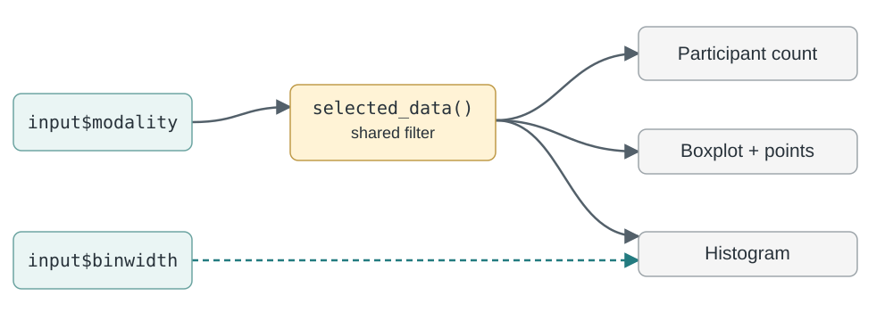
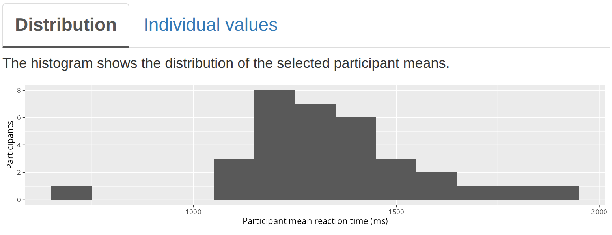
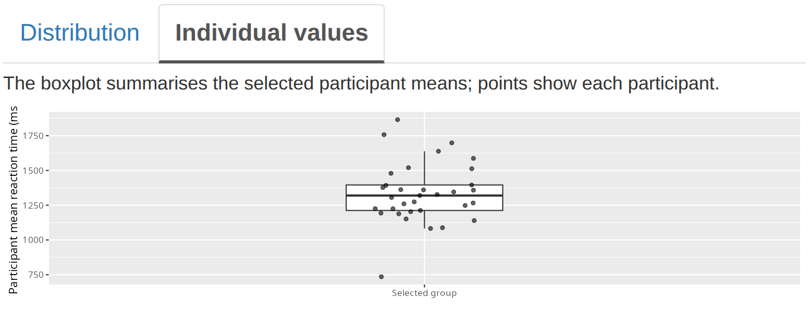
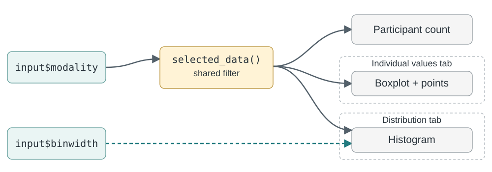
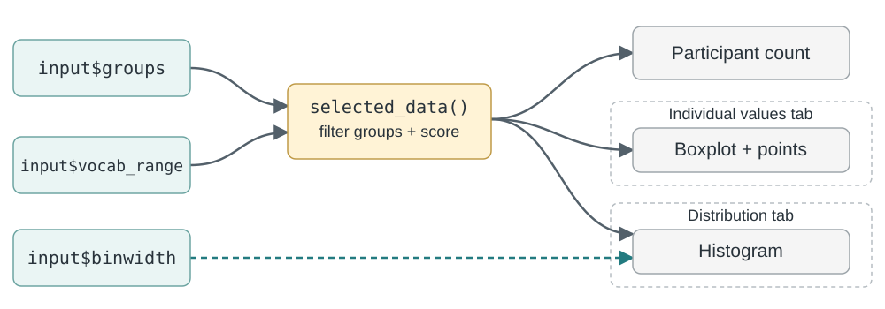
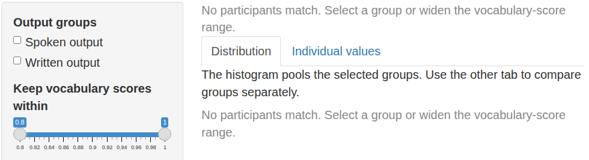
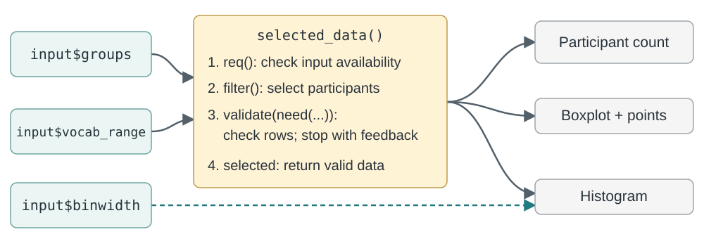
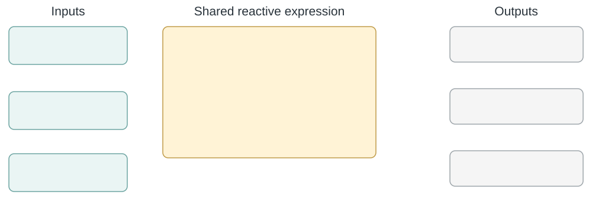
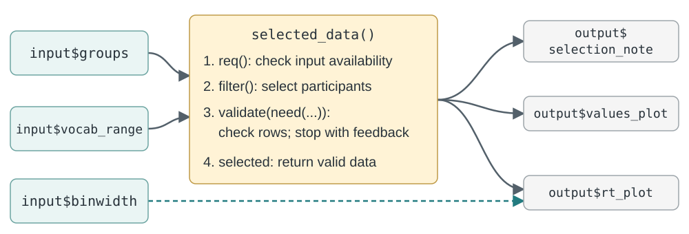

## Recall: Trace The Week 7 Connections {.smaller}

Open your completed Week 7 `layout_app.R` and choose **Run App**.



**Trace each input:** which outputs change? Why did we use `reactive()` for the shared filter instead of repeating it inside each output?

## Today: Make Exploration Easy To Navigate

- Give each plot its own tab, with clear labels and explanations.
- Let users select one or both groups and a range of vocabulary scores.
- Make all plots show the participants who match those choices.
- If no participants match, show a message explaining what to change.

## Download And Open The Session Guide {.smaller}

Unzip **`psyc40940-week-08-tabs-controls.zip`** into your existing module project. 

Open **`session-guide.html`** in a web browser. Read it beside your exercises code.

| Guide section | What you can add to an app |
|---|---|
| Exercise 1: build two tabs | Separate views into tabs with shared controls |
| Exercise 2A: filter groups and a range | Combine group and range filters across views |
| Exercise 2B: explain an empty selection | Explain empty results and help users recover |


## Two Tabs Give Each View Room {.smaller}

<div class="tabs-intro-columns">
<div class="tabs-intro-images">





</div>
<div>

[Wickham, §6.3](https://mastering-shiny.org/action-layout.html#multi-page-layouts): divide a complex page into manageable pieces.

- **More space:** one plot and its explanation at a time.
- **Clear purposes:** overall distribution or individual values and summaries.
- **Same selection:** shared controls and count stay outside the tabs.

**Trade-off:** the other plot is hidden. Show plots together when direct comparison matters.


</div>
</div>

## Tabs Change Location, Not Dependencies {.smaller}



The connections are unchanged. Keep controls and the count outside the tabs, and preserve the output names.

Changing group affects both plots. When the reader opens the other tab, it shows the current selection too.

## Put Familiar Plot Locations Inside Tabs 

<div class="connection-columns">
<div>

```{r tabs-structure, eval=FALSE}
mainPanel(
  tabsetPanel(
    tabPanel("Distribution",
      p("Explain this view."),
      plotOutput("rt_plot")
    ),
    tabPanel("Individual values",
      p("Explain this view."),
      plotOutput("values_plot")
    )
  )
)
```

</div>
<div>

**One outer wrapper:** `tabsetPanel()` holds all tabs.

**One wrapper per view:** `tabPanel()` gives a tab its visible name and contents.

Keep controls in `sidebarPanel()`. Leave the count above the tabs; it is omitted from this short example.

Keep `"rt_plot"` and `"values_plot"` matched to their server outputs.

</div>
</div>

## Exercise 1: Build And Explain Two Tabs 

Follow **Exercise 1: build two tabs** in the guide and open `starter_app.R` (**about 20 minutes**).

- Complete **three function names**: one tab container and two individual tabs.
- Complete **two explanations** telling the reader what each view contributes.
- Save and run. Switch tabs, change group, then change only bin width.
- Choose which view should come first and explain the reason.

The server is already complete. You are changing navigation and explanation around familiar plots.

Use `tabsetPanel()` for the container and `tabPanel()` for each tab.

## Check The Connections After Moving The Plots 

| Test | Expected result |
|---|---|
| Select writing, then open each tab | Both views show the same 39 participants |
| Change bin width | Only the histogram changes |
| Switch tabs | Controls keep their values; count stays visible |


- Why could the server stay the same? 
- When would showing both plots together be preferable?

## Check The Connections After Moving The Plots 

| Test | Expected result |
|---|---|
| Select writing, then open each tab | Both views show the same 39 participants |
| Change bin width | Only the histogram changes |
| Switch tabs | Controls keep their values; count stays visible |

- **Same connections:** we kept the input/output names and server calculations; only the UI locations changed.
- **Show plots together** when readers need to compare patterns directly, without remembering a view hidden in another tab.


## Recall: Choose One Or Several Groups {.smaller}

**Quick check (about 5 minutes):** predict which rows remain with one group, both groups, or no groups selected.

```{r checkbox-example, eval=FALSE}
checkboxGroupInput(
  "groups", "Output groups",
  choices = c("Spoken output" = "speech",
              "Written output" = "writing"),
  selected = c("speech", "writing")
)
```

`choices` lists the available values; `selected` ticks both initially. `input$groups` holds the current selection, which may contain one, two, or no values.

Use `modality %in% input$groups` to keep rows matching **any** selected group. `==` compares values element by element and was suitable for the earlier single choice.

Here `"groups"` names the control; `modality` remains the data column. 


## Filter Participants By Vocabulary Score {.smaller}

```{r range-example, eval=FALSE}
sliderInput("vocab_range", "Keep vocabulary scores within",
            min = 0.80, max = 1.00,
            value = c(0.80, 1.00), step = 0.01)
```

**Why filter?** We might want to examine reaction times among participants with vocabulary scores of **0.90–0.95**, rather than everyone. The range selects **which participants** appear; the axes still show reaction time.

The handles supply a vector: `[1]` is its lower value; `[2]` is its upper value.

```{r range-filter, eval=FALSE}
selected <- filter(
  d_participants,
  modality %in% input$groups,
  vocabulary_score >= input$vocab_range[1],
  vocabulary_score <= input$vocab_range[2]
)
```

Each condition must hold. **Vocabulary range** selects participants.

## Two Filters Feed The Shared Preparation {.smaller}



Group and vocabulary range select participants; vocabulary score is not mapped to either plot axis. The count and both plots use the same result from `selected_data()`.

**Trace it:** which input changes the histogram without changing the count or boxplot?

## Exercise 2A: Get Filtering Working First {.smaller}

Open `controls_app.R` and follow **Exercise 2A: filter groups and a range** (**about 12 minutes**).

Complete **four active blanks**: checkbox function, group input name, and two range indexes. Leave the commented validation block for the next checkpoint.

- Test both groups (**72**), speech (**33**), and writing (**39**) with the full range.
- Set the score range to **0.90–0.95** with both groups: **19 participants** remain. Check both tabs.
- Change bin width: the count and boxplot should stay fixed.

Then clear both groups or use the range **0.80–0.81**. Observe the result and restore a valid selection. We will now improve the feedback.

## Discussion: Help The Reader Recover {.smaller}



A subgroup of interest may contain no participants. What happened, and what could they change?

- **Cause:** no group is ticked, or no participants match the chosen score range.
- **Recovery:** select a group or widen the vocabulary-score range.
- **Why explain it?** A blank plot could look like an app error or unfinished loading.

## Explain Why A Calculation Stops {.smaller}

These checks run inside a reactive expression or a render block when its calculation is needed.

| Function | What happens when the check fails? |
|---|---|
| `req(input$vocab_range)` | Stop the current attempt silently if the range is unavailable |
| `need(condition, "message")` | Produce the failure message; on its own, it does not stop the calculation |
| `validate(need(...))` | Stop and show that message in the affected outputs |

- **Without validation:** our empty selection produces count **0** and empty plots, with no recovery guidance.
- **Without `req()`:** an unavailable input can reach the filter and cause an R error. Our fixed slider normally supplies a default, so this is mainly a startup guard.

Shiny documentation: [`req()`](https://shiny.posit.co/r/reference/shiny/latest/req.html) and [`validate()` / `need()`](https://shiny.posit.co/r/reference/shiny/latest/validate.html).

## Check Rows Before Returning Shared Data {.smaller}

<div class="connection-columns shared-example-columns">
<div>

```{r shared-validation, eval=FALSE}
selected_data <- reactive({
  req(input$vocab_range)
  selected <- filter(
    d_participants,
    modality %in% input$groups,
    vocabulary_score >= input$vocab_range[1],
    vocabulary_score <= input$vocab_range[2]
  )
  validate(need(
    nrow(selected) > 0,
    "Choose a group or widen the range."
  ))
  selected
})
```

</div>
<div>

**1. Check the prerequisite:** `req()` ends this attempt silently if the range is unavailable. Shiny tries again when the input changes; there is no waiting loop.

**2. Check the result:** `need()` tests whether rows remain and supplies a failure message. `validate()` acts on that result and stops the calculation if needed.

**3. Return valid data:** if the check passes, the last line returns `selected`. On failure, dependent outputs receive the validation feedback.

For an empty selection, `validate(need(...))` explains what the reader can change. Using `need()` alone would let the calculation continue.

</div>
</div>

## One Shared Check Reaches Every Output {.smaller}

The checks are code **inside one reactive expression**, rather than additional reactive nodes.



- **Input missing:** `req()` stops this attempt silently.
- **No rows:** validation stops; each dependent output displays the recovery message.
- **Rows present:** return the data and calculate the outputs. Changing inputs can restore a valid selection.

## Exercise 2B: Explain Empty Results {.smaller}

Continue in **the same `controls_app.R`** and follow **Exercise 2B: explain an empty selection** (**about 13 minutes**).

- Enable the four commented lines from `validate(need(` to `))`.
- Complete its **two blanks**: the filtered data-frame name and your own recovery message.
- Save, stop and rerun. Test no groups, an empty range, then a valid selection.

Tell the reader **what happened and what to change**. Check the count and each tab: they all depend on the shared preparation.

The guide explains how to uncomment the lines and lists the expected results.

## Draw The App's Reactivity Graph {.smaller}

Use your completed **`controls_app.R`** to fill these boxes and add arrows (**3 minutes**). Copy the boxes onto paper or use a drawing tool.



1. Name each input, the shared expression and each output from the server code.
2. Add arrows from dependencies to the calculations that read them.
3. Mark `req()` and `validate(need())` inside the shared expression.

**Predict:** what updates when the range changes? Does bin width rerun the filter? Tabs are not extra nodes.

## Check Your Graph Against The Code {.smaller}



- **Seven nodes, six arrows:** compare their names and directions with your code.
- **Range changes:** update selected rows, count and both plots, even though vocabulary is not on either plot axis.
- **Bin width changes:** redraw only the histogram; selected rows stay cached.

Use your graph to explain the empty-selection and recovery tests you completed in Exercise 2B.

## Build An App Around A Clear Question

Review today's choices: how would they help a reader answer a clear question?

- Keep controls and sample information easy to find.
- Use tab names and app text to explain what each view contributes.
- Choose views that help answer a question; compare them together when necessary.
- Test valid selections, empty selections and recovery.

The assessment permits **at most three tabs** and requires **at least two interactive plots**. Two purposeful tabs can be sufficient. Shiny-reactive plots qualify; Week 9 adds Plotly hover and zoom.

## After Class: Read About Tabs And Feedback 

Read @Wickham2021MasteringShiny:

- [Section 6.3.1: tabsets](https://mastering-shiny.org/action-layout.html#tabsets).
- [Section 8.1.4: validating outputs](https://mastering-shiny.org/action-feedback.html#validate-output).

Connect the examples to your app. 

**Bring a dataset for Week 9:** have the data available in your project, the code to load it, its source, and one question you would like to explore. A candidate dataset is fine if you are still deciding; supplied practice data remain available as a backup.

## Optional: Choose A Further Comparison {.smaller}

Once your core app works, choose an independent extension:

- **Pooled or grouped density?** Complete seven blanks in `optional_density_app.R`. Compare one overall curve with group curves using colour and transparent fill.
- **Let the reader facet the histogram:** complete four blanks in `optional_histogram_app.R`. Add a checkbox that switches between one pooled histogram and separate group panels.
- **Add a summary tab:** use the table example in `extension_app.R` and check each group's count and median.

Density changes group aesthetics; the histogram task adds user-controlled faceting. Both distinguish data selection from display choices.

Summary and Density are alternative third tabs. The histogram task keeps two tabs. Optional work can continue after class.

## Optional: One Density Or Separate Group Curves? {.smaller}

Open `optional_density_app.R` and follow **Optional: compare pooled and group density curves** in the guide. Complete its **seven blanks**.

```{r density-control, eval=FALSE}
radioButtons(
  "density_view", "Compare groups using",
  choices = c("All selected participants" = "pooled",
              "Separate groups" = "groups"),
  selected = "groups"
)
```

- One pooled curve can hide differences between groups. Map **colour and fill** to modality to see separate curves; transparent fill makes overlap visible.
- The radio control changes only the density plot. Group and range controls still select the participants for every view.

Compare shapes, not group sizes. 

## Optional: Let The Reader Choose Histogram Panels {.smaller}

Open `optional_histogram_app.R` and follow **Optional: let the user facet the histogram** in the guide. Complete its **four blanks**.

```{r histogram-facet-control, eval=FALSE}
checkboxInput(
  "facet_groups", "Show each group in a separate panel",
  value = FALSE
)
```

- **Unchecked:** one pooled histogram of the selected participants.
- **Checked:** add `facet_wrap(~modality)` to compare group distributions with common axes and bin width.
- Test that the count and boxplot stay unchanged.

The guide explains the supplied conditional code. Explain when each arrangement helps your question.

## Optional Reference: Other Ways To Supply Values {.smaller}

| Control | Value supplied | Useful when |
|---|---|---|
| `selectInput()` | One selected value by default | A compact list of choices |
| `radioButtons()` | One selected value | A few alternatives should all stay visible |
| `checkboxGroupInput()` | Several selected values | Readers may include several groups |
| `numericInput()` | One number | Readers need to type an exact value |
| `checkboxInput()` | `TRUE` or `FALSE` | A single option is on or off |

Choose a control for the value your calculation needs. The same input can guide filtering or a plotting choice, as our bin-width slider already does.


## After Completing Your App: Compare And Explain 

Now use `worked_example_app.R` to compare with your own version.

Compare both tabs, the shared controls, and all empty-selection tests. Explain how the shared preparation supplies valid data or feedback to each output.

Keep your own work. Use the reference to check your reasoning and app explanations.

## References
