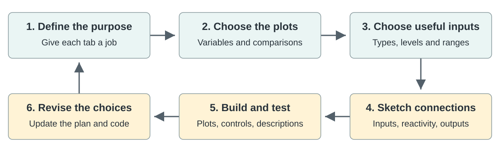
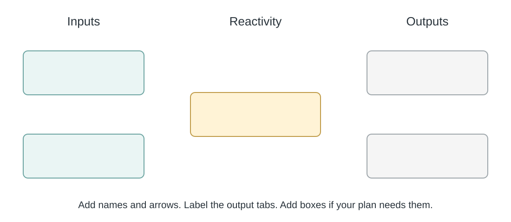
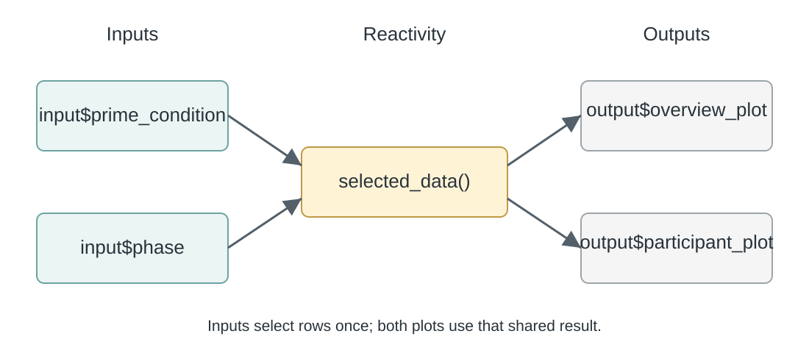

## Where to work

Unzip the whole Week 9 folder into your existing project. Keep data/ beside the app scripts. Open session-guide.html in your browser and read it beside the named R script. Use Run App for complete app scripts; finish the current script's `---` blanks before running.

We first add Plotly to a dense scatterplot using trial-level data from the familiar naming study (about 15 minutes including explanation and testing). For the rest of the session, use your own data if ready, or investigate the supplied language-learning study.

Follow the guide in this order:

1. Exercise 1: everyone adds Plotly to the familiar naming-data app.
2. Choose your data, then complete Exercises 2 and 3: plan the purpose, tabs, controls and graph on paper or in Word.
3. Exercise 4: follow one coding route—Route A for your own data or Route B for the supplied data—using the plan you have already made.
4. Exercise 5: show your app to another student nearby, use their feedback to refine it and retest it. Try an optional addition if the core works. 

## Install Plotly

Please install Plotly by running `install.packages("plotly")` in the RStudio Console. You only need to do this once, not each session. If Plotly is already installed, skip this step. The app scripts load their own packages.

## Exercise 1: add hover and zoom

Open `plotly_app.R`. This task uses `data/trial_reaction_times.csv`: 8,648 naming trials from 72 participants. The scatterplot shows response duration (`dur`) on x and reaction time (`rt`) on y, both in milliseconds, with output group as colour. Many trials come from the same participant. The count reports both participants and trials. Complete its three connections using the slides: the Plotly UI output function, its matching render function, and the function converting the ggplot stored in `p`.

<details>
<summary>Hint: the Plotly function names</summary>

Use `plotlyOutput("rt_plot")`, `renderPlotly` and `ggplotly(p)`. 

</details>

Save and use Run App. The slowest responses stretch the full plot axes. Drag to zoom into the main cluster and compare the regions occupied by speech and writing trials. Hover to identify a stimulus, participant, trial and timing values; then double-click to reset and see the unusually slow responses in context. Click a legend entry to hide/show a group. Transparent points reveal dense regions; zoom helps distinguish nearby observations without removing the long responses from the dataset. Zoom and legend visibility do not change the shared participant or trial count; group and range filters do. Test those filters, no groups and recovery. The tooltip text is supplied in `aes(text = ...)`; the Plotly conversion uses `tooltip = "text"`. Plotly is a tool to use when the interaction helps, not a requirement for every plot.

## Use an iterative development strategy

Start with the purpose and tab roles, then choose provisional plots using the variables and comparisons required. Decide which inputs would help readers explore those views, sketch the reactivity graph, then build and test the plots, controls, shared preparation and descriptions. Revise the plan as you learn from the result.



You do not need to settle every decision before coding. A clearer question may suggest another output; comparing several groups may require checkboxes rather than a single-choice selector; a working plot may suggest a different control or function. Add, replace or simplify features when they support the purpose. Keep a working version, change one part at a time, update your graph and descriptions, and retest the affected connections. These are ordinary development decisions that can inform your later reflection.

Wickham provides practical support for this approach:

- In [Sections 4.3–4.4](https://mastering-shiny.org/basic-case-study.html#exploration), he explores the data outside Shiny, then starts with a small prototype before adding detail.
- [Section 5.1](https://mastering-shiny.org/action-workflow.html#development-workflow) emphasises repeatedly editing the code, running the app and experimenting with the result.
- [Section 17.3](https://mastering-shiny.org/best-practices.html#testing) notes that a test plan can be a simple manual checklist. Use the predictions from your graph and the guide's checks to retest after changes.

The `purpose → provisional plots → inputs → graph` sequence is the planning framework used in this workshop, rather than a fixed sequence. It combines purposeful visualisation choices with his small-prototype and iterative-development approach.

## Choose your workshop route

Choose which data description to use. Both routes start with the same planning tasks on paper or in Word. App files will be introduced at the coding stage.

- Route A **own data**: explain what one row in your dataset represents—for example, one participant, one trial, or one participant’s summary for a condition. Identify the variables and data source, then use this information to complete Exercises 2 and 3. Skip the supplied-data description and continue to Exercise 2.
- Route B **supplied data**: read [Supplied dataset for the planning tasks](#supplied-data-brief) below, including its app requirements, then complete Exercises 2 and 3. It provides the observations, variable types and levels needed for those tasks.

## Supplied dataset for the planning tasks {#supplied-data-brief}

If you have not brought your own data, use this description for Exercises 2 and 3. You can choose a purpose, sketch tabs and plan the inputs and graph, without loading data or opening app code. 

This is the workshop dataset: `data/participant_rates.csv`. The data come from [van Lieburg et al. (2023), *The development of abstract syntactic representations in beginning L2 learners of Dutch*](https://doi.org/10.1007/s41809-023-00131-5). 

### What was recorded?

Seventeen learners of Dutch described pictures at up to five testing occasions over eight months. Before each response, they heard a prompt: a neutral word pair (Baseline), a sentence in active or passive voice. For example, "The girl pushes the boy" is active; "The boy is pushed by the girl" is passive. At each testing occasion, picture-description tasks happened before and after a short practice block using passive sentences. Before and After are phases within a visit. 

The outcome is how often a learner produced a full passive sentence. It is not a correctness or general language-ability score. A reasonable exploratory app can compare patterns across occasions or conditions, and inspect the individual variation. 

### What does one row mean?

One row summarises four recorded target trials for one learner, at one testing occasion, in one sentence condition and one phase. There are 492 summary rows, not 492 learners. Missing occasions have no row; they are not zero responses.

| Column | Type and levels | Meaning for planning |
|---|---|---|
| `participant` | identifier; 17 learners | connects repeated observations from the same learner |
| `study_session` | ordered occasions, 1–5 | describes change across testing visits |
| `prime_condition` | categorical; Baseline, Active sentence, Passive sentence | allows comparison or selection of three prompt conditions |
| `phase` | categorical; Before or After | identifies the phase within each visit |
| `n_passive` | count; 0, 1, 2, 3 or 4 | number of full passive responses out of four recorded target trials |
| `vocabulary_score` | numeric, 0–1; measured once at occasion 4 | can select learners with different vocabulary scores as an optional extension |

### Two possible starting purposes

Choose one starting purpose and use it to label your tabs:

- Purpose 1: explore how passive-sentence use changes across testing occasions and whether individual learners follow the average. Tab 1 shows the average pattern; Tab 2 adds individual variation. Condition and phase controls let the reader repeat that comparison for different selections.
- Purpose 2: explore whether sentence-condition differences look consistent across occasions and learners. Tab 1 makes condition means easy to compare; Tab 2 shows the individual paths behind those means. The same two controls focus the comparison.

Both purposes fit the same small app, but emphasise a different question. Use one as your starting point for Exercise 2. 


### Supplied-data app requirements for your plan

Use these requirements when completing Exercises 2 and 3:

- Inputs: condition checkboxes (`input$prime_condition`) and a one-choice phase selector (`input$phase`).
- Reactivity: `selected_data()` filters the rows once using both selections, then supplies both plots.
- Outputs: `output$overview_plot` shows mean counts out of four trials across occasions; `output$participant_plot` shows individual learner paths. Each plot has its own tab.

Plan this small core first. Continue to Exercise 2 to write the purpose and tab roles, then draw these connections in Exercise 3. Keep app code closed until Exercise 4.

## Exercise 2: define the purpose and tab roles

If you are using the supplied data (Route B), first read the previous section, [Supplied dataset for the planning tasks](#supplied-data-brief), including the variable table, suggested purposes and app requirements. Use that information to complete this exercise. If you are using your own data (Route A), use your own dataset description instead.

Planning only: use pen and paper, Word or similar, for Exercises 2 and 3. Do not write or edit R code during these tasks. 

What should the reader learn from the data? An exploratory purpose is sufficient. Use your own data notes or the supplied-data description and two starting purposes.

### 1. Find a question the data can address

Identify the behavioural outcome, what one row represents, and the variables that could organise variation. Check variable types, units, missing values and repeated observations before deciding what to compare. Choose a question pattern that fits the data:

- How does this behaviour differ between groups or contexts?
- How are two measures associated?
- How does behaviour change across occasions?
- Does an overall pattern describe individuals equally well?

Write: "This app helps readers explore how ______ varies with / across ______." Avoid promising a causal conclusion from observational comparisons. 

### 2. Give each tab a job

Sketch two tabs. Write each tab's question, variables and provisional plot type, then complete: "The first tab shows ______. The second tab adds ______." The plots should contribute different information to the overall purpose.

Choose the provisional plots before deciding which inputs they need. Check whether the variables are continuous, categorical or ordered, and how many levels a categorical variable has. For example, two continuous variables may support an association plot; a continuous outcome across categories may support a distribution comparison. Many category levels may need ordering or a different layout. The question and comparison should guide the choice alongside variable type.

<details>
<summary>Help: earlier session materials</summary>

Continue with your plan using what you already know. You do not need to revisit earlier weeks now; open these materials only if you need a reminder or code example.

- Weeks 3 and 4: `aes()`, geoms, continuous/categorical variables and the data structure each plot needs. Week 4 also compares raw observations with summaries.
- Week 5: "Variable Type Also Guides Aesthetics" and `02_colours_and_aesthetics.Rmd` cover colour, shape, scales and comparison choices. `01_labels_and_legends.Rmd` covers readable labels and legends; the supplementary slides contain further faceting and theme examples.
- Week 2: perception and comparison principles to help explain why a design helps the reader.

</details>

<details>
<summary>Examples: give two plots different jobs</summary>

Use these examples if you need ideas; choose plots that suit your own question and variables.

- Compare distributions and explore an association: one tab could use density curves or boxplots with individual points to compare reaction times between groups. A second could use a scatterplot of reaction time against response duration, with colour identifying the groups.
- Compare an average with individual patterns: one tab could use a point-and-line plot of mean responses across testing occasions. A second could use individual learner trajectories or a learner-by-occasion heatmap to show variation concealed by the average. For the supplied data, plot full passive-response counts out of four trials.

Explain what the second view adds to the first, rather than choosing two plot types just to make them different.

</details> 

### 3. Specify useful interaction

Start with your provisional plots, then choose two controls for the first version. For each, write "Changing this lets the reader compare / inspect ______", say which outputs it should affect, and give a sensible initial selection. A filter selects observations; a display control changes how the same observations are shown. Include a control because it supports a useful comparison, rather than simply because its code is available.

Match the control to the variable and intended selection. For a categorical variable, check the number of levels and whether users need a single value or several: a short set can remain visible as radio buttons or checkboxes, while a longer list may suit a dropdown. For a numeric range, check meaningful bounds, units and increments. Not every plotted variable needs an input. These choices are provisional: a better plot or a revised question may lead you to change the controls.

<details>
<summary>Optional help: control examples from earlier sessions</summary>

Use these references only if you need ideas or a reminder. You do not need to open earlier materials now; they are available on NOW.

| Decision or code pattern | Where to look |
|---|---|
| Select one category or a single numeric value | Week 6: `selectInput()` and the bin-width `sliderInput()` |
| Select several groups and match them with `%in%` | Week 7: `optional_groups_app.R`; Week 8: `controls_app.R` |
| Select a numeric interval using its two endpoints | Week 8: `controls_app.R`, Exercise 2A in its session guide |
| Choose one display mode with radio buttons | Week 8: `optional_density_app.R` |
| Turn faceting on or off with a checkbox | Week 8: `optional_histogram_app.R` |
| Reuse selected data and explain empty selections | Week 7: shared `reactive()` preparation; Week 8: Exercise 2B validation |

In Exercise 4, you can borrow a small working pattern and adapt its names, choices, ranges and labels to your variables. Check your graph to identify which outputs should change; the original example's behaviour is not automatically the right behaviour for your app.

</details>

Keep three short planning items: the overall purpose sentence, the two-tab sketch with each view's contribution, and two controls with their reasons. Use them for the preliminary graph and revise them later as you inspect plots.

## Exercise 3: sketch the preliminary reactivity graph

Use Word, or pen and paper. The blank template below is inspiration.



Use your plan from Exercise 2. For supplied data, use the input and output names in the requirements above. For your own data, choose names that match your proposed controls and plots.

Show three areas:

1. Inputs: the two controls readers will use.
2. Reactivity: the shared expression that selects or prepares data.
3. Outputs: the two plot outputs, with their tab names.

Draw arrows from each value to the calculation that reads it. Predict what each input in your own graph should update. The graph records your current plan; revise it when a plot or control changes during implementation.

For this exercise, use at least two tabs and two interactive plots. Start with two controls; a third is optional.

Your planning is now complete. Continue to Exercise 4 using [Route A for your own data](#route-a) or [Route B for supplied data](#route-b). Complete one coding route, then continue to Exercise 5 for feedback, refinement and testing. 

## Exercise 4 *Route A*: build with your own data {#route-a}

Your purpose sentence, two-tab sketch, two controls and preliminary graph are now ready. Use those decisions to build your first version; adjust the plan when testing suggests a better choice. Follow this route only if you are using your own data.

### A1. Load your data, then implement and test in stages

1. Open `own_data_app.R`. Replace `"data/---"` with your CSV path, or adapt the import to your file format. If you already have a working app, save a copy rather than overwriting it.
2. Make both ggplots work outside Shiny first. Check that each serves its tab's purpose and uses the right variables, quantities and units. Start with simple working plots, then refine their presentation.
3. Fill the two sidebar control slots. Borrow `selectInput()` from Week 6, `checkboxGroupInput()` from Weeks 7–8, or `sliderInput()` from Week 8. Adapt names, choices and defaults; add commas between UI elements.
4. Replace the shared-preparation `NULL` with code that selects or prepares your data and returns the resulting data frame. Borrow Week 7's `reactive()` pattern and Week 8's filtering and `validate(need(...))` checks. The reactive wrapper is already supplied.
5. Replace the first plot's `NULL` with its ggplot, now using `selected_data()` as the data. Run App and test this output. Next, connect and test the second plot in its render block. The UI output names already match the server.
6. Add the purpose, meaningful tab names, axis labels and short explanations. Describe what each tab adds, what the controls change and any important limits of the selected observations.
7. Test the predictions from your graph, every tab, empty selections where relevant and recovery. Revise the plan or code when behaviour differs from your intention.

The `NULL` values are temporary empty results so the outline can run while unfinished. Replace them, rather than adding a second reactive expression or duplicate render function. The `# ---` markers identify the blocks to complete; instructions belong here in the guide.

Once both plots and controls work, skip Route B and continue to [Exercise 5: show your app to another student and refine it](#exercise-5).

## Exercise 4 *Route B*: build with supplied data {#route-b}

Use your completed purpose sentence, tab sketch and graph to implement the supplied-data app. The input/output requirements were provided before Exercises 2 and 3; this section puts that plan into code.

### B1. Inspect the outline and preview the plots

Open `supplied_data_app.R` now. Keep your completed plan beside it so you can check the connections as you build.

The script already loads the packages and ready CSV and supplies `ui`, `server`, `sidebarLayout()` and two tabs with matching output/render names. The CSV is already prepared; use `data/README.md` for further details about its columns and coding. Use Run App to inspect the empty outline. Its `NULL` results deliberately display no plots yet. The `# ---` markers show five blocks to build: two controls, one shared preparation and two plots. Two tab explanations also need your own text.

Before wiring the controls, preview the ggplots in a separate R script. Load the CSV with the code below and use `preview_data` in place of the first `---` in each plotting example in B4. This previews one phase without needing working Shiny inputs. It lets you check the variables, axes and two tab roles first.

```{r preview-supplied-plots, eval=FALSE}
library(tidyverse)
d_workshop <- read_csv("data/participant_rates.csv", show_col_types = FALSE)
preview_data <- filter(d_workshop, phase == "Before")
```

Then return to the app and follow B2–B4 to connect controls and shared preparation. Use `selected_data()` for the ggplot data inside the render blocks, rather than leaving `preview_data` there.


### B2. Add the two controls

Replace the first sidebar marker with the input below. Complete the function name for a control that allows several choices. Keep the supplied input name, choices and defaults.

```{r condition-control-task, eval=FALSE}
---("prime_condition", "Sentence conditions",
    choices = c("Baseline", "Active sentence", "Passive sentence"),
    selected = c("Baseline", "Active sentence", "Passive sentence"))
```

Replace the second marker with a selector for one phase. Complete its function name; keep a single selected value.

```{r phase-control-task, eval=FALSE}
---("phase", "Phase to display",
    choices = c("Before", "After"), selected = "Before")
```

Add a comma after each control when placing it before `helpText()` inside `sidebarPanel()`. Save and Run App. Check that conditions allow multiple selections while the phase selector shows one value.

<details><summary>Control hints and earlier examples</summary>

Use `checkboxGroupInput` for conditions and `selectInput` for phase. Compare Week 8's `controls_app.R` and the selector in your Week 6 app. Copy only the relevant input call and adapt its name and values; do not paste a whole second UI.

</details>

### B3. Build the shared reactive preparation

Replace `NULL # --- shared preparation` inside the existing `reactive({ ... })` with this code. Complete the data object and a recovery message that tells the reader what to change.

```{r shared-preparation-task, eval=FALSE}
selected <- filter(
  ---,
  prime_condition %in% input$prime_condition,
  phase == input$phase
)
validate(need(nrow(selected) > 0, "---"))
selected
```

The loaded data object is `d_workshop`. `%in%` matches any selected condition; `==` matches the single phase. The final line returns the filtered rows. Reuse the shared expression for both plots, as in Week 7. Week 8 shows the validation pair and recovery messages.

### B4. Add and test one plot at a time

Replace the first render block's `NULL` with the average plot below. Complete its data argument using your shared reactive result and write the axis labels. Keep the supplied variable mappings.

```{r average-plot-task, eval=FALSE}
ggplot(---,
       aes(x = study_session, y = n_passive,
           colour = prime_condition, group = prime_condition)) +
  stat_summary(fun = mean, geom = "line") +
  stat_summary(fun = mean, geom = "point") +
  scale_x_continuous(breaks = 1:5) +
  scale_y_continuous(breaks = 0:4) +
  coord_cartesian(ylim = c(0, 4)) +
  labs(x = "---", y = "---", colour = "Sentence condition")
```

Use `selected_data()` for the data. Label x as testing occasion and y as mean full passive responses (out of 4). `n_passive` counts full passive responses out of four trials, so each learner has an integer value from 0 to 4. `stat_summary(fun = mean, ...)` calculates a mean across learners for each occasion and condition; this average can be fractional. The shared filter has already selected one phase. Save and run before proceeding: change condition and phase and check that this plot updates. Once the average plot works, add the individual plot below.

Replace the second render block's `NULL` with the individual plot below. Complete its shared data argument and labels.

```{r individual-plot-task, eval=FALSE}
ggplot(---,
       aes(x = study_session, y = n_passive,
           colour = prime_condition,
           group = interaction(participant, prime_condition))) +
  geom_line(alpha = 0.35) +
  geom_point(alpha = 0.35) +
  scale_x_continuous(breaks = 1:5) +
  scale_y_continuous(breaks = 0:4) +
  coord_cartesian(ylim = c(0, 4)) +
  labs(x = "---", y = "---", colour = "Sentence condition")
```

Label y as full passive responses (out of 4), with ticks 0–4. A one-unit change represents one more or fewer full passive response in four trials. `interaction(participant, prime_condition)` identifies one learner–condition path, preventing lines from joining different learners or conditions. The code is supplied; you do not need to invent this grouping. The mean reveals the overall pattern while individual paths reveal variation. Missing occasions are not zero responses, and repeated rows are not additional learners.

Replace each tab's `p("---")` with a brief explanation of what its plot contributes to your chosen purpose. Put the overall purpose in the app introduction and tell readers what the controls change. Keep labels and explanation relevant to the comparison. You do not need to interpret the paper's research findings.

### B5. Check the core before extending it

1. With all conditions and Before, the shared selection has 246 summary rows. After also has 246 rows. Baseline alone in either phase gives 82 rows. These counts describe the data; they are not an extra output you need to build.
2. Change the conditions: both plots should change. Change the phase: both plots should change. Compare these effects with your graph.
3. Clear all conditions: both plots should show your recovery message. Restore a condition and check both tabs again.

<details><summary>After your attempt: compare the core graph</summary>



Both input nodes connect to `selected_data()`. The shared expression connects to each plot output. Tabs and static data are not extra reactive nodes.

</details>

## Exercise 5: show your app to another student and refine it {#exercise-5}

Both routes complete this exercise. Show your app to another student nearby and ask for feedback. Allow about 10 minutes to show your app, hear their suggestions and make improvements.

### 1. Make the app ready for a reader

Include its purpose, what each tab adds, units, what the controls change and relevant limitations. Use `p()` and `helpText()` from the earlier apps; comments in the R script are not visible to the reader.

### 2. Show your app to another student

Show your app to another student nearby and let them explore it before you explain it aloud. Ask them to describe:

- what question the app helps them explore,
- what each tab shows and what the second view adds,
- what they expect a control to change, then whether the result matches that expectation,
- anything unclear about the labels, units, instructions or behaviour.

Then show your purpose sentence and graph. Do they match what the other student understood and observed? Explain one design choice and how it helps the reader. For the supplied-data route, focus on the app's clarity and behaviour; detailed interpretation of the paper's findings is not required.

### 3. Refine and retest

Use the feedback to improve something that was unclear. For example, if the other student cannot tell what a control changes, revise its label or add a short `helpText()` explanation. If the tabs seem to repeat each other, clarify what each view contributes or adjust a plot.

Retest the affected controls and both tabs, including empty selections and recovery where relevant. Use your graph to predict which outputs should change; revise the code or graph if they disagree.

Record one change and why it helps the reader; this can inform your later reflection. If no change is needed, record one choice the other student found clear and why it worked. Further refinement can continue independently and in Session 10. Try optional additions only after the core app works.

## Optional: choose one addition after the core works

Choose an addition useful for your question. You may borrow code from previous weeks. If you add an input, update your graph and explain which output or shared expression reads it. Keep the app to two plots and two or three controls for this exercise.

### Option 1: add a numeric range filter

For the supplied data, add a slider for the LexTALE scores (`vocabulary_score`) using this UI call before the sidebar's `helpText()`. For your own data, choose a suitable numeric variable and bounds.

```{r optional-vocabulary-control, eval=FALSE}
sliderInput("lextale_range", "Vocabulary score (LexTALE)",
            min = 0, max = 1, value = c(0, 1), step = 0.0125)
```

Replace the `filter()` call inside the shared expression with:

```{r optional-vocabulary-filter, eval=FALSE}
selected <- filter(
  d_workshop,
  prime_condition %in% input$prime_condition,
  phase == input$phase,
  vocabulary_score >= input$lextale_range[1],
  vocabulary_score <= input$lextale_range[2]
)
```

Keep the validation and final `selected` line. Update the message to suggest widening the range as well as selecting a condition. This is the Week 8 range-filter pattern. LexTALE was measured once at occasion 4: it selects learners, not occasions; all available occasions remain eligible. It does not establish a causal effect of vocabulary.

Test 0–1, 0.50–0.60 and an empty 0–0.40 selection, then restore 0–1. Both plots should update. Keep this as your only third control if choosing it.

### Option 2: add a faceting checkbox to one plot

Borrow `checkboxInput()` and the conditional faceting pattern from Week 8's `optional_histogram_app.R`. Add a checkbox named `facet_conditions`, then store the average ggplot in `p` inside its existing render block. After the plotting expression and before returning `p`, use:

```{r optional-facet-choice, eval=FALSE}
if (input$facet_conditions) {
  p <- p + facet_wrap(~prime_condition)
}
p
```

The checkbox should default to FALSE. It changes only the average plot's arrangement, not the selected rows or individual view. Keep panel scales common. Explain whether colour on shared axes or separate panels helps your comparison. Add an arrow from the new input directly to the average output. Choose this or the range control, rather than adding both in this exercise.

### Option 3: add Plotly to a core plot

Apply Exercise 1's three-function pattern to one plot: its UI output function, matching render function and `ggplotly(p)`. Store the ggplot in `p` before converting it. No additional control is needed. Test that existing filters and recovery still work and explain whether hover or zoom adds useful information. `extension_app.R` is a worked reference for converting both plots, to compare after your attempt.

## Between Weeks 9 and 10

Aim to bring a working starting point, not a polished final portfolio:

1. Confirm a summative dataset, record its source and explain one row. If you used the supplied practice route, transfer the planning exercise to a proposed dataset of your own. If still unsure, bring a candidate source and a specific suitability question.
2. Keep your purpose sentence, two-tab sketch and updated graph. Aim for two working plots and two controls in the app. Get at least one own-data ggplot working; if the app is unfinished, retain the runnable version or smallest failing example and write what you expected, the error and the next step.
3. Start or update the report Rmd using the formative workflow. Plan four different static figure types and render a draft with at least one figure. Use your formative feedback to identify a concrete priority for design reasoning, interpretation or presentation.
4. Bring the whole project, latest rendered report, your graph and specific questions to Session 10. Do not leave missing-file or rendering problems until final submission.

Session 10 provides time to refine unfinished code, review the static figures and report commentary, and go through the full submission requirements, AI declaration and NOW submission guide. It does not introduce another compulsory app feature. Protect time for the static report as well as the dashboard.

For reference, read Wickham's [section 7.1.6](https://mastering-shiny.org/action-graphics.html#interactivity-limitations). No written response is required.

## After your attempt: compare the examples

`plotly_worked_app.R` completes the short familiar-data exercise. `worked_example_app.R` completes the small two-control, two-plot study app. Use it after your own attempt to compare behaviour and reasoning.

Optional: `extension_app.R` converts both study views to Plotly. Compare it with your Exercise 1 changes; retain conventional reactive plots when clearer. Plotly does not resolve sparse data or replace good explanations.

## References

van Lieburg, R., Sijyeniyo, E., Hartsuiker, R. J., & Bernolet, S. (2023). The development of abstract syntactic representations in beginning L2 learners of Dutch. *Journal of Cultural Cognitive Science, 7*, 289–309. [Paper](https://doi.org/10.1007/s41809-023-00131-5). [Public data and analysis scripts](https://osf.io/x8ejm/).

Wickham, H. (2021). *Mastering Shiny*. O'Reilly Media. [Online edition](https://mastering-shiny.org/).
