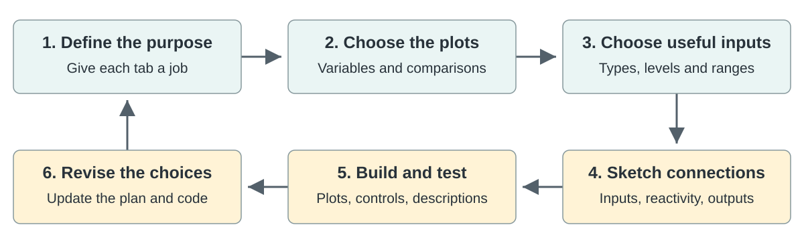

## Today: Plan And Build An App

- Add Plotly hover and zoom to a familiar plot.
- Plan the app's purpose, two views and controls; sketch a reactivity graph.
- Build the app: connect plots and controls, add explanations, then test and refine.

Download `psyc40940-week-09-dashboard-workshop.zip` from NOW and unzip the whole folder into your module project.

Keep `session-guide.html` open in a browser alongside RStudio.

Install Plotly once in the RStudio Console: `install.packages("plotly")`.

## Does Hover Or Zoom Help The Question? {.smaller}

The slowest responses stretch the axes. Zoom into the main cluster: do speech and writing trials occupy different regions? Hover to identify a stimulus; double-click to reset.

```{r plotly-demonstration, echo=FALSE, message=FALSE, warning=FALSE}
d_demo <- readr::read_csv("data/trial_reaction_times.csv",
                         show_col_types = FALSE)
p_demo <- ggplot2::ggplot(
  d_demo,
  ggplot2::aes(x = dur, y = rt, colour = modality, group = modality,
               text = paste("Stimulus:", stimulus,
                            "<br>Participant:", ppt_id,
                            "<br>Trial:", trial_id,
                            "<br>Group:", modality,
                            "<br>Duration (ms):", round(dur, 1),
                            "<br>Reaction time (ms):", round(rt, 1)))
) +
  ggplot2::geom_point(alpha = 0.2) +
  ggplot2::labs(x = "Response duration (ms)",
                y = "Reaction time (ms)", colour = "Output group")
plotly::ggplotly(p_demo, width = 980, height = 320, tooltip = "text")
```

8,648 trials from 72 participants: transparent points reveal dense regions. Zoom reveals local detail while reset restores the full context; neither action removes trials.

## Change The Output And Render Pair Together {.smaller}

<div class="study-code-columns">
<div>

**Familiar Shiny plot**

```{r standard-shiny-comparison, eval=FALSE}
# In the UI.
plotOutput("rt_plot")

# Inside the server.
output$rt_plot <- renderPlot({
  p <- ggplot(
    selected_data(),
    aes(x = dur, y = rt,
        colour = modality)
  ) +
    geom_point(alpha = 0.2)
  p
})
```

</div>
<div>

**With Plotly hover and zoom**

```{r plotly-comparison, eval=FALSE}
# In the UI.
plotlyOutput("rt_plot")

# Inside the server.
output$rt_plot <- renderPlotly({
  p <- ggplot(
    selected_data(),
    aes(x = dur, y = rt,
        colour = modality)
  ) +
    geom_point(alpha = 0.2)
  ggplotly(p)
})
```

</div>
</div>

**Together:** Spot the three differences; then complete `plotly_app.R`.

## Exercise 1: Connect And Test Plotly (10 mins)

Complete `plotlyOutput()`, `renderPlotly()` and `ggplotly()` in `plotly_app.R`. Test hover, zoom, group/range filters and recovery from no selection.

The second plot stays a conventional Shiny-reactive plot. 

## Develop A Small App, Then Revise It {.smaller}



Your plan is provisional [@Wickham2021MasteringShiny]. See [Sections 4.3–4.4](https://mastering-shiny.org/basic-case-study.html#exploration) and [Section 5.1](https://mastering-shiny.org/action-workflow.html#development-workflow) for examples of this approach.


## Choose A Route For The Workshop

- **Have your own dataset?** Use its description and variable information for the planning tasks.
- **No dataset yet?** Read **Supplied dataset for the planning tasks** in `session-guide.html`. It provides the observations, variables and possible purposes you need.

Both routes begin with the same pen-and-paper tasks: an overall purpose, tab roles, provisional plots, useful controls and a preliminary reactivity graph.

We will introduce the app code when planning is complete.


## Exercise 2: Give The App An Overall Purpose 

Use pen and paper, Word, or similar (**about 10 minutes**).

What should a reader understand after using your app?

- Identify the behaviour or outcome and what one row represents.
- Choose a comparison: groups, an association, change, or variation hidden by a summary.
- Check that the variables can address it; describe associations without assuming causation.

Complete: **“This app helps readers explore how ______ varies with / across ______.”**

An exploratory purpose is enough. 

## Give Each Tab A Different Job 

Sketch two tabs and complete:

**“The first tab shows ______. The second tab adds ______.”**

For example, one tab could compare response-time distributions and another examine the relationship between reaction time and response duration.

For each tab, name its question, variables and provisional plot type. Check whether variables are continuous or categorical, and how many category levels the plot must show. Explain what the second tab adds.

## Decide What Readers Should Be Able To Change 

Choose **two useful controls** for your provisional plots. For each, finish:

**“Changing this lets the reader compare / inspect ______.”**

- For categorical choices, consider the number of levels and whether readers need one or several selections.
- For a numeric range, use meaningful bounds and units.
- A display choice should help compare the plotted variables, such as colour versus panels.


## Exercise 3: Sketch The Preliminary Reactivity Graph (5 mins)

Draw three areas: **inputs → reactivity → outputs**. Name the two controls, shared preparation and two plot outputs; label the output tabs.

Draw arrows from each value to the calculation that reads it. Predict which outputs change when each input changes.

For this exercise, start with **two plots, two tabs and two controls**. 

Your graph is a first plan. Update it while building.

## Exercise 4: Build The Plots, Then Connect The App 

**Coding starts here.**

- Make the first ggplot work with your data in R; then make the second.
- Add controls and shared reactive preparation, and connect one plot at a time.
- Add descriptions of the purpose, tab roles, units and control effects.
- Test the connections against your graph, including empty selections and recovery.

**Own data:** use `own_data_app.R` or your current app. Choose the two plots and controls yourself.

**Supplied data:** use `supplied_data_app.R`. Route B in the guide supplies the code tasks for controls, shared filtering and plots.

## Show Your Plan And First Plot

Show your purpose sentence, two-tab sketch, preliminary graph and first working plot.

If a control is connected, demonstrate what it changes. Otherwise identify the next connection to build.

## Exercise 5: Show Your App And Refine It

Show your app to another student nearby. Let them explore it before you explain it aloud.

Can they identify its purpose, what each tab adds, the units and what each control changes? Ask them to predict a control's effect, test it and point out anything unclear.

Use the feedback to improve labels, instructions or behaviour. Test both tabs and all controls, including empty selections and recovery. Check the connections against your graph.

Record one change and why it helps the reader, or one choice that worked well.

## Optional: Add One Useful Feature

Once the core app works, choose one addition that helps your question:

- A numeric range filter: select observations using another variable, such as vocabulary score.
- A faceting checkbox: switch one plot between shared axes and separate panels.
- Plotly: add hover or zoom where inspecting individual observations is useful.

The session guide provides instructions. Keep two plots and no more than three controls. Update your graph and retest the affected outputs. These additions can be completed independently.

## For Week 10: Bring A Working Starting Point 

- Confirm your summative dataset, source and observation unit. If still deciding, bring a candidate and a specific question about suitability.
- Keep your purpose sentence, two-tab sketch and updated graph. Aim for two working plots and two controls; get at least one own-data plot working and record any remaining app error.
- Start or update your report Rmd: plan four different static figure types and render a draft containing at least one figure. Use your formative feedback to identify a priority.
- Bring the whole project, your latest report and specific questions.

We'll have time to refine unfinished work, review the static report and go through submission. 

## After Your Attempt: Compare The Examples 

`plotly_worked_app.R` completes the Plotly exercise.

**Supplied-data route:** `worked_example_app.R` completes the small two-control, two-plot app. Compare it only after your attempt.

Optional supplied-data reference: `extension_app.R` converts both practice plots to Plotly. For your own app, add Plotly only if its interaction helps your question.

## References
