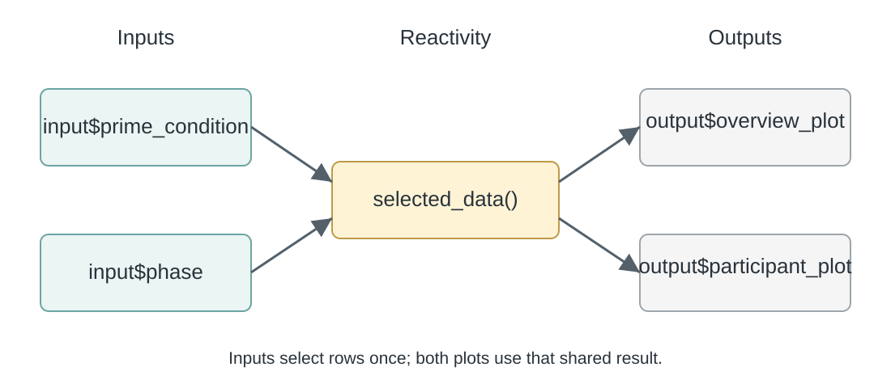

## Continue from your Week 9 app

If you made a plot work inside Shiny in Week 9, continue from that version today: add input controls, connect them to shared reactive preparation, then add a second view. If you missed Week 9 or do not yet have a working plot, follow the catch-up route in Exercise 1 first. Most of the session is for implementing and testing these connections. Submission requirements are covered near the end; detailed report and ZIP instructions below are for reference and independent practice.

Keep your Week 9 purpose, tab sketch and graph beside the code. Update the graph when your app changes; there is no new graph-drawing task. Keep a runnable version and change one part at a time.

## Where to work

Have your Week 9 work available if you have it, or bring your data files if you have not started the app. Supplied practice data are available if you have neither. Save your current script and stop the running app before opening another project. Begin by organising a dedicated assessment project. Work on a copy so your previous working version remains available. You do not need to copy the whole weekly teaching folder into the assessment project.

## Exercise 1: resolve the data-loading problems from Week 9

Last week, some data imports worked when run line by line in the project Console but failed with Run App, or vice versa. The app and project were sometimes in different folders, so the same relative path started from different locations.

Together, set up `psyc40940-portfolio` as your summative project. Keep the app, report and project file together, with your data file inside `data/`, so the Console, report and app use the same starting point for paths.

### Set up your portfolio folder

1. Copy the whole `psyc40940-portfolio/` folder from the unzipped Week 10 download to the location where you want to keep your assessment work, separate from the weekly teaching folders. It is also available in the separate `psyc40940-portfolio.zip`; unzip it before continuing.
2. Copy the app script you started in Week 9 into `psyc40940-portfolio/`. Rename the copied script `app.R`. Keep your original Week 9 script as a backup.
3. Copy the data file your app uses into the portfolio's existing `data/` folder. Keep its original filename and extension: it might be a CSV, Excel, SPSS or another supported format. If your app needs additional files, copy those too.
4. Double-click `psyc40940-portfolio.Rproj` inside `psyc40940-portfolio/` to open this project in RStudio. Check that RStudio shows `psyc40940-portfolio` as the current project.
5. Open the copied `app.R`, update its data path as explained below, and use Run App to check that your existing plot still works.

The folder already contains `report.Rmd`, `references.bib` with one example entry, `apa.csl` and `data/`. The project settings disable saving/restoring a workspace. Knit `report.Rmd` once to check the blank template renders; no data or figures are needed yet. Completing the report continues independently.

```text
psyc40940-portfolio/
  psyc40940-portfolio.Rproj  <- double-click this file
  app.R                    <- your copied Week 9 script
  report.Rmd
  references.bib
  apa.csl
  data/
    your-data-file          <- keep its actual name and extension
```

A project file stores settings; copying it alone does not copy your app or data. Keep `app.R` beside the report and project file.

<details><summary>If you do not yet have an app from Week 9</summary>

Follow the same folder and project steps. If you have data, copy `own_data_app.R` from this download into the portfolio folder and rename it `app.R`. If you have neither an app nor data, copy `supplied_data_template.R` as `app.R` and put the supplied `participant_rates.csv` and its dictionary into `data/`. Then follow the catch-up instructions below before Exercise 2. The supplied data are for practice; choose your own dataset for the summative submission.

</details>

### Use one path in the Console, report and app

A relative file path starts from R's current working directory. Opening the assessment project sets that directory to its main folder. When Shiny runs an app, it uses the app's folder. With `app.R`, the Rmd and `.Rproj` together, all three start from the same folder.

For the supplied data, both app and report can therefore use:

```{r project-data-import-example, eval=FALSE}
d_workshop <- read_csv("data/participant_rates.csv")
```

For your own data, keep the import function appropriate to your file format and update its path to `data/` followed by the actual filename and extension. The `read_csv()` example is only for CSV files; an Excel or SPSS import should keep its existing import function. Change any old `../data/` path or week-folder prefix in the copied code to match this new structure. Do not insert an absolute Desktop or Downloads path.

Keep package loading and data import in `app.R`, then use Run App to check the original plot still appears. Test input-dependent reactive code with Run App; line-by-line checks are for data loading and ordinary R code.

Once the plot runs, identify its data argument, UI output and matching render block. Keep the Week 9 graph beside it and decide which useful control to connect first. For supplied data, use sentence-condition checkboxes and one-choice phase selection; for your own data, choose controls suited to its variables.

<details><summary>Optional help: if the import still fails</summary>

Check the project name, then inspect the Files pane. Confirm that your data file is inside `data/`, with matching spelling and capitalisation. Check you opened the copied `app.R` from the assessment project, not the original weekly script. Test package loading and the import line before changing any plotting or filtering code.

</details>

## Catch-up: build your first plot if you missed Week 9

Complete this section only if you do not yet have a working plot inside Shiny. Begin with Exercise 1's project and file organisation, then follow the route matching your data. You can work on this while others connect controls. Once the plot runs, join Exercise 2; a useful target today is one plot that responds to a control.

<details>
<summary>I have data but have not built the app yet</summary>

Use the copied `own_data_app.R` as your project's `app.R`.

1. Put your data file inside `data/`. In the import line, replace `data/---` with its actual filename and extension. The template uses `read_csv()` for CSV files; for another format, use the import function you used successfully before. Keep the imported object named `my_data`, or consistently use the name already in your code.
2. Run the library and import lines in the project Console. Inspect the data and choose one question and a suitable column for your first plot. State what one row represents; you do not need to complete the full Week 9 planning exercise before trying one plot.
3. Create a simple ggplot outside Shiny. You can reuse code from earlier weeks or complete one of the examples below. Replace `---` with an actual column name, without quotation marks. Choose one example that suits your variable.

For a numeric variable, inspect its distribution:

```{r catchup-own-histogram, eval=FALSE}
ggplot(my_data, aes(x = ---)) +
  geom_histogram(bins = 20)
```

For a categorical variable, compare the number of observations in each category:

```{r catchup-own-bar, eval=FALSE}
ggplot(my_data, aes(x = ---)) +
  geom_bar()
```

4. In the existing `output$plot_one` render block, replace `NULL # --- first plot` with your working ggplot code. Keep the surrounding `renderPlot({ ... })` and its matching UI output name.
5. Save `app.R` and use Run App. Check that the same plot now appears in the first tab. Keep the second output and shared-preparation placeholders until you need them; they do not prevent this first plot from running.

Then follow Exercise 2 to connect a useful control. Your imported object is `my_data` and your first output is `plot_one`; adapt the supplied-data examples' `d_workshop` and `overview_plot` names accordingly. Add the second view when the first connection works.

</details>

<details>
<summary>I have neither an app nor a dataset yet</summary>

Use the copied `supplied_data_template.R` as your project's `app.R`, with `data/participant_rates.csv` beside it in the `data/` folder. The template imports this ready CSV as `d_workshop`; keep its package and import lines in the app.

The supplied data describe 17 learners across testing occasions, sentence conditions and Before/After phases. One row summarises four target trials; `n_passive` counts full passive responses from 0 to 4. Use `data/README.md` for the source paper and variable descriptions. For a first question, compare average passive counts across occasions and conditions in the Before phase.

1. Run the library and import lines in the project Console and inspect the data. Test the plot below in ordinary R first. Complete the outcome mapping using the count column just described.

```{r catchup-supplied-first-plot, eval=FALSE}
ggplot(filter(d_workshop, phase == "Before"),
       aes(x = study_session, y = ---,
           colour = prime_condition, group = prime_condition)) +
  stat_summary(fun = mean, geom = "line") +
  stat_summary(fun = mean, geom = "point") +
  scale_x_continuous(breaks = 1:5) +
  scale_y_continuous(breaks = 0:4) +
  coord_cartesian(ylim = c(0, 4)) +
  labs(x = "Testing occasion",
       y = "Mean full passive responses (out of 4)",
       colour = "Sentence condition")
```

2. Replace `NULL # --- average plot` inside the existing `output$overview_plot` render block with this completed ggplot code. Keep the surrounding `renderPlot({ ... })` and UI output name.
3. Save `app.R` and use Run App. Check that the first plot appears. Leave the second-plot and shared-preparation placeholders until you reach their tasks.
4. Join Exercise 2 to connect condition and phase controls, then add the second view if ready. When adding shared preparation, replace the template's unfinished `selected_data <- reactive({ NULL })` expression, rather than creating a second expression with that name.

A one-plot reference, `supplied_data_app.R`, is available if you need help locating where the ggplot belongs. Compare only the relevant render block, then continue in your own `app.R`.

The practice app helps you learn the pattern; the summative portfolio needs your own suitable dataset and question. Before leaving, identify a candidate source and one specific next step towards using it. You can still take part in the submission walkthrough using this practice project.

</details>

## Together: trace a control through the app

A UI control stores the reader's selection in `input`. Code inside your shared `reactive()` expression reads that value and returns selected rows. A render block uses that reactive result to build the plot. Merely displaying a control does not make the plot use it.



Keep this chain in mind: change a control, select the relevant rows, redraw the connected plot. Your second plot will reuse the same selected rows. The bin-width example from earlier weeks is different: it changes the histogram's bins directly, without selecting different rows.

## Exercise 2: connect the controls and test your first plot

Save and Run App after each stage. Own-data students follow the same stages with their own data object and variables. Supplied-data students complete the code below in the copied `app.R` in their assessment or practice project.

### Optional AI help: request one control for your current app

Choose the variable you want the control to use. After running your package-loading and data-import lines in the project Console, ask R to list its available values:

```{r ai-control-variable-values, eval=FALSE}
distinct(d_workshop, phase)
```

Replace `d_workshop` with your data object's name and `phase` with the column you want to use, without quotation marks. `distinct()` keeps one row for each observed value and preserves the column name. Copy this command and its printed output into the prompt; you do not need to write the variable overview yourself.

<details>
<summary>Copyable prompt: add a control using my variable</summary>

Paste the R command and output into the first `---`, and your current complete `app.R` into the second. This example asks for a dropdown; request checkboxes instead if readers should select several values.

```text
I am learning R Shiny. Add a dropdown control for the variable below
so it filters the data used by my existing plot.

Show the code to add or replace in the UI and server, using exact
lines from my current code to tell me where each change goes.
Briefly explain the changes.

Variable name and available values (R command and printed output):
---

My current app.R:
---
```

</details>

Save the working version, read the suggested changes and test them in RStudio. Ask for an explanation of unfamiliar code. [Posit's Shiny Assistant](https://gallery.shinyapps.io/assistant/) is one option; choose R. Your usual coding assistant can use the same prompt. This is optional support within Exercise 2, not a separate task.

The assessment permits AI coding support. Write your own report commentary, interpretation, reflection, design rationale and explanations, and record the coding help in the [official AI declaration](https://now.ntu.ac.uk/d2l/le/lessons/1174881/topics/15126556).

### Add the UI controls

In `sidebarPanel()`, replace the condition-control marker with this input. Complete the function name that permits several selections. Keep the supplied control name, choices and defaults.

```{r continuation-condition-control, eval=FALSE}
---("prime_condition", "Sentence conditions",
    choices = c("Baseline", "Active sentence", "Passive sentence"),
    selected = c("Baseline", "Active sentence", "Passive sentence"))
```

Replace the phase-control marker with this single-choice selector. Complete its function name.

```{r continuation-phase-control, eval=FALSE}
---("phase", "Phase to display",
    choices = c("Before", "After"), selected = "Before")
```

Add a comma after each control when it is followed by another element inside `sidebarPanel()`. Run the app: the controls should appear, but the plot will not change until its data are connected. If you added the controls in Week 9, check their names and continue to the shared preparation.

<details><summary>Optional reminder: input functions and names</summary>

Use `checkboxGroupInput()` for several conditions and `selectInput()` for one phase. The quoted UI names correspond to `input$prime_condition` and `input$phase` in the server. The data columns `prime_condition` and `phase` are the values compared with those selections in `filter()`. Weeks 7 and 8 provide earlier examples.

</details>

### Add shared reactive preparation

At the shared-preparation marker inside `server`, add the following expression. If your Week 9 script already has `selected_data <- reactive({ NULL })`, replace that unfinished expression instead of creating a duplicate. Complete the function name, two input names and a recovery message.

```{r continuation-shared-preparation, eval=FALSE}
selected_data <- ---({
  selected <- filter(
    d_workshop,
    prime_condition %in% input$---,
    phase == input$---
  )
  validate(need(nrow(selected) > 0, "---"))
  selected
})
```

Use `reactive()` to make the shared expression respond to its inputs. `%in%` retains any selected sentence condition; `==` matches the one phase. `validate(need(...))` explains an empty selection; write a message telling the reader how to recover. The final `selected` line returns the data frame. These are the shared-filter and recovery patterns from Weeks 7 and 8.

For your own data, use your loaded data object and the input names you chose. Begin with one filter and connect it to the plot before extending it. Do not put a reference to `input$...` in ordinary preparation code outside the server's reactive expressions.

### Make the existing plot use the selected rows

Inside `output$overview_plot`, change the ggplot's data argument to `selected_data()`. In the fallback app, this replaces `filter(d_workshop, phase == "Before")`. Keep the existing geoms, mappings and labels. Do not add another render block for the same output.

`selected_data()` obtains the rows returned by the shared reactive expression you created. The parentheses are required because it is a reactive expression, rather than an ordinary data frame. You can now change a control and see the first plot update.

### Test the first connection and recover

Use the final part of Exercise 2 for these checks and brief class feedback. Change one input at a time and compare the result with your graph.

For the supplied data:

1. Select all conditions and Before: the selection contains 246 summary rows from 17 learners. You do not need to add a count output.
2. Select Baseline only: only that condition should remain in the plot; the selection contains 82 rows for either phase.
3. Switch Before to After: the phase selection changes the data used for the plot. All conditions in After also gives 246 rows.
4. Clear the conditions: the recovery message should explain what to select. Restore a condition and check the plot returns.

For your own data, choose tests with known outcomes, including an empty selection where possible. If a control appears but the plot stays unchanged, check that the shared expression reads the correct `input$...` name and that the plot uses `selected_data()` rather than the original data frame.

The first priority is one plot that responds correctly to a useful control. Finish and test that connection before adding more features.

## Exercise 3: add the second view and explain the app

Allow about 25 minutes, including feedback and support. Once the first connection works, add the complementary plot from your Week 9 plan. It should answer a related question or reveal information concealed by the first view. Reuse the shared rows when the controls should affect both views.

For the supplied data, replace `NULL # --- individual plot` inside the existing `output$participant_plot` render block with the code below. Complete its data argument and y-axis label.

```{r continuation-individual-plot, eval=FALSE}
ggplot(---,
       aes(x = study_session, y = n_passive,
           colour = prime_condition,
           group = interaction(participant, prime_condition))) +
  geom_line(alpha = 0.35) +
  geom_point(alpha = 0.35) +
  scale_x_continuous(breaks = 1:5) +
  scale_y_continuous(breaks = 0:4) +
  coord_cartesian(ylim = c(0, 4)) +
  labs(x = "Testing occasion", y = "---",
       colour = "Sentence condition")
```

Use `selected_data()` and label the outcome as full passive responses out of four trials. The supplied `interaction()` grouping gives each learner–condition combination its own path. The first plot summarises the average; this view reveals individual variation. Missing occasions are not zero responses.

Replace the second tab's `p("---")` with an explanation of what it adds. Update the sidebar's `helpText()` to describe the controls now connected to your plots. Add an overall purpose and meaningful units to your own-data app too. These instructions are visible to readers; R comments are not.

Test both tabs after changing each control. Ask another student nearby to use the app before you explain it aloud: can they identify the purpose, what each view adds and what the controls change? Use the feedback to improve a label, instruction or behaviour, then retest. Update the graph if the actual connections differ from your original plan.

Two plots and two useful controls remain the workshop target. If unfinished, save the runnable version and record the next connection to build. Students who finish can refine their own dataset's app or use Week 9's optional extensions independently; no extra Shiny feature is required today.

## Submission walkthrough: prepare the files the marker needs

Allow about 15 minutes. Open the [summative assessment brief](https://now.ntu.ac.uk/d2l/le/lessons/1174881/topics/15225379) and [summative submission guide](https://now.ntu.ac.uk/d2l/le/lessons/1174881/topics/15286394) on NOW. Open the [official AI declaration form on NOW](https://now.ntu.ac.uk/d2l/le/lessons/1174881/topics/15126556). Together, trace the complete sequence; keep the detailed reference instructions below for preparing and testing your final submission independently.

1. Check the dedicated assessment project organised at the start of the session. Keep `app.R` and the report beside `.Rproj`, with actual data in `data/`. The detailed setup instructions below remain available if needed.
2. Keep one Rmd report, its rendered HTML (or justified PDF), the separate Shiny app, actual data, bibliography and any required helper files inside that project. Keep paths relative and make the report and app load their own packages and data. Follow agreed data-access arrangements where data cannot be supplied.
3. Complete the [official AI declaration from NOW](https://now.ntu.ac.uk/d2l/le/lessons/1174881/topics/15126556), including a statement if no AI was used, and include the saved form. Check that the report, app and filenames meet the brief's anonymity requirements.
4. ZIP only the intended submission files. Before submitting, restart R without a saved workspace, extract the ZIP into a different folder, open its project, knit the report and run the app. Repair missing dependencies and retest the extracted copy. This full check is independent preparation, rather than another timed class exercise today.

Do not submit the weekly teaching ZIP or a folder containing all teaching materials. The assessment brief is authoritative; the submission guide explains the file-preparation steps.

## Keep the static report in your completion plan

Allow about five minutes. The dashboard does not replace the report. List four different static plot types for your summative dataset, each with its question, interpretation and a design reason linked to the visualisation principles. Use your formative feedback to identify one priority; carry that lesson into your new dataset.

Continue or start one report Rmd with a meaningful anonymous title, Markdown headings, captioned figures, citations, commentary and reflection. Use `echo = FALSE` for routine code and keep the source reproducible. The report and app use the same dataset but should make complementary contributions. The detailed report-preparation activity below is available for independent practice; completing all four figures is not an additional class task.

## Leave with a working step and a clear next action

Allow about five minutes for final questions and next steps. Save your current app and updated graph. Record what works, any remaining error and the next specific step. A tested single-control plot is better progress than an app with several unfinished connections; two useful interactive plots are still required in the final portfolio.

Before submission, finish the static report and app, use the submission guide to assemble the file set, and test a fresh extracted ZIP. Retain the tested ZIP and upload confirmation. Use the current brief for the deadline, word guidance and full requirements.

## Reference: submission steps and independent practice

The following detailed instructions are available when you prepare the portfolio. They are not additional timed activities to complete during today's app workshop.

<details>
<summary>Detailed project setup, report preparation and extracted-ZIP practice</summary>

### Open the submission guide and declaration form

Open the [summative assessment brief](https://now.ntu.ac.uk/d2l/le/lessons/1174881/topics/15225379) and [summative submission guide](https://now.ntu.ac.uk/d2l/le/lessons/1174881/topics/15286394) on NOW. Open the [official AI declaration form on NOW](https://now.ntu.ac.uk/d2l/le/lessons/1174881/topics/15126556) and download a copy. The brief defines the requirements; the submission guide takes you through preparing and checking the files.

Together, trace the submission sequence below. Use your own assessment project if ready; otherwise inspect how the supplied practice project follows the same structure.

### 1. Create or check your assessment project

If you need a dedicated assessment project, choose File > New Project > New Directory > New Project in RStudio. Use a neutral name such as behavioural-portfolio, choose a location you can find again and click Create Project. Check that the .Rproj file appears in the Files pane and open it when returning to the work.

If the assessment files are already in a dedicated folder without a project file, choose File > New Project > Existing Directory. If you already have an organised assessment project, reuse it. The supplied practice project already has portfolio.Rproj.

The .Rproj file stores settings; it does not contain the report, app or data. These remain separate files in the project folder. Disable restoring a saved workspace and saving it on exit in the project options, so your code must load what it needs. Keep a backup of your working project and make a clean submission copy containing the final files.

### 2. Add the data, report and app

1. Create data/ inside the project and copy the actual files used by your code into it. Record their sources and what the observations and variables represent.
2. Create or adapt one Rmd report beside .Rproj. File > New File > R Markdown creates a new report; choose HTML. Give it a meaningful title, leave the author field empty and replace template instructions with your own text.
3. Save required bibliography, citation-style, image and helper files inside the project. Use relative paths matching the folder structure.
4. Load packages and import/prepare the data in code, then Knit the Rmd to produce the rendered HTML. Routine code can use echo = FALSE; the submitted Rmd retains the code needed for reproduction.
5. Keep the Shiny dashboard in a separate app.R beside the report and .Rproj. Load its required packages and data in that app and use Run App to test it.

Follow any agreed data-access alternative when data cannot be included. Use the submission guide for the full instructions; a filename mentioned in a report is not a supplied data file.

### Independent practice: prepare your summative report Rmd

After the app workshop, allow about 15 minutes to create or improve the report source before testing a submission copy. Use your own draft if you have one; an unfinished report is fine. If you need practice before your own data are ready, inspect the supplied report structure and use it to plan your own file.

#### Create or adapt the file

1. Open your current report Rmd, or the starter report copied in Exercise 1. Knit the unedited starter once before completing it. Keep it beside the project file and app.R.
2. Use a meaningful title about your data or question and leave the author field empty. Keep one YAML header at the top. Reuse the Week 1 report format if you need figure cross-references and citations.
3. You may adapt your formative Rmd for its structure. Replace its old data import, figures, dataset descriptions and remaining template instructions with work relevant to your summative data.
4. Add real Markdown headings using # or ## followed by a space, outside code chunks. One possible structure is question and data, visualisations, reflection and references. Give the visualisation subsections meaningful titles about their questions; this is a suggested structure, not a prescribed set of headings.

#### Put analysis and commentary into the report

5. Add a setup chunk that loads packages, and code that imports and prepares your data using relative paths. Set echo = FALSE for routine code unless seeing that code helps your narrative; I can inspect the submitted Rmd.
6. Move at least one existing static ggplot into a code chunk with a unique name. Add a figure caption using fig.cap in the chunk options. Check that labels and units make sense in the report and that plot text is readable at the rendered size.
7. Write a short interpretation of the figure and explain one design choice using the visualisation principles. Plan the other three different static plot types and what each will add; the complete set need not be finished during these 15 minutes.
8. Add citations and references within the report, following the Week 1 format. The starter uses bookdown::html_document2 and includes one example citation with a matching bibliography entry. Replace the example with your own sources. After adding a plot to the figure-one chunk, refer to it as `Figure \@ref(fig:figure-one)` in prose; do not cross-reference an empty figure chunk. Use the starter README or completed practice report for further examples. If using a bibliography or citation-style file, include the actual file in the project. Keep reflection on decisions and limitations in the same Rmd, and add sessionInfo() or an equivalent package/version summary at the end.

#### Render and check

Knit and inspect the HTML. Check headings, figure size, caption, any figure reference and the reference list. Correct one rendering error at a time. Keep the Shiny app separate; do not paste the whole app into the report. Your checkpoint is one report source, a rendered draft with at least one figure, and a plan for all four static plot types. Continue the remaining figures and commentary during project work and after the session.

If your own report cannot yet render, use the supplied project for the extracted-ZIP practice while keeping a specific list of what your own report needs next. The summative submission guide on NOW gives the detailed setup and file-preparation instructions.

### 3. Complete the official NOW AI declaration

Download the [official AI declaration form from NOW](https://now.ntu.ac.uk/d2l/le/lessons/1174881/topics/15126556), complete its explanation of your use of AI tools, and save the completed form inside the assessment folder in the requested format. State if you did not use AI. Include the form in your final ZIP; do not leave it in Downloads or replace it with a note in the submission box. Follow the official form's specific instructions, including any required fields, while keeping the report and app anonymous as required by the brief.

Your commentary, interpretation, design rationale, explanations and reflection must be your own work. Coding assistance must be understood, checked and declared.

### Reference project: inspect the report and app when useful

Open `submission-example/portfolio.Rproj`. The project disables workspace saving/restoration.

1. Knit `report.Rmd`. It renders four static example plot types, captions and a figure cross-reference, a citation, reflection prompts, and `sessionInfo()`. The code is complete.
2. Open the root-level `app.R` and use Run App. Test sentence conditions, phases, the LexTALE range, both average comparison layouts, empty selections, restoration and both tabs.
3. Stop the app and identify the two data-import paths.

The report reads `data/participant_rates.csv` and `data/production_trials.csv`. The root-level `app.R` reads `data/participant_rates.csv` too. Open the supplied `.Rproj` and keep the project structure together, so the Console, report and app start from the same folder.

The example continues Week 9's sentence-production study. Its four static techniques are a mean-change plot, boxplots with points, a learner-by-session heatmap and response-composition bars. They demonstrate different contributions and trade-offs, not a ready-made portfolio answer. No extra Shiny feature or research model is introduced. The dictionary explains the repeated observations and the count of full passive responses out of four trials.

### Build the file set the marker needs

Your assessment ZIP needs:

- Exactly one RMarkdown report and its rendered HTML. PDF is acceptable with a good reason, but retain the Rmd source.
- Your existing RStudio project file.
- A separate `app.R` beside the report, using the same project-relative data paths. The brief also permits an organised app folder; use the simple root-level layout for this workshop.
- Relevant data, bibliography and any helper scripts/functions needed to reproduce the work.
- A clear package setup in the report and app; `sessionInfo()` or an equivalent package/version summary at the end of the report.
- Stable source/access instructions and import/preparation code where data cannot be included.
- The required AI declaration according to the NOW submission instructions.

Keep data paths relative to their source file's working directory. Do not rely on an object left in the Environment pane or on a CSV outside the submitted folder.

Remove unused guides, slides, drafts, cached workspaces and irrelevant files. Check that no name or N number appears in the report, app, project name, filenames, paths or documentation.

### Independent practice: test an extracted copy

Inspect the example structure and identify the packages and data each output needs when practising this check.

After the workshop, allow about 15 minutes: work with your own project if ready; otherwise practise with submission-example/.

1. Render the report and save the working app.
2. Create a ZIP containing the intended project files.
3. Close the current project or restart R without restoring a workspace.
4. Extract the ZIP to a different temporary folder and open its Rproj file.
5. Knit the extracted Rmd. Run the extracted app from its root-level `app.R`.
6. Test group/filter changes, every tab, empty selections and recovery.
7. Record and fix any missing package, file, source citation, figure or input connection. Rebuild and retest the extracted ZIP after repairs.

If the example works but your project does not, compare file locations and package setup first. Read the Console and repair one error at a time. Do not fix a path by inserting a personal absolute path.

### Check coverage against the brief

| Component | Check |
|---|---|
| Data | one suitably rich behavioural dataset, source and observation unit explained |
| Static report | four different useful visualisation types with publication-quality presentation and commentary |
| Shiny | at least two interactive plots and meaningful user inputs; no more than three tabs |
| Communication | question, units, selection, limitations and controls clear to a reader |
| Reflection | specific decisions, challenges, compromises, constraints and possible improvements in your own words |
| Reproducibility | report and app run from the extracted project with submitted files |
| Submission | anonymity, word limit and AI declaration checked against the brief |

Shiny-reactive ggplots qualify as interactive plots. Plotly is an available tool, not a requirement. A summary table, generated UI, observers and update buttons are not compulsory assessment features.

### Keep the report and app connected

Use the same dataset and explain what each component contributes. The dashboard should support exploration, rather than merely duplicating the report's static figures.

The maximum is 2,000 words across written report text, figure commentary, captions, dashboard explanatory text and reflection. Code, references/bibliography, raw R output and data-file contents do not count. Use the current assessment brief for authoritative submission details.

### Bring a specific question to support

During independent work, identify the smallest step that is failing and what you expected to happen. Bring the relevant file, error message and a short example. If you are blocked on data, bring a source link, a description of one row and the variables needed for two views.

Most remaining time is for individual project work, debugging and feedback. If the app runs, focus on the quality of the question, views and explanations.

### Write useful reflection notes

Record one concrete choice and its consequence. Examples:

- why tabs helped navigation but made simultaneous comparison harder;
- why a filter revealed a pattern, and which observations it excluded;
- why a simpler geom or conventional reactive plot was clearer;
- how missing values or a small selected sample constrained interpretation;
- which changes made the project reproducible.

Write the commentary, interpretation, explanations and reflection yourself. Code assistance does not remove the need to explain and justify your work.


</details>

## Resources to use while completing your portfolio

Choose a resource for the problem you are solving; these are optional references, not extra tasks or required app features.

### Shiny logic, layout and debugging

In Wickham's Mastering Shiny:

- [Chapter 3: Basic reactivity](https://mastering-shiny.org/basic-reactivity.html) revisits the input–calculation–output structure.
- [Chapter 14: The reactive graph](https://mastering-shiny.org/reactive-graph.html) helps trace dependencies when an output updates unexpectedly or fails to update.
- [Chapter 5: Workflow](https://mastering-shiny.org/action-workflow.html) supports development, debugging and asking for help.
- [Chapter 6: Layout, themes, HTML](https://mastering-shiny.org/action-layout.html), especially [tabsets](https://mastering-shiny.org/action-layout.html#tabsets), supports arranging views.
- [Chapter 8: User feedback](https://mastering-shiny.org/action-feedback.html), especially [validation](https://mastering-shiny.org/action-feedback.html#validate-output), supports useful messages when selections cannot produce an output.

Andrews's [Chapter 16: Interactive Web Apps with Shiny](https://github.com/mark-andrews/ddsr/releases/download/v22.7.31/chapter_16_shiny.pdf) offers an alternative worked introduction. The [official Shiny function reference](https://shiny.posit.co/r/reference/shiny/latest/) is useful for checking a specific function's arguments. Stay with the functions that serve your question; advanced chapters do not add assessment requirements.

### Plot choices and presentation

Revisit Weeks 2, 4 and 5 for visualisation principles, plot choices, aesthetics and presentation. Explain how a choice supports your question and what it conceals.

- Wickham, Navarro and Pedersen's ggplot2: Elegant Graphics for Data Analysis: [Chapter 11, colour scales and legends](https://ggplot2-book.org/scales-colour.html); [Chapter 16, faceting](https://ggplot2-book.org/facet.html); [Chapter 17, themes](https://ggplot2-book.org/themes.html).
- Andrews's [Chapter 4: Data Visualization](https://www.mjandrews.org/book/ddsr/assets/chapter_04_visualization.pdf), used earlier in the module.
- The [ggplot2 function reference](https://ggplot2.tidyverse.org/reference/) and [Posit cheatsheets](https://posit.co/resources/cheatsheets/) for layers, mappings and function arguments. Use references to support a design decision, rather than choosing a plot simply because its code is available.

### Reports and reproducible projects

The [R Markdown Cookbook](https://bookdown.org/yihui/rmarkdown-cookbook/) helps with report formatting and rendering problems. Its [cross-referencing section](https://bookdown.org/yihui/rmarkdown-cookbook/cross-ref.html) explains figure captions, chunk labels and figure references using a bookdown output such as html_document2, as introduced in Week 1.

Andrews's [Chapter 7: Reproducible Data Analysis](https://www.mjandrews.org/book/ddsr/assets/chapter_07_reproducible.pdf) revisits reproducible reports. R for Data Science's [Chapter 6: Workflow—scripts and projects](https://r4ds.hadley.nz/workflow-scripts.html) explains project folders and relative paths. Use these for additional explanation; follow the module's current assessment brief and summative submission guide on NOW for the required file set.

### Using Shiny Assistant for a specific code problem

[Posit's Shiny Assistant](https://gallery.shinyapps.io/assistant/) can help explain code, investigate errors or explore a small change. Choose R and supply the relevant code, what you expected and what happened. For example: “Explain why this filter returns no rows. Keep my UI and plotting code unchanged.” Check the suggested change in your own RStudio project, including the selections that previously failed.

The assessment permits coding support, but your submitted commentary, interpretation, design rationale, explanations and reflection must be your own work. Understand and justify assisted code, and record your use in the official NOW AI declaration. AI output is not a reference source.

## After your attempt: compare the completed core

`worked_example_app.R` completes the same small two-control, two-view continuation app. Compare it after implementing and testing your own connections. Use it to locate a difference or explain behaviour, rather than replacing your whole app with the answer.

The separate `submission-example/` project is for practising report and file preparation. Its richer reference app is not an additional set of features to implement in today's continuation exercise.

## References

Posit. (n.d.). [RStudio Projects](https://docs.posit.co/ide/user/ide/guide/code/projects.html). RStudio User Guide.

Posit. (n.d.). [Run Shiny application](https://shiny.posit.co/r/reference/shiny/latest/runapp.html). Shiny reference.

PSYC40940 [summative assessment brief](https://now.ntu.ac.uk/d2l/le/lessons/1174881/topics/15225379) and [summative submission guide](https://now.ntu.ac.uk/d2l/le/lessons/1174881/topics/15286394). Available on NOW; use the current versions for requirements and preparation instructions.

van Lieburg, R., Sijyeniyo, E., Hartsuiker, R. J., & Bernolet, S. (2023). The development of abstract syntactic representations in beginning L2 learners of Dutch. Journal of Cultural Cognitive Science, 7, 289–309. [Paper](https://doi.org/10.1007/s41809-023-00131-5). [Data](https://osf.io/x8ejm/).

Wickham, H. (2021). Mastering Shiny. [Online edition](https://mastering-shiny.org/).
