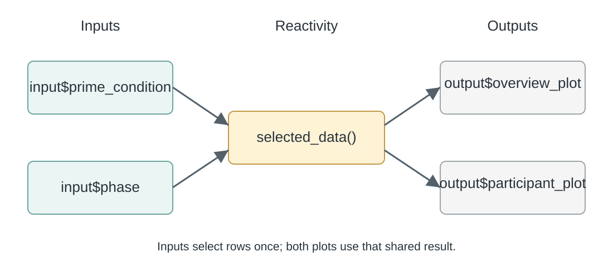

## Today: Make Your Plot Respond To The Reader

- Organise the assessment project and bring in your Week 9 working plot.
- Add controls and connect them to shared selected data.
- Add a second useful view, clear explanations and tests.
- Check what to submit and how to prepare the assessment files.

Most of the session is app building. A report and full submission ZIP do not need to be finished today.

Download and unzip the Week 10 folder; open `session-guide.html` in a browser. Have your Week 9 app and actual data files available to copy into the assessment project.

## Exercise 1: Fix Last Week's Data Paths

Last week, some data imports worked but others failed. Give the `.Rproj` file, the `.R` script and the `.Rmd` file the same starting folder.

1. Download this week's exercises, copy **`psyc40940-portfolio/`** from the unzipped download to your module folder.
2. Copy last week's app script into it and rename the copy **`app.R`**.
3. Copy your data file into **`data/`**, keeping its filename and format.
4. Double-click **`psyc40940-portfolio.Rproj`** to open the project.
5. Open the copied **`app.R`**, update its data path and test with **Run App**.

The guide includes a catch-up route if you have not started an app.

## One Folder Means One Starting Point For Paths

```text
psyc40940-portfolio/
  psyc40940-portfolio.Rproj
  app.R
  report.Rmd
  data/
    participant_rates.csv
```

```{r shared-project-path, eval=FALSE}
d_workshop <- read_csv("data/participant_rates.csv")
```

With the project open and these files at its root, use the same import path in the Console, report and app. Keep the import function for your file format; update its path to your actual filename inside `data/`.

An app inside `app/` starts one level deeper when run. Putting `app.R` beside `.Rproj` avoids switching between `data/...` and `../data/...`.

## Check The Import Before Adding Controls

Run package loading and the import data line from your copied `app.R`. Open your assessment's `.Rproj` if you are still in the module project.

Use **Run App** to check the original plot. Keep package loading and data preparation inside the app so it works in a fresh session. Then identify the first input-to-plot connection to add.

## Trace A Control Through The App



A control stores a selection. The shared reactive expression uses it to select rows. Each connected render block uses those rows for its plot.

Adding a control to the UI is only the first connection: the plot must use its value through the shared preparation.

## Connect One Input To Your Existing Plot {.smaller}

<div class="study-code-columns">
<div>

**In the UI's sidebar**

```{r continuation-ui-example, eval=FALSE}
selectInput(
  "phase", "Phase to display",
  choices = c("Before", "After"),
  selected = "Before"
)
```

</div>
<div>

**Inside the server**

```{r continuation-server-example, eval=FALSE}
selected_data <- reactive({
  filter(
    d_workshop,
    phase == input$phase
  )
})
```

</div>
</div>

Use `selected_data()` as the data argument of the existing ggplot inside its render block. Now changing the phase changes the plotted rows.

This example has one control. The supplied-data task extends it to sentence-condition checkboxes and phase selection.

## Optional AI Help: Add A Control To Your App {.smaller}

Choose the variable for the control. After loading your data, run:

```{r ai-variable-overview, eval=FALSE}
distinct(d_workshop, phase)
```

Substitute your data object and column name. Copy the command and its output, together with your current `app.R`, into your prompt.

"Add a dropdown for this variable to filter my plot. Show what code to add or replace in the UI and server, and exactly where it goes in my current code. Briefly explain the changes."

The guide has a copyable prompt. Read and test the suggested changes; declare any assistance on the NOW form. Your assessment commentary and design rationale remain your own work.

## Exercise 2: Connect And Test Your Plot (35 mins)

Follow Exercise 2 in the guide, editing the copied `app.R` in your assessment project. The supplied-data route has code to complete; use the same steps with your own variables.

1. Add useful controls in the sidebar and run the app to check they appear.
2. Add or complete the shared `reactive()` expression. Its filter must read the matching `input$...` names.
3. Make the existing plot use `selected_data()` instead of its original data argument.
4. Test the first plot before connecting the second view.

Keep one working version. A visible control does not automatically change a plot.

<!-- Teaching note: the preceding side-by-side code can remain open while students implement the first connection. Keep the connection recap to about five minutes; project organisation has its own opening activity. -->

## Explain A Selection With No Rows

Inside the shared reactive expression, retain the filtered rows and explain an empty selection:

```{r continuation-validation-example, eval=FALSE}
validate(need(
  nrow(selected) > 0,
  "No observations match. Select a condition."
))
selected
```

This is Week 8's recovery pattern. Write a message that identifies a control the reader can change. Both plots can reuse the same check.

## Check The Controls And Recovery

Change one input at a time. Does the result match your graph?

- Try one selection, then another. Check that the expected observations appear.
- For supplied data, compare conditions and switch Before to After.
- Clear the conditions, read the recovery message and restore a selection.

If a plot does not respond, check the input name, the filter and the ggplot's data argument. It must read the shared reactive result, not the original data frame.

The first teaching block protects time for one correctly connected plot. Briefly share one result or problem.

## Exercise 3: Add A Second View And Explain It (25 mins)

Use your Week 9 plan to add the complementary plot. The supplied-data guide provides an individual-learner plot to complete.

- Reuse `selected_data()` when the controls should affect both views.
- Add the purpose, tab explanations, units and useful `p()` / `helpText()` instructions.
- Test each input in both tabs, including empty selections and recovery.

Show your app to another student nearby before explaining it. Can they identify what each view adds and what the controls change? Refine one unclear element and retest it.

## Submission Walkthrough: Follow The Whole Sequence (15 mins)

Open the [summative assessment brief](https://now.ntu.ac.uk/d2l/le/lessons/1174881/topics/15225379) and [summative submission guide](https://now.ntu.ac.uk/d2l/le/lessons/1174881/topics/15286394) on NOW. Open the [official AI declaration form on NOW](https://now.ntu.ac.uk/d2l/le/lessons/1174881/topics/15126556).

1. Check the assessment project and data paths organised at the start.
2. Put the report, separate app, data and supporting files inside it.
3. Render the report, test the app and include the completed declaration.
4. ZIP only the required files; test a freshly extracted copy before submission.

The next slides explain the file set and final checks. Completing the full ZIP test is independent preparation, rather than another timed class exercise today.

## Keep The Required Files Inside Your Assessment Project {.smaller}

```text
psyc40940-portfolio/
  psyc40940-portfolio.Rproj
  report.Rmd
  report.html
  references.bib
  ai-declaration.pdf
  data/
    your-data.csv
  app.R
```

Use the project organised at the start. Keep `app.R` and the report beside `.Rproj` so they share the same starting point for data paths.

Include exactly one report Rmd and its rendered output, the separate app, actual data and any bibliography/style/helper files used. Use relative paths and load packages/data in code. The `.Rproj` file does not contain these other files.

## Include The Official NOW AI Declaration

1. Download the supplied [GenAI / AI declaration form from NOW](https://now.ntu.ac.uk/d2l/le/lessons/1174881/topics/15126556).
2. Complete it, including a statement if you did not use AI tools.
3. Save it inside the assessment folder and include it in the final ZIP.

Follow the form's instructions. Keep the report, app and filenames anonymous as required by the brief.

Code assistance must be understood and checked. Your commentary, interpretation, design rationale and reflection must be your own work.

## Test A Freshly Extracted Copy Before Submitting

Use the [summative submission guide](https://now.ntu.ac.uk/d2l/le/lessons/1174881/topics/15286394) when preparing your final ZIP:

1. Render the report and save the app.
2. ZIP the intended files, excluding unused teaching materials and saved workspaces.
3. Restart R without a restored workspace, extract to a different folder and open that project.
4. Knit the extracted report, run its separate app and test the controls and tabs.

The code must load its own packages and data. Include `sessionInfo()` or equivalent version information in the report. Use agreed access instructions where data cannot be supplied. Repair missing files and retest the ZIP.

## The Static Report Still Needs Four Useful Figure Types (5 mins)

List the four static plot types you plan for your summative dataset. For each, identify its question, interpretation and a design reason linked to the visualisation principles.

Use the starter `report.Rmd`: four figure sections, captions, one citation example and reflection. Replace `---`, use meaningful headings and apply your formative feedback. Routine code is hidden with `echo = FALSE`.

The report and app should make complementary contributions. Planning and completing the static report continues independently; it is not replaced by today's dashboard work.

## Leave With A Working Step And A Clear Next Action (5 mins)

Save the app and updated graph. Record what works, any remaining error and the next specific connection or improvement.

For the final portfolio, check the brief: four different static plot types, at least two interactive plots, meaningful input, no more than three tabs, commentary and reflection.

Use the [summative assessment brief](https://now.ntu.ac.uk/d2l/le/lessons/1174881/topics/15225379) for the deadline, word guidance, anonymity rules and requirements. Use the [summative submission guide](https://now.ntu.ac.uk/d2l/le/lessons/1174881/topics/15286394) to check the file set, AI declaration and extracted ZIP.

The following resource slides are optional references for completing your portfolio.

## Choose A Shiny Reference For Your Problem {.smaller}

In Wickham's *Mastering Shiny*:

- [Chapter 3: basic reactivity](https://mastering-shiny.org/basic-reactivity.html) and [Chapter 14: the reactive graph](https://mastering-shiny.org/reactive-graph.html): trace inputs, shared calculations and outputs.
- [Chapter 5: workflow](https://mastering-shiny.org/action-workflow.html): develop, debug and ask useful questions.
- [Chapter 6: layouts](https://mastering-shiny.org/action-layout.html#tabsets) and [Chapter 8: user feedback](https://mastering-shiny.org/action-feedback.html#validate-output): organise tabs and explain empty results.
- Andrews, [Chapter 16: Interactive Web Apps with Shiny](https://github.com/mark-andrews/ddsr/releases/download/v22.7.31/chapter_16_shiny.pdf): an alternative worked introduction.

Use these as references when needed; they are not extra portfolio features to implement.

## Revisit The Resources For Clear Figures {.smaller}

- Wickham, Navarro and Pedersen's *ggplot2* book: [colour and legends](https://ggplot2-book.org/scales-colour.html), [faceting](https://ggplot2-book.org/facet.html), and [themes](https://ggplot2-book.org/themes.html).
- Andrews, [Chapter 4: Data Visualization](https://www.mjandrews.org/book/ddsr/assets/chapter_04_visualization.pdf): revisit the plotting approach used earlier in the module.
- [ggplot2 function reference](https://ggplot2.tidyverse.org/reference/) and [Posit cheatsheets](https://posit.co/resources/cheatsheets/): look up layers, mappings and arguments.

Use Weeks 2, 4 and 5 to justify choices: what does a view make easy to compare, and what might it conceal?

## Find Help With Code And Reports {.smaller}

- [Posit Shiny Assistant](https://gallery.shinyapps.io/assistant/): choose R and ask for a small code explanation or debugging change. Check the result in your own project.
- [R Markdown Cookbook](https://bookdown.org/yihui/rmarkdown-cookbook/): report problems, including [captions and figure cross-references](https://bookdown.org/yihui/rmarkdown-cookbook/cross-ref.html).
- Andrews, [Chapter 7: reproducible analysis](https://www.mjandrews.org/book/ddsr/assets/chapter_07_reproducible.pdf), and *R for Data Science*, [Chapter 6: scripts and projects](https://r4ds.hadley.nz/workflow-scripts.html): files, projects and reproducible work.

Example request: “Explain why this filter returns no rows. Keep my UI and plotting code unchanged.” Supply the relevant code and error.

Follow the assessment's AI guidance: understand assisted code; write your own commentary and reflection; complete the NOW declaration.

