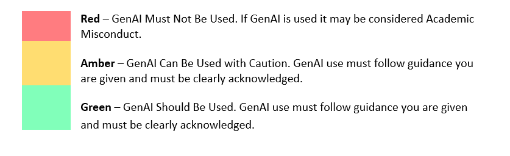

```{r setup, include=FALSE}
library(tidyverse)
library(kableExtra)
library(knitr)
library(flextable)
opts_chunk$set(echo = F, warning = F, message = F)

nice_table <- function(df){
  if (is_html_output()) {
    kable(df) %>% kable_styling()
  } else {
    flextable(df) |>
      fontsize(size = 8, part = "all") |>     # smaller font (change number as needed)
      autofit() |>                            # auto fit columns to content
      width(width = 1.05)                      # stretch to page width
  }
}

```

## Assessment Specification

- Module Title: Visualisation of Behavioural Data and Data Dashboards
- Module Code: PSYC40940
- Module Leader: **Jens Roeser**
- Module Leader email: **jens.roeser@ntu.ac.uk**
- Element name: PSYC40940 Elem 1 Cwk Portfolio
- Element no: 1
- Weighting: 100 per cent
- Word limit (excl. refs): **max 2,000 words**

**Deadline: Friday 9th January 2026**

You will receive a provisional grade and feedback on or before: **30th January 2026**

The type of feedback you will receive will be: Written

*All written work must be submitted to the appropriate dropbox before 2 pm on the deadline day. Ensure that you receive an email confirming that the work has been submitted. Keep this email for your records.*


## Coursework


- Refer to the module overview on NOW for the module's learning outcomes.
- Keep an electronic copy of all your written pieces of work for your records. Before submitting your work ensure you understand the [NTU Academic Irregularities Policies](https://www.ntu.ac.uk/studenthub/my-course/student-handbook).
- Ensure you consult the [NTU Psychology Generative AI Policy](https://www.ntu.ac.uk/studenthub/news/2023/12/artificial-intelligence-%40-ntu).
- Do not put your name or N number anywhere in the document unless specifically instructed to do so by the module leader.
- Ensure that you understand the [Notification of Exceptional Circumstances (NEC) procedure](https://www.ntu.ac.uk/studenthub/my-course/student-handbook).


## Assessment details

**Purpose:** To demonstrate mastery across all module learning outcomes.

**Format:** For this assessment students will submit a portfolio combing the following three elements:

- RMarkdown report
- Shiny dashboard 
- Reflective commentary 

**Task:** Students choose one complex behavioural dataset -- i.e., data related to human behaviour (e.g., psychological experiments, survey responses, reaction times, decision-making patterns, social media behaviour, etc.) and produce:

1. **Static Visualisations**:
   - 4 different visualisation types (e.g., violin plot, contour plot, heat maps). 
   - Publication-quality formatting. 
   - Commentary on design choices. 
2. **Interactive Dashboard** (using Shiny; max 3 tabs):
   - Allow user input (e.g., variable selection, filters). 
   - Include at least 2 interactive plots. 
   - Dashboard should support exploration and insight generation into human behaviour. 
3. **Reflection Section**:
   - Discuss challenges, design decisions, and practical constraints. 
   - Link work to principles of effective visualisation, data communication, and transparency. 

Points 1 and 3 should be included in the same RMarkdown document. Point 2 can be a free standing Shiny application or can be included in the RMarkdown document.


## Submission format

You must submit your work as a *single* zip archive that contains exactly one RMarkdown file, the html or pdf document generated from this file, the RStudio project file, the relevant data file, and any supplementary files (e.g. for bibliography references, custom R functions etc). Note that it is a requirement of the assignment that your work be reproducible. In other words, we must be able to reproduce your report in full from the RMarkdown source code, the R script with the Shiny app, and other files you provide. All data and R code (with the possible exception of the Shiny app) must be referenced by the RMarkdown document.

**Remember that for high or exceptional grades it is vital that you display learning that goes beyond the content explicitly taught in class.**

## Where do I find datasets?

You must choose your own data set. 

One resource that we think students should explore immediately is the following journal:

[)](https://openpsychologydata.metajnl.com/])

[https://openpsychologydata.metajnl.com/]

This journal has over 10 years of articles, each of which provides an open data set in behavioural sciences and provides a detailed description of how this data was collected, and for which scientific research questions or areas it is relevant. Many of the data sets in this journal would be suitable for use in this module. We advise students to immediately explore the data sets there to get a sense of the data sets that they can use for their portfolio.

Another resource, and a very large one, is the OSF: 

[)](https://osf.io/])

[https://osf.io/]


The OSF is the principal repository for sharing behavioural data. We recommend that you use the search bar and search by some topic or keyword. Then look at *Files* in particular, and you will see hundreds or thousands of files, a large fraction of which a data files (with extensions like csv, xlsx, sav, Rda, etc). 

Another useful repository of openly available data is [Rdatasets](http://vincentarelbundock.github.io/Rdatasets/datasets.html).

However, you may use any other data set too. The only restriction is that you have to share that data with us. In other words, it can not be confidential data that you are not able to share.

But there is still much more. Google search for psychology datasets. Ask your friendly GenAI for suggestions. I just asked ChatGPT *"Can you recommend some repositories that provide large open access psychology data sets?"* and it gave many suggestions of repositories.


## Assessment criteria

*The criteria we will use to mark / grade your work, made clear to you in advance:*

The standard NTU grading scheme will be used as the grading framework. The specific criteria for this assignment are as follows: 

1. **Technical Execution:** Quality of code and reproducibility using RMarkdown and Shiny.
2. **Visualisation Design:** Effectiveness, clarity, aesthetics, and adherence to principles of good data visualisation. 
3. **Use of Behavioural Data:** Relevance, complexity, and appropriateness of the chosen behavioural dataset.
4. **Interactivity & Dashboard Design:** Functionality, user experience, and ability to support data exploration.
5. **Reflection & Commentary:** Critical thinking, creativity, and awareness of practical constraints.
6. **Communication & Structure:** Clarity, coherence, and professionalism in writing and presentation.

For high or exceptional grades it is vital that you display learning that goes beyond the content explicitly taught in class.

See the end of this document for the detailed grading matrix.

*How we make sure that marking/grading is fair:*

To ensure fairness, all assessed work is marked with reference to marking criteria and with reference to the NTU grading scheme. Furthermore, all marking of assessed work is moderated by another internal marker in line with university policy. All assessment processes are overseen by external examiners. Moderation procedures will not have been completed by the time the work is returned to you. For that reason ALL grades must be regarded as provisional until ratified by the Board of Examiners.

## Feedback

*This is how you will receive comments on your work:*

You will receive comments on your work through structured feedback aligned with the assessment criteria for both formative and summative tasks.

For the formative assessment (Mini Portfolio Project; see NOW learning room for details), feedback will be provided during the module through written comments and/or peer review. These comments will focus on your use of behavioural data, visualisation techniques, and reproducibility practices, helping you prepare for the final portfolio.

For the summative assessment (Final Portfolio), you will receive detailed feedback mapped to the marking rubric and module learning outcomes. This will include comments on technical execution, design quality, interactivity, reflection, and communication.

Feedback will be delivered via the NOW learning room and will highlight both strengths and areas for improvement to support your academic and professional development.

*This is how the feedback will identify areas that you can improve on in the future:*

Feedback on your portfolio will be structured around six key assessment criteria: technical execution, visualisation design, use of behavioural data, interactivity and dashboard design, reflection and commentary, and communication and structure. For these criteria, you will receive specific comments highlighting strengths and areas for development, mapped directly to the module learning outcomes (MLOs). This will help you understand not only what you did well, but also where you can enhance your skills -- for example, by improving reproducibility in your code, refining the clarity of your visualisations, or deepening your critical reflection. The feedback is designed to support your growth as a data visualisation practitioner and guide your future work in both academic and applied contexts.


## Module-Specific Guidance

As outlined below GenAI use is rated <span style="color:#FFBF00">AMBER</span>. This means GenAI can be used with caution (see below).

In the "Visualisation of Behavioural Data and Data Dashboards" module, generative AI tools such as ChatGPT, GitHub Copilot, or other coding assistants may be used to support learning. Specifically, students are permitted to use generative AI to help produce code, troubleshoot coding errors, and explore alternative programming approaches. These tools can be valuable for enhancing understanding and efficiency when working with RMarkdown, Shiny, and other data visualisation technologies.


## School of Social Sciences -- Generative Artificial Intelligence (GenAI) Traffic Light

At NTU, Generative Artificial Intelligence (GenAI) should be used to support and enhance your learning, not to replace independent thinking, critical analysis, or academic integrity. The following guidance explains acceptable and unacceptable uses of GenAI in assessments. To help you understand when and how GenAI tools can be used, we have categorised GenAI use into three levels: 

)

This module adheres to the default position of NTU Psychology on the use of generative AI. Please read through the policy in detail here: [NTU Psychology Generative AI Student Policy](https://www.ntu.ac.uk/studenthub/news/2023/12/artificial-intelligence-%40-ntu)


## Additional specific guidance for the use of GenAI AI in this assessment is

This module follows the principles outlined in the document [General guidance on inappropriate use of Generative Artificial Intelligence (GenAI) in summative assessments](https://now.ntu.ac.uk/d2l/le/lessons/694190/topics/14179315).

 
A summary of the requirements are (please refer to the full policy and guidance for details):

- You are **allowed to ask** an AI tool to support you to deepen your understanding of a topic, to check that you have understood a concept correctly, or to check that your own writing makes sense.
- You **must not** use an AI tool to create any of the text that you actually submit for the assignment; the work you submit must be clearly your own. You also must not use an AI tool as a reference. 


## Disclosure and attribution requirements

Please ensure you complete the declaration form provided in the "Assessments" section of the learning room. On this declaration form, please additionally explain how you used GenAI to help prepare your work in the "Explanation of AI use" box. Please upload the declaration form along with your coursework to the Dropbox.

\newpage

## Grading Matrix


```{r}
nice_table(read_csv("gm.csv"))
```
