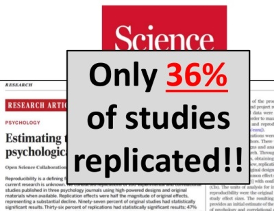
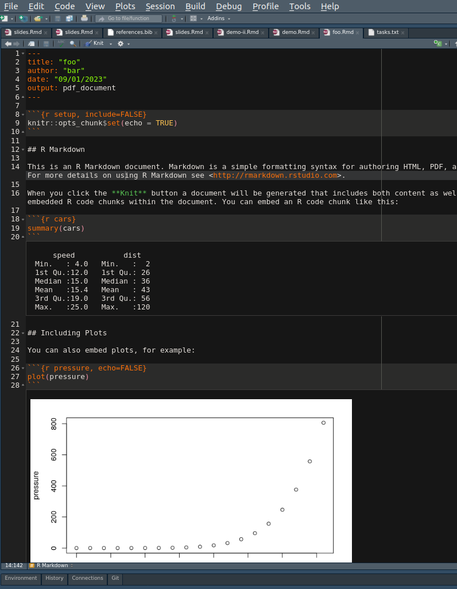

```{r setup, include=FALSE}
knitr::opts_chunk$set(echo = TRUE, warning = FALSE, eval = TRUE, message = FALSE, comment=NA)
options("kableExtra.html.bsTable" = T, digits = 2)
options(pillar.print_min = 5, pillar.print_max = 6)
library(tidyverse)
library(knitr)
library(kableExtra)
```

## Aims 

- Sorting out your RStudio working environment.
- Getting you ready to produce reproducible reports in RMarkdown.

# Why is reproducibility important?

## How can you trust someone's results?

-   Results are communicated through reports such as peer reviewed scientific articles.
-   Reported results should be reproducible!
-   Data and code should be made available to others!
-   It is difficult to relate code to figures, tables, numbers etc. especially where numbers were copy-pasted from software.

<!-- ## Rules for reproducible data analysis! -->

<!-- - Never change your data manually; document everything in code. -->

<!--   - Documentation / reproducibility -->

<!--   - Retrospective amendments made easy -->

<!-- - Organized working environment -->

<!--   - `.Rproj` with one directory per project with sub-directories for scripts, data, plots, etc. -->

<!--   - Short scripts: minimal code with one clear purpose. -->

<!-- - Comment your code (`# Ceci n'est pas un comment!`) -->

<!-- - Share code and data with your readers: [github.com](https://github.com/jensroes) or [osf.io](https://osf.io/sp87n/) -->

<!-- - Use RMarkdown for full reproducibility of your results. -->

## Why do we need reproducible analyses?

::: {style="float: left; width: 55%;"}
-   Open Science Collaboration led by Brian Nosek [@open2015estimating].
-   Aimed to replicate important findings in psychological research.
-   Main finding: 36% where replicated; only 23% for Social Psychology
-   Reasons: small samples, pressure to publish sensational results.
-   Solutions: pre-registration, replications, large samples, abandoning significance testing, transparency.
:::

::: {style="float: right; width: 40%;"}
```{r fig.align='right', out.width="100%", echo = F, eval = T}

```
:::

## A truely reproducible report

::: {style="float: left; width: 55%;"}
-   Data, code, report need be one unit.
-   Based on the concept of *literate programming* [@knuth1984literate]: text and code are linked in one single file to generate manual or computer program.
-   This principle can be used to creating reproducible reports, sometimes known as *dynamic documents* [@xie2017dynamic].
-   RMarkdown is the best way of doing this using R.
:::

::: {style="float: right; width: 40%;"}
```{r fig.align='right', out.width="90%", echo = F, eval = T}

```
:::

## Why RMarkdown?

::: {style="float: left; width: 30%;"}
```{r fig.align='right', out.width="100%", echo = F, eval = T}

```
:::

::: {style="float: right; width: 60%;"}
-   Documentation of all analysis steps
-   Quickly updating and reproducing analysis
-   No copy-pasting between programmes
-   Producing texts, website, supplementary materials, APA-style manuscripts, slides
-   Easy cross-referencing
-   Automatic reference lists
-   Easy type-setting of equations
:::

##  What is RMarkdown? {.smaller}

::: {style="float: left; width: 40%;"}
```{r fig.align='right', out.width="90%", echo = F, eval = T}

```
:::

::: {style="float: right; width: 50%;"}

-   Text file format, a script like an R script.
-   Open, edit, run in RStudio like scripts.
-   RMarkdown are a mixture of *markdown* code and normal R code (and your data).
-   R code in RMarkdown documents occurs in R *chunks*, i.e. blocks of code, or *inline* R code inside of markdown code
-   Markdown: minimal syntax that instructs how text should be formatted.
-   Rendering into `.pdf`, `.html`, `.docx`, `.doc`
:::

<!-- ## Key concepts and tools -->

<!-- <div style="float: left; width: 40%;"> -->

<!-- ```{r fig.align='left', out.width="90%", echo = F, eval = T} -->

<!--  -->

<!-- ``` -->

<!-- </div> -->

<!-- <div style="float: right; width: 60%;"> -->

<!-- >- Document preparation system for creating high quality technical and scientific documents. -->

<!-- >- Widely used in statistics, computer science, physics -->

<!-- >- $\LaTeX$ documents are written in a `.tex` source code file and rendered to pdf -->

<!-- </div> -->

<!-- ## Download repository -->

<!-- - Go to [github.com/jensroes/psyc40940](https://github.com/jensroes/psyc40940) -->

<!-- - Click on: `Code` \> `Download ZIP`  -->

<!-- - Unzip directory on your machine -->

<!-- - Open project by double clicking on `psyc40940.Rproj` -->

<!--   - `slides.Rmd`: slides in RMarkdown format -->

<!--   - `exercises`: R scripts that we will work with -->

<!--   - `data/`: my scripts will read in data from here -->

## Installation

::: {style="float: left; width: 35%;"}
-   [Installation](https://posit.co/download/rstudio-desktop/)
-   RStudio comes with necessary R package `rmarkdown`
-   RStudio environment: Console, Help, Files, Packages, Environment, History
:::

::: {style="float: right; width: 53%;"}
-   Install these two packages:

```{r eval = F}
install.packages('tidyverse')
install.packages('psyntur')
```
:::

## Setup an R-project

-   What it is: A special folder for your work in R.
-   What it does: Keeps your scripts, data, and results together.
-   Why it helps:
    -   Sets the folder as your working directory automatically.
    -   No `setwd()` headaches.
    -   Easy to share or move your whole project.
-   Works well with Git/GitHub for teamwork and version control.
-   Everything for one analysis stays neatly in one place.
-   Create R Project for psyc40940 with sub-directories: "data", "exercises", "plots"
-   Download `blomkvist.csv` from NOW and move it into the "data" folder. 

## RMarkdown example

From the RStudio menu ...

-   Click on `File` \> `New File` \> `R Markdown`
-   Document (PDF, WORD, HTML)
-   `output: html_document`: we will use html for simplicity\
-   Name your RMarkdown: `basics.Rmd`
-   Save in same directory as `.Rproj` file.
-   Compile (`Knit`) document
-   Inspect features of RMarkdown document: YAML preamble, text, markdown code (section headers, italics, bold font), chunks with R code, inline code.

## R / RMarkdown / `tidyverse` basics {.columns-2}

-   Executing code in chunks
-   Comments, commands
-   Using R as a calculator
-   Vectors and combining vectors (`c()`)
-   Base-R functions: `mean`, `sum`, `min`, `max`, `sd`
-   Variables and assignment (`<-`)
-   Loading libraries (`tidyverse`, `psyntur`)
-   Data frames:
    -   Reading in data using `read_csv` (next slide)
    -   Creating a data frame via `tibble`
    -   Datasets in packages: `?psyntur::faithfulfaces` (many more in `datasets`)
-   `tidyverse` functions: `select`, `filter`, `slice` (indexing, e.g. `[1]`), `pull`, `summarise`


## Load data

-   Create a new *R chunk*: `CTRL+ALT+I` or `OPTION+ALT+I` (i.e. the letter "i") called `packages` and load libraries needed:

```{r eval = F}
library(tidyverse)
library(psyntur)
```


-   Create a new chunk called `loaddata` and load the `blomkvist.csv` data published in @blomkvist2017reference

```{r eval = F}
# Load data
bk_alldata <- read_csv("data/blomkvist.csv") 

# Select a few variables
bk_selected <- select(blomkvist_alldata, id, smoker, age, rt = rt_hand_d)

# Remove missing data
blomkvist <- drop_na(bk_selected)
```

```{r echo = F}
blomkvist <- read_csv("../../data/blomkvist.csv") %>% 
  select(id, age, smoker, sex, rt = rt_hand_d) %>% 
  drop_na()
```

## The setup chunk: global options

-   Note \`\`\``{r setup, echo=FALSE}`
-   `setup` is a label of this chunk (optional; useful for cross-referencing of figures and tables).
-   Chunk configuration option `echo = FALSE`: don't display chunk in output; `echo = TRUE`: display chunk.

```{r eval = F}
knitr::opts_chunk$set(message = FALSE, # don't return messages
                      warning = FALSE, # don't return warnings
                      comment = NA, # don't comment output
                      echo = TRUE, # display chunk (is default)
                      eval = TRUE, # evaluate chunk (is default)
                      out.width = '45%',  # figure width
                      fig.align='center') # figure alignment
```


## Figures

- Create a new *R chunk* with label `myscatterplot`
- Set `echo = F` cause we only need the figure.
- Add a figure caption `fig.cap = "A scatterplot."` in the chunk configurations.

```{r eval = F}
library(psyntur)
scatterplot(x = age, y = rt, data = blomkvist)
```


## Figures

-   Change the default size to `out.width = 75%`.
-   Cross-reference figure using `\@ref(fig:myscatterplot)` in the text.

```         
"A scatterplot of age and reaction time can be found in Figure \@ref(fig:myscatterplot)."
```

In the YAML preamble change

```
output: html_document
```

to 

```
output: bookdown::html_document2
```


## Formatted tables

-   Reporting results in tables formatted to a high standard.
-   Calculate descriptive statistics:

```{r}
(smoker_rt <- summarise(blomkvist, mean = mean(rt), sd = sd(rt), .by = smoker))
```

```{r eval = F}
library(knitr)
kable(smoker_age,
      booktabs = TRUE,
      digits = 2,
      align = 'c', # centre value in each column
      caption = 'Descriptives of age by smoker.') 
```

-   Label the chunk "`smoker`" and cross-reference the table in the text using `Table \@ref(tab:smoker)`.

## Bibliography and citations {.columns-2 .smaller}

-   Create a file (in RStudio) and call it `references.bib` (save in same working directory as your `.Rmd` file)
-   Get the `.bib` entry for @blomkvist2017reference from Google Scholar and paste it into `references.bib`:
    -   Copy the title "Reference Data on Reaction Time and Aging Using the Nintendo Wii Balance Board" into Google Scholar
    -   Click `cite` and `BibTeX`
    -   Copy object into `references.bib`
-   Note the citation *key* `blomkvist2017reference`
-   Cite @blomkvist2017reference using `@blomkvist2017reference` or `[@blomkvist2017reference]`.
-   Create a section "`# References`"
-   Add to the YAML preamble:

```{r eval = F}
bibliography: references.bib
biblio-style: apalike
```


<!-- ## $\LaTeX$ mathematical typesetting  -->

<!-- `If $\Phi = \phi_1, \phi_2 \ldots \phi_k \ldots \phi_k$, where each $0 \leq \phi_k \leq 1$, -->

<!-- and $\sum_{k=1}^K \phi_k = 1$, then $\Phi$ is a probability mass function.` -->

<!-- Renders -->

<!-- If $\Phi = \phi_1, \phi_2 \ldots \phi_k \ldots \phi_k$, where each $0 \leq \phi_k \leq 1$, -->

<!-- and $\sum_{k=1}^K \phi_k = 1$, then $\Phi$ is a probability mass function. -->

<!-- ## *Display* mode using `'$$'` as delimiters -->

<!-- <div style="float: left; width: 50%;"> -->

<!-- ``` -->

<!-- The probability of the observed data is as follows: -->

<!-- $$ -->

<!-- \mathrm{P}(x_i \ldots x_n \vert \mu, \sigma^2) -->

<!-- = \prod_{i=1}^n \mathrm{P}(x_i \vert \mu, \sigma^2), -->

<!-- $$ -->

<!-- where $\mu$ and $\sigma$ are parameters. -->

<!-- ``` -->

<!-- </div> -->

<!-- <div style="float: right; width: 45%;"> -->

<!-- Renders the following -->

<!-- The probability of the observed data is as follows: -->

<!-- $$ -->

<!-- \mathrm{P}(x_i \ldots x_n \vert \mu, \sigma^2) -->

<!-- = \prod_{i=1}^n \mathrm{P}(x_i \vert \mu, \sigma^2), -->

<!-- $$ -->

<!-- where $\mu$ and $\sigma$ are parameters. -->

<!-- Top tip: you can literally copy $\LaTeX$ code for formulas from straight Wikipedia: e.g. look for the formula for the Gaussian probability density function. -->

<!-- </div> -->

<!-- ## Display maths -->

<!-- >- Using $\LaTeX$'s `aligned` environment to align multiple mathematical statements. -->

<!-- >- We will get back to what this means. -->

<!-- ``` -->

<!-- $$ -->

<!-- \begin{aligned} -->

<!--   y_i &\sim N(\mu_i, \sigma^2),\\ -->

<!--   \mu_i &= \beta_0 + \beta_1 \cdot x_i + beta_2 \cdot z_i -->

<!-- \end -->

<!-- $$ -->

<!-- ``` -->

<!-- >- The `'&'` is used to align the lines so that '$\sim$' (`\sim`) and '$=$' are aligned. -->

<!-- >- `'$\\$'` forces a line break. -->

## Formatted inline R output

```{r}
# Fit the model and get the summary
model <- lm(rt ~ sex, data = blomkvist)
model_summary <- summary(model)
```

```{r}
# Extract R^2
r2 <- model_summary$r.sq
```

```{r eval = F}
The $R^2$ for this model is `r round(r2, 2)`.
```

> Renders "The $R^2$ for this model is `r round(r2, 2)`."

## Formatted inline R output

```{r}
# Extract F statistic
f_stat <- model_summary$fstatistic
p_value <- pf(f_stat[1], f_stat[2], f_stat[3], lower.tail = FALSE)
```

```{r eval = FALSE}
The model summary can be summarised like so: $F(`r round(f_stat[2])`, `r round(f_stat[3])`) =
`r round(f_stat[1],2)`$, $p `r format.pval(p_value, eps = 0.01)`$.
```

> Renders "The model summary can be summarised like so: $F(`r round(f_stat[2])`, `r round(f_stat[3])`) = `r round(f_stat[1],2)`$, $p `r format.pval(p_value, eps = 0.01)`$."

```{r}
p <- c(0.05, 0.02, 0.011, 0.005, 0.001)
format.pval(p, eps = 0.01)
```

## Mathematical typesetting

-   Strings are parsed using $\LaTeX$ and typeset accordingly when used between `'$'` symbols for inline mode.
-   For example `$\beta$` renders $\beta$.
-   Subscripts: `$\beta_0$` is $\beta_0$ and using `'{}'` for more than one symbol as in `$\beta_{01}$` which is $\beta_{01}$
-   How would you write $\beta_{0_1}$?
-   Superscripts: `'^'` as in `$\sigma^2$` which is $\sigma^2$.
-   How would you write $\sigma^{2^2}$?
-   How about $\sigma_e^2$?

## Some arithmetic operations and fractions 

::: {style="float: left; width: 60%;"}
-   `$x + y$`, `$x - y$`
-   Multiplication use either `$\cdot$` or `$\times$` to get $\cdot$ or $\times$, respectively, as in $3 \cdot 2$
-   Division: `$/$` or `$\div$` to get $/$ or $\div$, respectively, or `$\frac{1}{2}$` for $\frac{1}{2}$
-   `$\pm$` renders to $\pm$
:::

## For other formats ...

```{r eval = FALSE}
install.packages("rmdformats")
```


```{r eval = FALSE, echo = F}
install.packages("remotes")
remotes::install_github("juba/rmdformats")
```

-   Create from template:
    -   `File` \> `New File` \> `R Markdown` (e.g. `readthedown` or `robobook` for documents)
    -   `rmdshower::shower_presentations` and `ioslides_presentation` for slides
-   [RMarkdown example](https://rpubs.com/jensroes/765467)
-   Online sharing on RPubs ("Publish")

## APA7 manuscripts using `papaja`

-   Example: <https://osf.io/vayhq/> published in @roeser2021modelling
-   Installation: <https://github.com/crsh/papaja>

## Homework

Next week we will start with data visualisation, so make sure you understand RMarkdown and R code.

- See materials on R programming and RMarkdown in Week 1 NOW folder.
- For an introduction to R programming read [Chapter 2 of @andrews2021doing](https://github.com/mark-andrews/ddsr/releases/download/v22.7.31/chapter_02_introduction.pdf).
- For a more information about RMarkdown (also how to create APA7 style documents) read [Chapter 7 of @andrews2021doing](https://github.com/mark-andrews/ddsr/releases/download/v22.7.31/chapter_07_reproducible.pdf) 
- And [chapter 27 of @wickham2016r](https://r4ds.had.co.nz/r-markdown.html).
- Check the [`rmarkdown` website](https://rmarkdown.rstudio.com/lesson-1.html).
 


## References {.smaller}

```{=html}
<style>
slides > slide { overflow: scroll; }
slides > slide:not(.nobackground):after {
  content: '';
}
</style>
```
